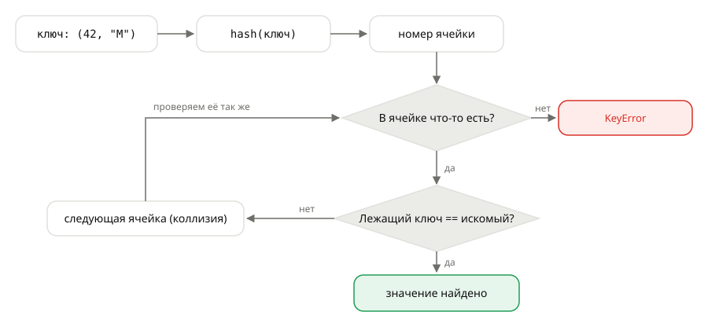
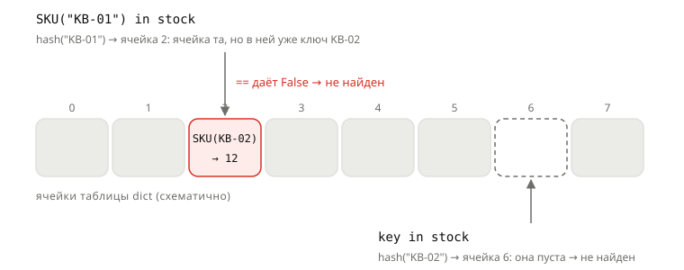

## Теория
`dict` и `set` находят элемент почти мгновенно, сколько бы элементов ни хранили. Они не перебирают элементы, а вычисляют по ключу число — **хеш** (`hash(key)`) — и по нему сразу переходят к нужной ячейке внутренней таблицы. У разных ключей хеш может совпасть (**коллизия**), поэтому найденный ключ дополнительно сверяется с искомым через `==`.

Отсюда требование к ключам и элементам множеств: объект должен быть **hashable** — хеш у него не меняется, пока объект живёт, а равные объекты имеют равные хеши. Чаще всего hashable-объекты неизменяемы, поэтому на практике говорят «ключом может быть только неизменяемое». Но это упрощение, и на собеседованиях любят исключения: неизменяемый кортеж может быть не hashable, а изменяемый объект своего класса — hashable. Чтобы не теряться, нужно понимать сам контракт, а не правило-запоминалку.

## Наглядно
**Рисунок 1.** Как `dict` ищет ключ: сначала хеш выбирает ячейку, потом `==` проверяет, тот ли там ключ. Если в ячейке чужой ключ (коллизия), проверка повторяется для следующей ячейки.



**Таблица 1.** Контракт hashable: два правила, которые должен соблюдать любой ключ, и что сломается при их нарушении.

| Правило | Что будет, если нарушить |
|---|---|
| хеш не меняется, пока объект живёт | ключ ищется не в той ячейке — запись «теряется» |
| `a == b` ⇒ `hash(a) == hash(b)` | равные ключи попадают в разные ячейки — дубли в `set`, промахи в `dict` |
| `hash(a) == hash(b)` ⇏ `a == b` | это не правило, а допустимая коллизия |

**Таблица 2.** Какие объекты hashable. Сравните столбцы «Неизменяемый» и «Hashable» — они совпадают не всегда.

| Тип | Неизменяемый | Hashable | Комментарий |
|---|---|---|---|
| `int`, `float`, `bool`, `None` | да | да | `1`, `1.0` и `True` — один ключ |
| `str`, `bytes` | да | да | хеш меняется между запусками программы |
| `tuple` | да | **только если всё внутри hashable** | `(42, ["M"])` — нет |
| `frozenset` | да | да | неизменяемое множество, может быть ключом |
| `list`, `dict`, `set`, `bytearray` | нет | нет | `__hash__ = None` |
| свой класс без `__eq__` | нет | да | `==` и `hash()` — по идентичности |
| свой класс с `__eq__`, но без `__hash__` | нет | **нет** | Python сам обнулил `__hash__` |
| `@dataclass(frozen=True)` | да | да | хеш по полям |

## На практике
Задача: сервис цен кэширует цену товара по ключу «товар + размер», чтобы не ходить в БД на каждый запрос. Пробуем разные варианты ключа и находим правильный.

### Шаг 1. Пробуем кортеж
Кладём цену по ключу-кортежу и ищем её новым, но таким же кортежем:
```python
cache = {}
cache[(42, "M")] = 1499
print((42, "M") in cache)
```
Результат:
```
True
```
Новый кортеж `(42, "M")` — другой объект, но он равен ключу в словаре и имеет тот же хеш (хеш кортежа вычисляется из хешей элементов). Поэтому поиск его находит.

### Шаг 2. Пробуем список
Тот же ключ, но списком:
```python
cache[[42, "M"]] = 1499
```
Результат:
```
TypeError: unhashable type: 'list'
```
У `list` нет `__hash__`. Это защита: если бы хеш списка считался по содержимому, после `append` он бы изменился, и словарь искал бы ключ не в той ячейке. Что при этом происходит — видно на своём классе, где эту защиту обошли.

### Шаг 3. Смотрим, как теряется ключ
Артикул товара — свой класс, хеш и сравнение сделаны по полю `code`, которое можно менять. Кладём остаток по артикулу, а потом меняем артикул:
```python
class SKU:
    def __init__(self, code):
        self.code = code

    def __eq__(self, other):
        return isinstance(other, SKU) and self.code == other.code

    def __hash__(self):
        return hash(self.code)       # хеш зависит от изменяемого поля


key = SKU("KB-01")
stock = {key: 12}
key.code = "KB-02"                   # меняем ключ, который уже лежит в словаре

print(key in stock)
print(SKU("KB-01") in stock)
print(len(stock))
```
Результат:
```
False
False
1
```
**Рисунок 2.** Почему оба поиска промахиваются: запись лежит в ячейке, выбранной по старому хешу, а ключ в ней уже изменён. Ячейки и номера — схематичные.



`key` ищется по хешу `"KB-02"` — в другой, пустой ячейке. `SKU("KB-01")` приходит в правильную ячейку, но проверка `==` с лежащим там ключом не проходит: у него уже `"KB-02"`. Запись есть, достать её нельзя — и никакой ошибки.

### Шаг 4. Пробуем кортеж со списком
Делаем ключ «товар + набор размеров» и проверяем, можно ли его хешировать:
```python
try:
    hash((42, ["M", "L"]))
except TypeError as e:
    print("TypeError:", e)
```
Результат:
```
TypeError: unhashable type: 'list'
```
Кортеж неизменяем — заменить его элемент нельзя. Но список внутри него менять можно, и тогда хеш кортежа не был бы постоянным. Поэтому хеш кортежа существует, только если hashable все его элементы. Если нужен набор значений внутри ключа, берут `frozenset` или вложенный кортеж: `(42, ("M", "L"))`.

### Шаг 5. Проверяем обычный класс
Создаём два заказа с одинаковым `id`, сравниваем их и кладём в множество, а потом меняем поле:
```python
class Order:
    def __init__(self, id):
        self.id = id

o1, o2 = Order(1), Order(1)
print(o1 == o2, len({o1, o2}))
o1.id = 99
print(o1 in {o1})
```
Результат:
```
False 2
True
```
По умолчанию и `==`, и `hash()` работают **по идентичности**: объект равен только самому себе. Атрибуты в этом не участвуют, поэтому их изменение контракт не нарушает. Hashable ≠ неизменяемый.

### Шаг 6. Добавляем `__eq__`
Хотим, чтобы товары с одинаковым `id` считались равными, — определяем `__eq__` и пробуем положить товар в множество:
```python
class Product:
    def __init__(self, id):
        self.id = id

    def __eq__(self, other):
        return isinstance(other, Product) and self.id == other.id


print(Product.__hash__)
{Product(1)}
```
Результат:
```
None
TypeError: unhashable type: 'Product'
```
Python сам выставил `__hash__ = None`: старый хеш по идентичности противоречил бы новому `__eq__` — два равных товара получили бы разные хеши. Если нужны и сравнение, и хеш, хеш определяют **по тем же полям**, что и `__eq__`, и эти поля не меняют.

### Шаг 7. Делаем правильный ключ
Описываем ключ через `frozen` dataclass, используем его в кэше и в множестве, а потом пробуем изменить поле:
```python
from dataclasses import dataclass

@dataclass(frozen=True)
class PriceKey:
    product_id: int
    size: str

cache = {PriceKey(42, "M"): 1499}
print(cache[PriceKey(42, "M")])
print(len({PriceKey(42, "M"), PriceKey(42, "M"), PriceKey(42, "L")}))

key = PriceKey(42, "M")
key.size = "L"
```
Результат:
```
1499
2
dataclasses.FrozenInstanceError: cannot assign to field 'size'
```
`frozen=True` даёт сразу всё: `__eq__` и `__hash__` по полям и запрет на изменение полей — контракт соблюдается автоматически. Обычный `@dataclass` (без `frozen`) — не hashable, по той же причине, что в шаге 6.

### Шаг 8. Проверяем числовые ключи
Модуль статистики собрал выручку по ключам из разных источников — выводим словарь и хеши ключей:
```python
revenue = {1: 100, 1.0: 200, True: 300}
print(revenue)
print(hash(1), hash(1.0), hash(True))
```
Результат:
```
{1: 300}
1 1 1
```
`1 == 1.0 == True`, а значит, по контракту и хеши у них равны. Для словаря это **один ключ**: сам ключ остаётся от первой вставки (`1`), значение — от последней.

### Шаг 9. Проверяем, можно ли хранить хеш
Запускаем Python дважды и выводим хеш одной и той же строки:
```bash
python -c 'print(hash("KB-01"))'
python -c 'print(hash("KB-01"))'
```
Результат: два разных числа. При старте интерпретатора хеши `str` и `bytes` получают случайную «соль» — защита от атак, которые подбирают много ключей с одинаковым хешем и замедляют словари сервера. Вывод для backend: `hash()` годится только внутри одного процесса. Ключ кэша в Redis, имя файла или значение в БД считают через `hashlib`, например `hashlib.sha256(b"KB-01").hexdigest()`.

## Частые ошибки
- **«Неизменяемый — значит hashable».** `(42, ["M"])` неизменяем, но не hashable. Проверяют не «можно ли изменить», а «есть ли постоянный хеш, согласованный с `==`».
- **Хеш от изменяемых полей.** Записи «теряются» в словарях и множествах, и ошибки нет. Поля, от которых зависит хеш, делайте неизменяемыми (`frozen=True`, свойство без сеттера).
- **`__eq__` без `__hash__`.** Класс внезапно перестаёт работать в `set` и как ключ. Решение — `__hash__` по тем же полям или `@dataclass(frozen=True)`.
- **Обычный `@dataclass` как ключ.** `eq=True` по умолчанию обнуляет хеш. Нужен `frozen=True` (или осознанный `unsafe_hash=True`).
- **Смешанные числовые ключи.** `{1: …, True: …}` — один ключ. Бьёт по словарям, где вперемешку лежат флаги и `id`.
- **`hash()` как постоянный идентификатор.** Между запусками он разный — для внешнего хранения `hashlib`.

## Итог
**Как ищут `dict` и `set`**
- Сначала `hash(key)` → ячейка таблицы, затем `==` с найденным ключом (из-за коллизий).
- Поэтому ключу нужны оба метода: `__hash__` и `__eq__`.

**Контракт hashable**
- Хеш не меняется за время жизни объекта.
- `a == b` ⇒ `hash(a) == hash(b)`; обратное не требуется (коллизии допустимы).
- Нарушение не даёт ошибки — записи молча «теряются» или дублируются.

**Hashable и неизменяемость — не одно и то же**
- Встроенные изменяемые (`list`, `dict`, `set`) — не hashable: `__hash__ = None`.
- `tuple` hashable, только если hashable всё внутри: `hash((1, [2]))` → `TypeError`.
- Объект своего класса изменяем, но hashable: `==` и `hash()` по идентичности.
- Правило: хеш зависит только от тех данных, по которым считается `==`, и эти данные не меняются.

**Свои классы**
- Определили `__eq__` — Python выставил `__hash__ = None`.
- Правильный ключ-объект — `@dataclass(frozen=True)`: `__eq__` и `__hash__` по полям, поля не меняются.

**Ловушки**
- `1`, `1.0`, `True` — один ключ: `len({1, 1.0, True}) == 1`.
- `hash()` строк меняется между запусками — для БД, кэша и файлов используют `hashlib`.

## Вопросы на собеседовании
<details><summary>Почему список не может быть ключом словаря?</summary>

Хеш списка менялся бы при каждом изменении, и словарь искал бы элемент не в той ячейке — запись «терялась» бы. Поэтому у `list` нет `__hash__`, и Python сразу выбрасывает `TypeError: unhashable type: 'list'`.
</details>

<details><summary>Любой ли кортеж можно сделать ключом?</summary>

Нет. Хеш кортежа вычисляется из хешей элементов; если внутри есть нехешируемый объект (список, словарь), `hash()` кортежа выбросит `TypeError`.
</details>

<details><summary>Что будет, если в классе определить `__eq__`, но не `__hash__`?</summary>

Python установит `__hash__ = None`, объекты станут нехешируемыми — их нельзя положить в `set` или использовать как ключ `dict`.
</details>

<details><summary>Что выведет `len({1, 1.0, True})`?</summary>

`1`. Значения равны и имеют одинаковый хеш — для множества это один элемент.
</details>

<details><summary>Обязан ли хеш быть уникальным?</summary>

Нет. Разные объекты могут иметь одинаковый хеш (коллизия), словарь различает их через `==`. Обязательно обратное: равные объекты имеют равные хеши.
</details>

<details><summary>Можно ли использовать `hash()` для ключей кэша в Redis?</summary>

Нет. Хеш строк рандомизирован при каждом запуске интерпретатора, поэтому у разных процессов и после перезапуска он разный. Нужен детерминированный хеш из `hashlib`, например `sha256`.
</details>

## Связанные темы
- База: «Словари», «Множества», «Изменяемые и неизменяемые типы» (курс Python, раздел «Коллекции»).
- Дальше: «Как устроен `dict`» — таблица, открытая адресация, почему сохраняется порядок.
