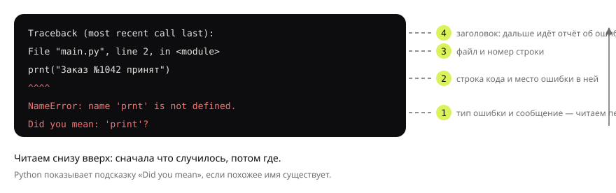

## Теория
Программа на Python — это текстовый файл с расширением `.py`. Интерпретатор Python читает его **сверху вниз** и выполняет строку за строкой. Чтобы программа что-то сообщила человеку, она **выводит** текст функцией `print()`. Строки, которые начинаются с `#`, — **комментарии**: Python их пропускает, они для людей.

Если Python встречает то, что не может выполнить, он останавливает программу и печатает **traceback** — отчёт об ошибке: что случилось и в какой строке. Ошибки бывают двух видов. **Синтаксические** (`SyntaxError`) Python находит ещё до запуска, поэтому не выполняется ни одна строка. Ошибки **во время выполнения** (`NameError`, `TypeError` и другие) возникают на конкретной строке, а всё, что было выше неё, уже успело выполниться. Умение читать traceback — первый навык разработчика: ошибки будут всегда.

## Наглядно
**Таблица 1.** Из чего состоит первая программа и что делает каждая часть.

| Элемент | Пример | Что делает |
|---|---|---|
| вызов функции | `print("Заказ принят")` | выводит значение в консоль и переводит строку |
| строка | `"Заказ принят"` | текст в кавычках — одинарных или двойных |
| несколько значений | `print("Заказ", 1042)` | выводит значения через пробел |
| `sep=` | `print("2026", "10", "20", sep="-")` | меняет разделитель между значениями |
| `end=` | `print("Оплата...", end=" ")` | меняет то, что печатается в конце (по умолчанию — перевод строки) |
| пустой `print()` | `print()` | выводит пустую строку |
| комментарий | `# пересчёт после скидки` | пояснение для людей, Python его пропускает |

**Рисунок 1.** Устройство traceback. Цифры показывают порядок чтения: сначала последняя строка (что случилось), потом строка кода и её номер (где).



## На практике
Задача: магазин должен сообщать покупателю о заказе — номер, статус, дату. Пишем уведомление и разбираемся, что делать, когда программа падает.

### Шаг 1. Выводим сообщение
Одна строка кода — одно сообщение:
```python
print("Заказ №1042 принят")
```
Результат:
```
Заказ №1042 принят
```
Текст стоит в кавычках — это **строка**. Без кавычек Python решил бы, что `Заказ` — имя переменной, и упал бы с ошибкой.

### Шаг 2. Выводим несколько значений
`print` принимает несколько значений через запятую и сам ставит между ними пробел:
```python
print("Заказ", 1042, "принят")
print("2026", "10", "20", sep="-")
```
Результат:
```
Заказ 1042 принят
2026-10-20
```
Параметр `sep` меняет разделитель: во второй строке вместо пробела стоит дефис.

### Шаг 3. Управляем концом строки
Каждый `print` заканчивает вывод переводом строки. Параметр `end` это меняет — так два вызова печатают одну строку:
```python
print("Проверяем оплату...", end=" ")
print("готово")
print()
print("Спасибо за покупку!")
```
Результат:
```
Проверяем оплату... готово

Спасибо за покупку!
```
Пустой `print()` вывел пустую строку между сообщениями.

### Шаг 4. Пишем комментарии
Комментарий начинается с `#` и идёт до конца строки — пишем в нём, **зачем** код, а не пересказываем его:
```python
# Покупатель видит номер заказа в письме и в личном кабинете — формат должен совпадать
print("Заказ №1042 принят")
```
Результат:
```
Заказ №1042 принят
```

### Шаг 5. Читаем ошибку выполнения
Опечатка в имени функции во второй строке:
```python
print("Проверяем заказ")
prnt("Заказ №1042 принят")
```
Результат:
```
Проверяем заказ
Traceback (most recent call last):
  File "main.py", line 2, in <module>
    prnt("Заказ №1042 принят")
    ^^^^
NameError: name 'prnt' is not defined. Did you mean: 'print'?
```
Первая строка успела выполниться — ошибка случилась только на второй. Читаем traceback снизу вверх (рисунок 1): `NameError` — Python не знает имени `prnt`; подсказка `Did you mean: 'print'?` прямо называет исправление; `^^^^` подчёркивает проблемное место в строке; `line 2` — где искать.

### Шаг 6. Читаем синтаксическую ошибку
Забыли закрывающую кавычку во второй строке:
```python
print("Проверяем заказ")
print("Заказ №1042 принят)
```
Результат:
```
  File "main.py", line 2
    print("Заказ №1042 принят)
          ^
SyntaxError: unterminated string literal (detected at line 2)
```
Здесь не выполнилась **даже первая строка**: синтаксис Python проверяет до запуска. Знак `^` показывает, где Python споткнулся: строка, открытая этой кавычкой, так и не закрылась.

## Частые ошибки
- **Кавычки.** Забытая кавычка или разные кавычки (`"текст'`) — `SyntaxError: unterminated string literal`.
- **Регистр.** `Print` и `print` — разные имена: `NameError: name 'Print' is not defined. Did you mean: 'print'?`.
- **Лишний отступ.** Пробел в начале строки без причины — `IndentationError: unexpected indent`. В Python отступы — часть синтаксиса, о них подробно в теме «Условия».
- **`print` без скобок.** Так писали в Python 2: `print "текст"` в Python 3 — `SyntaxError: Missing parentheses in call to 'print'`.
- **Чтение traceback сверху.** Самое важное — последняя строка. Сначала тип и сообщение ошибки, потом номер строки.

## Итог
**Программа**
- Файл `.py` выполняется сверху вниз, строка за строкой.
- Комментарий `# ...` Python пропускает; пишем в нём «зачем», а не «что».

**Вывод**
- `print(a, b)` выводит значения через пробел и переводит строку.
- `sep="-"` меняет разделитель, `end=" "` — то, что печатается в конце.
- `print()` без аргументов выводит пустую строку.

**Ошибки**
- `SyntaxError` находится до запуска — не выполняется ни одна строка.
- Ошибки выполнения (`NameError` и др.) происходят на конкретной строке; всё, что выше, уже выполнилось.
- Traceback читаем снизу вверх: тип и сообщение → строка кода → номер строки.

## Вопросы на собеседовании
<details><summary>Python — интерпретируемый или компилируемый язык?</summary>

Обычно говорят «интерпретируемый», но точнее так: CPython сначала компилирует исходный код в байткод (файлы `.pyc`), а затем интерпретирует байткод в виртуальной машине. Машинного кода, как в C, не получается. Поэтому синтаксические ошибки находятся до запуска — на этапе компиляции в байткод.
</details>

<details><summary>Чем `SyntaxError` отличается от `NameError`?</summary>

`SyntaxError` — код нельзя разобрать: ошибка находится до выполнения, программа не стартует. `NameError` — ошибка во время выполнения: код синтаксически верный, но на конкретной строке используется имя, которого нет. Строки до неё уже выполнились.
</details>

<details><summary>Как читать traceback?</summary>

Снизу вверх. Последняя строка — тип исключения и сообщение (что случилось). Выше — строка кода и место: файл и номер строки (где). Если вызовов несколько, traceback показывает всю цепочку, и последний кадр — место, где ошибка возникла.
</details>

## Глубже
Что делает CPython с файлом до выполнения, что такое байткод и как его посмотреть модулем `dis` — в курсе «Python под капотом», тема «CPython и байткод».
