## Теория
Любая программа работает с данными: названиями, ценами, количествами, флагами «да/нет». Чтобы обращаться к данным, им дают имена — это **переменные**. Переменная — это имя, привязанное к значению.

У каждого значения есть **тип**, и тип определяет, что с этим значением можно делать: числа складываются арифметически, строки склеиваются, логические значения участвуют в условиях. Типизация в Python **динамическая**: тип принадлежит значению, а не переменной, и заранее не объявляется. И одновременно **строгая**: Python сам не смешивает типы, поэтому строку с числом он не сложит, а выдаст ошибку. В этой теме — пять базовых типов, с которых начинается любая программа, и правила обращения с ними.

## Наглядно
**Таблица 1.** Пять базовых типов Python: что хранят, как записываются, где встречаются в магазине и что с ними можно делать.

| Тип | Что хранит | Как записать | Пример в магазине | Основные операции |
|---|---|---|---|---|
| `str` | текст | `"Мышь"`, `'paid'` | название, email, статус заказа | склейка `+`, `len()`, методы `.lower()`, `.strip()` |
| `int` | целое число | `1499`, `-5`, `0` | остаток, `id`, количество, цена в рублях | `+ - * /`, `//` (деление нацело), `%` (остаток) |
| `float` | дробное число | `4.7`, `0.5` | рейтинг, вес посылки | арифметика; **не для денег** — неточен (тема «Числа») |
| `bool` | истина или ложь | `True`, `False` | «в продаже», «email подтверждён» | `and`, `or`, `not`, условия |
| `NoneType` | «значения нет» | `None` | скидка не назначена, город не указан | проверка `is None` |

**Рисунок 1.** Слева — имена переменных, в центре — значения, на которые они указывают, справа — тип каждого значения. Обратите внимание: тип подписан у значения, а не у имени.



## На практике
Задача: описать в коде карточку товара — название, цену, остаток на складе, рейтинг, признак «в продаже» и скидку, которую менеджер ещё не назначил, — и посчитать стоимость покупки.

### Шаг 1. Описываем товар
Создаём по переменной на каждое поле карточки и выводим три из них:
```python
name = "Беспроводная мышь"
price = 1499
stock = 12
rating = 4.7
is_active = True
discount = None

print(name, price, stock)
```
Результат:
```
Беспроводная мышь 1499 12
```
`=` — это **присваивание**, а не «равно»: Python вычисляет значение справа и привязывает к нему имя слева. Сравнение на равенство — другой оператор, `==`.

### Шаг 2. Проверяем типы
Функция `type()` возвращает тип значения — выведем типы всех полей:
```python
print(type(name), type(price), type(rating), type(is_active), type(discount))
```
Результат:
```
<class 'str'> <class 'int'> <class 'float'> <class 'bool'> <class 'NoneType'>
```
Тип Python определил сам — по тому, как записано значение: кавычки дают `str`, точка — `float`, `True` — `bool`.

### Шаг 3. Меняем значение
Продали одну мышь — привязываем имя `stock` к новому значению:
```python
stock = 12
stock = 11
print(stock)
```
Результат:
```
11
```
Можно даже привязать то же имя к значению другого типа: `stock = "двенадцать"`. Python не запретит — тип принадлежит значению, а не имени. Но код, который дальше ждёт число, сломается. Договорённость: **у переменной один смысл и один тип на всю программу**.

### Шаг 4. Считаем стоимость
Умножаем цену на количество — для двух чисел `*` работает как обычное умножение:
```python
quantity = 2
total = price * quantity
print(total)
```
Результат:
```
2998
```
Тот же `*` со строкой работает иначе — повторяет её: `"-" * 10` даёт `----------`. А разные типы Python сам не смешивает — попробуем сложить строку с числом:
```python
"10" + 5
```
Результат:
```
TypeError: can only concatenate str (not "int") to str
```
Это и есть строгая типизация. Чтобы сложить, тип меняют явно: `int("10") + 5` даёт `15` (подробно — в теме «Приведение типов»).

### Шаг 5. Отмечаем отсутствие значения
У товара нет скидки, но это можно записать двумя способами с разным смыслом:
```python
discount = None   # скидку ещё не назначали — значения нет
discount = 0      # скидку назначили, и она нулевая
```
Для программы это разные факты. С остатком так же: `stock = 0` — товар закончился, а `stock = None` — остаток неизвестен, склад не ответил. Проверка на отсутствие значения пишется так: `discount is None` (почему `is`, а не `==`, — в курсе «Python под капотом»).

### Шаг 6. Даём хорошие имена
- `snake_case`: `free_delivery_from`, а не `FreeDeliveryFrom` (так принято в Python, стандарт PEP 8).
- Имя говорит, что внутри: `stock`, а не `x` или `data2`.
- Нельзя начинать с цифры и использовать ключевые слова (`class`, `for`, `None`…) — это `SyntaxError`.
- Регистр важен: `price` и `Price` — разные имена.
- Значения, которые не меняются во время работы программы, по договорённости пишут `UPPER_CASE`: `FREE_DELIVERY_FROM = 3000`. Python их не защищает — это сигнал для читателя кода.

## Частые ошибки
- **Число пришло строкой.** Всё, что приходит из формы, URL, файла или переменной окружения, — строки. `"1499" + "1499"` даёт `"14991499"`, а `1499 * "3"` вообще не падает — получится строка из 1499 троек. Перед расчётом — явное преобразование: `int(quantity)`.
- **`true` вместо `True`.** У `True`, `False`, `None` первая буква заглавная, иначе — `NameError: name 'true' is not defined. Did you mean: 'True'?`.
- **Перекрытие встроенных имён.** `str = "Мышь"`, `list = [...]`, `id = 5`, `sum = 0` — имя встроенной функции привязывается к вашему значению, и функция ломается: `str(1499)` → `TypeError: 'str' object is not callable`. Ошибка всплывает далеко от места, где имя перекрыли.
- **`0` вместо `None` (и наоборот).** «Неизвестно» превращается в «ноль» — товар считается закончившимся, хотя склад просто не ответил.
- **`float` для денег.** `0.1 + 0.2` даёт `0.30000000000000004`. Для денег используют `int` (в копейках) или `Decimal` — тема «Числа и арифметика».

## Итог
**Переменные**
- Переменная — имя, привязанное к значению; `=` — присваивание, `==` — сравнение.
- Повторное присваивание перепривязывает имя, старое значение «отвязывается».
- Имена — `snake_case`, по смыслу; константы — `UPPER_CASE`; встроенные имена (`str`, `list`, `id`, `sum`, `type`) не занимаем.

**Типы**
- Пять базовых: `str`, `int`, `float`, `bool`, `NoneType`. Узнать тип — `type(x)`.
- Тип задаётся записью значения: `"1"` — `str`, `1` — `int`, `1.0` — `float`.
- Тип определяет операции: `2 * 3` даёт `6`, а `"2" * 3` — `"222"`.

**Типизация**
- Динамическая: тип у значения, не у переменной, заранее не объявляется.
- Строгая: `"10" + 5` — `TypeError`; преобразуем явно: `int("10") + 5`.

**`None`**
- «Значения нет» — отдельный тип, не `0`, не `""`, не `False`.
- Проверка — `x is None`.

## Вопросы на собеседовании
<details><summary>Python — язык со статической или динамической, строгой или слабой типизацией?</summary>

Динамической: тип принадлежит значению и проверяется во время выполнения, переменные типов не имеют. Строгой: неявных преобразований между несовместимыми типами нет — `"10" + 5` даёт `TypeError`, а не `"105"` или `15`, как в JavaScript.
</details>

<details><summary>Чем отличаются `None`, `0`, `""` и `False`?</summary>

Это значения четырёх разных типов: `NoneType`, `int`, `str`, `bool`. В условии `if` все они «ложные», но смысл разный: `None` — значения нет, остальные — конкретные значения (ноль, пустая строка, «нет»).
</details>

<details><summary>Почему `True + True` равно `2`?</summary>

`bool` — подкласс `int`: `True` ведёт себя как `1`, `False` — как `0`. Следствие, о котором спрашивают чаще: `1` и `True` — один и тот же ключ словаря.
</details>

## Глубже
Переменная в Python — ярлык на объекте, а не коробка. Отсюда растут многие «странности»: два имени меняют один список, `is` и `==` дают разный результат, функция «случайно» меняет переданные ей данные. Подробно — в курсе «Python под капотом»: темы «Всё — объект» и «`is` vs `==`».
