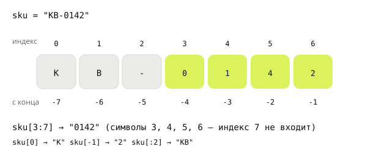

## Теория
Строка (`str`) — это последовательность символов: названия товаров, email, артикулы, тексты писем. У каждого символа есть номер — **индекс**, отсчёт с нуля. По индексам берут отдельные символы и **срезы** — куски строки.

Строки **неизменяемы**: изменить символ внутри строки нельзя. Все методы строк (`lower`, `strip`, `replace`…) не меняют исходную строку, а **возвращают новую** — результат нужно сохранить в переменную. Чтобы вставить значения в текст, используют **f-строки**: `f"Заказ №{order_id}"`. В backend строки приходят отовсюду — из форм, URL, файлов — и почти всегда их нужно сначала почистить: убрать пробелы, привести к одному регистру.

## Наглядно
**Рисунок 1.** Индексы строки `"KB-0142"`: сверху — номера от начала (с нуля), снизу — от конца (с `-1`). Выделен срез `sku[3:7]`: символы с 3-го по 6-й, индекс 7 в срез не входит.



**Таблица 1.** Основные операции со строками на примере `s = "  Ivan.Petrov@Mail.RU  "` и `sku = "KB-0142"`.

| Операция | Пример | Результат |
|---|---|---|
| длина | `len(sku)` | `7` |
| символ по индексу | `sku[0]`, `sku[-1]` | `"K"`, `"2"` |
| срез | `sku[3:]`, `sku[:2]` | `"0142"`, `"KB"` |
| убрать пробелы по краям | `s.strip()` | `"Ivan.Petrov@Mail.RU"` |
| регистр | `s.strip().lower()` | `"ivan.petrov@mail.ru"` |
| замена | `sku.replace("-", "")` | `"KB0142"` |
| проверка начала/конца | `sku.startswith("KB")` | `True` |
| из чего состоит строка | `"0142".isdigit()`, `"SALE10".isalnum()` | `True`, `True` (только цифры; только буквы и цифры) |
| поиск подстроки | `"KB" in sku`, `sku.find("01")` | `True`, `3` (`-1`, если нет) |
| разбить по разделителю | `"мышь;клавиатура".split(";")` | `['мышь', 'клавиатура']` |
| подстановка значений | `f"Итого: {total} ₽"` | `"Итого: 4497 ₽"` |

## На практике
Задача: подготовить данные покупателя и товара — почистить email из формы регистрации, разобрать артикул, собрать текст уведомления.

### Шаг 1. Записываем строки
Строку берут в двойные или одинарные кавычки — удобно, когда внутри нужны другие кавычки. Многострочный текст — в тройные кавычки:
```python
name = 'Мышь "Pro"'
letter = """Здравствуйте!
Ваш заказ принят."""
print(name)
print(letter)
```
Результат:
```
Мышь "Pro"
Здравствуйте!
Ваш заказ принят.
```

### Шаг 2. Склеиваем и измеряем
`+` склеивает строки, `*` повторяет, `len` возвращает длину:
```python
sku = "KB" + "-" + "0142"
print(sku, len(sku))
print("-" * 20)
```
Результат:
```
KB-0142 7
--------------------
```

### Шаг 3. Подставляем значения в текст
f-строка — строка с буквой `f` перед кавычками; выражения в `{}` вычисляются и подставляются. После двоеточия можно задать формат:
```python
order_id = 1042
total = 4497
rating = 4.6666
print(f"Заказ №{order_id} на сумму {total} ₽")
print(f"Рейтинг: {rating:.1f}, сумма с разрядами: {1234567:,}")
```
Результат:
```
Заказ №1042 на сумму 4497 ₽
Рейтинг: 4.7, сумма с разрядами: 1,234,567
```
`:.1f` — один знак после запятой, `:,` — разделитель тысяч.

### Шаг 4. Берём символы и срезы
Разбираем артикул `KB-0142` (рисунок 1) — префикс категории и номер:
```python
sku = "KB-0142"
print(sku[0], sku[-1])
print(sku[:2], sku[3:])
print(sku[3:100])
```
Результат:
```
K 2
KB 0142
0142
```
Срез `[начало:конец]` не включает конец; пропущенная граница — «с начала» или «до конца». Срез за пределами строки ошибки не даёт, а обращение к несуществующему индексу — даёт: `sku[10]` → `IndexError: string index out of range`.

### Шаг 5. Чистим ввод пользователя
Email из формы пришёл с пробелами и в разном регистре — приводим к единому виду цепочкой методов:
```python
raw_email = "  Ivan.Petrov@Mail.RU  "
email = raw_email.strip().lower()
print(email)
print(raw_email)
```
Результат:
```
ivan.petrov@mail.ru
  Ivan.Petrov@Mail.RU  
```
Вторая строка — исходная переменная не изменилась: методы возвращают новую строку.

### Шаг 6. Проверяем и ищем
Проверки возвращают `True`/`False`, `find` — индекс или `-1`:
```python
sku = "KB-0142"
print(sku.startswith("KB"), sku.endswith("42"))
print("01" in sku, sku.find("01"), sku.find("X"))
print(sku.replace("-", ""))
```
Результат:
```
True True
True 3 -1
KB0142
```

### Шаг 7. Разбиваем и собираем
`split` режет строку по разделителю, `join` собирает обратно. Результат `split` — **список**: подробно о списках — в разделе «Коллекции»:
```python
tags = "беспроводная;эргономичная;новинка"
parts = tags.split(";")
print(parts)
print(", ".join(parts))
```
Результат:
```
['беспроводная', 'эргономичная', 'новинка']
беспроводная, эргономичная, новинка
```

### Шаг 8. Убеждаемся, что строки неизменяемы
Попробуем поменять первый символ артикула:
```python
sku = "KB-0142"
sku[0] = "M"
```
Результат:
```
TypeError: 'str' object does not support item assignment
```
Изменить строку нельзя — можно только собрать новую: `sku = "M" + sku[1:]`.

## Частые ошибки
- **Метод без присваивания.** `email.strip()` ничего не меняет в `email` — нужно `email = email.strip()`.
- **Конец среза.** `sku[3:6]` — это `"014"`: символ с индексом 6 не входит.
- **Индекс за пределами.** `sku[7]` для строки из 7 символов — `IndexError`: последний индекс — 6 (или `-1`).
- **Забытая `f`.** `"Итого: {total} ₽"` без `f` — фигурные скобки останутся в тексте как есть.
- **`find` вернул -1.** `-1` — это валидный индекс (последний символ), поэтому `sku[:sku.find("X")]` молча обрежет строку. Проверяйте `"X" in sku`.
- **Регистр при сравнении.** `"Mail.RU" == "mail.ru"` — `False`. Перед сравнением — `.lower()`.

## Итог
**Создание и склейка**
- Кавычки `'...'` или `"..."`, многострочные — `"""..."""`.
- `+` склеивает, `*` повторяет, `len()` — длина.
- f-строки: `f"{total} ₽"`, формат после двоеточия: `{x:.2f}`, `{x:,}`.

**Индексы и срезы**
- Индексы с 0, отрицательные — с конца: `s[-1]` — последний символ.
- Срез `s[a:b]` — с `a` до `b`, не включая `b`; `s[:2]`, `s[3:]`.
- Срез за границы — без ошибки, индекс за границы — `IndexError`.

**Методы**
- `strip`, `lower`/`upper`, `replace`, `startswith`/`endswith`, `find`, `split`, `join`.
- Методы возвращают новую строку — результат сохраняем: `s = s.strip()`.
- Строки неизменяемы: `s[0] = "M"` — `TypeError`.

## Вопросы на собеседовании
<details><summary>Почему строки в Python неизменяемы и что это даёт?</summary>

Неизменяемость позволяет использовать строки как ключи словарей (хеш строки не меняется), безопасно передавать их в функции и разделять одну строку между переменными без копирования. Любое «изменение» создаёт новую строку.
</details>

<details><summary>Чем `find` отличается от `index`?</summary>

Если подстроки нет, `find` возвращает `-1`, а `index` выбрасывает `ValueError`. `-1` легко по ошибке использовать как индекс, поэтому `index` или проверка `in` часто надёжнее.
</details>

<details><summary>Как быстрее собрать строку из многих частей: `+=` в цикле или `join`?</summary>

`join`. Из-за неизменяемости каждый `+=` создаёт новую строку и копирует старое содержимое, а `join` один раз считает итоговую длину и собирает строку целиком.
</details>

## Глубже
Почему склейка в цикле медленная, что такое интернирование строк и почему `len` не всегда равен числу «букв» — в курсе «Python под капотом», тема «Строки изнутри».
