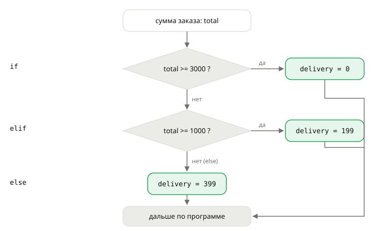

## Теория
Программа должна вести себя по-разному в разных ситуациях: бесплатная доставка для крупных заказов, другой текст для отменённого заказа. Для этого есть **условная инструкция** `if`: она выполняет блок кода, только если условие истинно. `elif` («иначе если») добавляет следующие проверки, `else` — что делать, если не подошло ничего.

Блок, который относится к условию, выделяется **отступом** — обычно четыре пробела. Отступы в Python — часть синтаксиса, а не оформление: по ним интерпретатор понимает, где блок начинается и заканчивается. Проверки `if`/`elif` идут сверху вниз, и выполняется **только первая** подходящая ветка. Для короткого выбора одного из двух значений есть **условное выражение** `a if условие else b`, а для сравнения одного значения со списком вариантов — `match`/`case`.

## Наглядно
**Рисунок 1.** Как выполняется цепочка `if`/`elif`/`else` на примере расчёта доставки: условия проверяются сверху вниз, срабатывает первое истинное, остальные пропускаются.



**Таблица 1.** Три способа описать выбор и когда каждый подходит.

| Конструкция | Пример | Когда использовать |
|---|---|---|
| `if` / `elif` / `else` | расчёт доставки по порогам суммы | несколько разных условий, блоки из нескольких строк |
| условное выражение | `label = "в наличии" if stock > 0 else "нет в наличии"` | выбрать одно из двух значений в одну строку |
| `match` / `case` | текст по статусу заказа | одно значение сравнивается с набором вариантов |

## На практике
Задача: рассчитать доставку: от 3000 ₽ — бесплатно, от 1000 ₽ — 199 ₽, иначе — 399 ₽; показать покупателю статус наличия и понятный текст статуса заказа.

### Шаг 1. Пишем if
Проверяем одно условие — бесплатная доставка:
```python
total = 3500
delivery = 399
if total >= 3000:
    delivery = 0
print(delivery)
```
Результат:
```
0
```
Строка `delivery = 0` с отступом — тело условия. Если бы условие было ложным, она бы не выполнилась, и осталось бы `399`.

### Шаг 2. Добавляем else
`else` — ветка «во всех остальных случаях»:
```python
total = 2500
if total >= 3000:
    delivery = 0
else:
    delivery = 399
print(delivery)
```
Результат:
```
399
```

### Шаг 3. Добавляем elif
Три тарифа — три ветки. Порядок важен: сначала самый строгий порог:
```python
total = 1500
if total >= 3000:
    delivery = 0
elif total >= 1000:
    delivery = 199
else:
    delivery = 399
print(delivery)
```
Результат:
```
199
```
При `total = 3500` верны оба условия, но сработает только первое — `0` (рисунок 1). Если поменять ветки местами, заказ на 3500 ₽ попадёт в `>= 1000` и заплатит 199 ₽.

### Шаг 4. Следим за отступами
Блок — это строки с одинаковым отступом после двоеточия. Забытый отступ — ошибка ещё до запуска:
```python
if total >= 3000:
delivery = 0
```
Результат:
```
IndentationError: expected an indented block after 'if' statement on line 1
```
Договорённость Python — 4 пробела. Не смешивайте пробелы и табы.

### Шаг 5. Выбираем значение в одну строку
Когда нужно одно из двух значений, удобно условное выражение:
```python
stock = 0
label = "в наличии" if stock > 0 else "нет в наличии"
print(label)
```
Результат:
```
нет в наличии
```

### Шаг 6. Отличаем 0 от None
Скидка из настроек: `None` — не задана (берём 10 %), `0` — задана нулевой. `or` их не различает, условное выражение — различает:
```python
raw_discount = 0
print(raw_discount or 10)
print(10 if raw_discount is None else raw_discount)
```
Результат:
```
10
0
```

### Шаг 7. Сравниваем с вариантами через match
`match` сравнивает значение с вариантами `case`; `|` — «или», `_` — «всё остальное»:
```python
status = "shipped"
match status:
    case "new":
        text = "Заказ принят"
    case "paid" | "shipped":
        text = "Заказ в пути"
    case "cancelled":
        text = "Заказ отменён"
    case _:
        text = "Статус неизвестен"
print(text)
```
Результат:
```
Заказ в пути
```
`match` появился в Python 3.10. Для двух-трёх вариантов `if`/`elif` не хуже — выбирайте то, что проще читается.

## Частые ошибки
- **Порядок `elif`.** Срабатывает первая истинная ветка. Пороги проверяют от строгого к мягкому: `>= 3000`, потом `>= 1000`.
- **Переменная только в одной ветке.** Если `delivery` присваивается только внутри `if`, при ложном условии дальше будет `NameError`. Задайте значение во всех ветках или до условия.
- **Двоеточие и отступ.** `if total > 5` без `:` — `SyntaxError: expected ':'`; тело без отступа — `IndentationError`.
- **`=` вместо `==`.** `if total = 5:` — `SyntaxError: invalid syntax. Maybe you meant '==' or ':=' instead of '='?`.
- **`or` вместо проверки на `None`.** `value or default` подменяет и `0`, и `""`. Для «не задано» — `default if value is None else value`.
- **`if is_active == True`.** Избыточно: пишите `if is_active:`.

## Итог
**if / elif / else**
- `if условие:` + блок с отступом; `elif` — следующие проверки; `else` — всё остальное.
- Проверки сверху вниз, выполняется только первая истинная ветка.
- Пороги — от строгого к мягкому.

**Отступы**
- Блок — строки с одинаковым отступом (4 пробела) после двоеточия.
- Нет отступа — `IndentationError`, нет двоеточия — `SyntaxError`.

**Короткие формы**
- `a if условие else b` — выбрать одно из двух значений.
- `default if x is None else x` — значение по умолчанию, не трогающее `0`.

**match / case**
- Значение против вариантов; `|` — несколько вариантов, `case _` — остальное.

## Вопросы на собеседовании
<details><summary>Чем `x or default` отличается от `default if x is None else x`?</summary>

`x or default` вернёт `default` для любого ложного `x`: `None`, `0`, `""`, `False`. Второй вариант подставляет значение по умолчанию только для `None`, а `0` и пустую строку оставляет как есть. Если `0` — допустимое значение, нужен второй вариант.
</details>

<details><summary>Почему отступы в Python — часть синтаксиса?</summary>

Python не использует фигурные скобки для блоков — границы блока определяются отступом. Поэтому неверный отступ меняет смысл программы или вызывает `IndentationError`. Стандарт (PEP 8) — 4 пробела.
</details>

<details><summary>Когда стоит использовать `match`, а когда `if`/`elif`?</summary>

`match` удобен, когда одно значение сравнивается с несколькими вариантами, особенно со структурами (кортежи, словари, объекты). Для пороговых условий (`total >= 3000`) и разнородных проверок естественнее `if`/`elif`.
</details>
