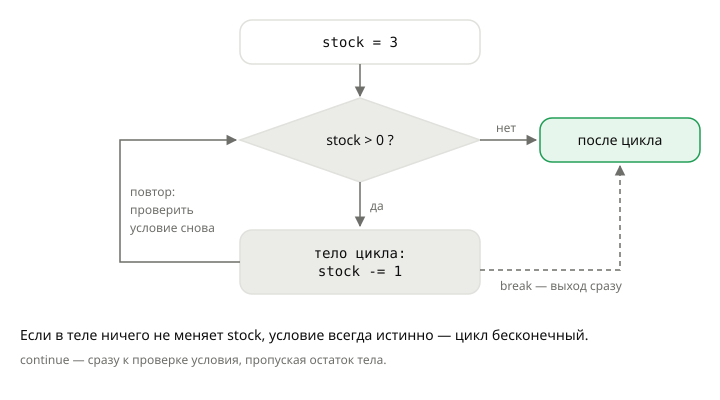

## Теория
**Цикл** повторяет блок кода несколько раз. Цикл `while` («пока») повторяет блок, **пока условие истинно**: перед каждым повтором (итерацией) условие проверяется заново, и как только оно становится ложным, программа идёт дальше. Подходит, когда число повторов заранее неизвестно: повторять попытку оплаты, пока не получится или пока не кончатся попытки; добавлять товары, пока хватает бюджета.

Чтобы цикл закончился, что-то внутри него должно менять условие. Если этого нет, цикл **бесконечный** и программа зависает. Управлять циклом изнутри помогают две команды: `break` — выйти из цикла сразу, `continue` — пропустить остаток тела и перейти к следующей проверке условия.

## Наглядно
**Рисунок 1.** Как работает `while`: условие проверяется перед каждым повтором; тело выполняется, пока оно истинно; `break` выходит из цикла сразу (пунктир).



**Таблица 1.** Способы управлять циклом.

| Что | Что делает | Когда нужно |
|---|---|---|
| условие `while` | проверяется перед каждой итерацией | основной способ закончить цикл |
| `break` | немедленно выходит из цикла | цель достигнута раньше: оплата прошла, бюджет кончился |
| `continue` | переходит к следующей проверке условия, пропуская остаток тела | текущий элемент нужно пропустить |
| `while True` + `break` | цикл без условия, выход — только через `break` | условие выхода удобнее проверять в середине тела |

## На практике
Задача: отгружать товар, пока он есть на складе; повторять оплату до трёх попыток; обработать заказы, пропуская отменённые; собрать корзину в пределах бюджета.

### Шаг 1. Повторяем, пока условие истинно
Отгружаем товар по одной штуке, пока остаток больше нуля:
```python
stock = 3
while stock > 0:
    print(f"Отгружаем, на складе: {stock}")
    stock -= 1
print("Товар закончился")
```
Результат:
```
Отгружаем, на складе: 3
Отгружаем, на складе: 2
Отгружаем, на складе: 1
Товар закончился
```
Каждая итерация уменьшает `stock`; когда он становится `0`, условие ложно — цикл заканчивается.

### Шаг 2. Ограничиваем число попыток
Платёжный сервис иногда отвечает ошибкой — пробуем не больше трёх раз. Здесь оплата проходит со второй попытки:
```python
attempt = 1
paid = False
while attempt <= 3 and not paid:
    print(f"Попытка оплаты №{attempt}")
    paid = attempt == 2        # имитация: проходит вторая попытка
    attempt += 1
print("Оплачено" if paid else "Оплата не прошла")
```
Результат:
```
Попытка оплаты №1
Попытка оплаты №2
Оплачено
```

### Шаг 3. Выходим раньше через break
То же самое, но выход при успехе — через `break`, а условие отвечает только за лимит попыток:
```python
attempt = 1
while attempt <= 3:
    print(f"Попытка оплаты №{attempt}")
    if attempt == 2:           # оплата прошла
        print("Оплачено")
        break
    attempt += 1
```
Результат:
```
Попытка оплаты №1
Попытка оплаты №2
Оплачено
```

### Шаг 4. Пропускаем итерацию через continue
Обрабатываем заказы с 1040 по 1044, заказ 1042 отменён — его пропускаем:
```python
order_id = 1039
cancelled = 1042
while order_id < 1044:
    order_id += 1
    if order_id == cancelled:
        continue
    print(f"Обрабатываем заказ №{order_id}")
```
Результат:
```
Обрабатываем заказ №1040
Обрабатываем заказ №1041
Обрабатываем заказ №1043
Обрабатываем заказ №1044
```
`order_id += 1` стоит **до** `continue`. Если поставить его в конец тела, `continue` будет перепрыгивать увеличение, и на заказе 1042 цикл станет бесконечным.

### Шаг 5. Выходим из while True
Добавляем в корзину мыши по 1499 ₽, пока следующая не превысит бюджет 5000 ₽. Условие выхода удобно проверить до добавления:
```python
budget = 5000
price = 1499
total = 0
count = 0
while True:
    if total + price > budget:
        break
    total += price
    count += 1
print(count, total)
```
Результат:
```
3 4497
```

### Шаг 6. Не допускаем бесконечного цикла
Если в шаге 1 забыть строку `stock -= 1`, условие `stock > 0` останется истинным навсегда — программа зависнет. В тренажёре её остановит тайм-аут, на сервере — нет: зависший цикл занимает процесс целиком. Перед запуском проверяйте: **что в теле цикла приближает условие к ложному?**

## Частые ошибки
- **Условие не меняется.** В теле нет изменения переменной из условия — бесконечный цикл.
- **`continue` перепрыгивает изменение.** Если счётчик увеличивается в конце тела, `continue` его пропустит — тоже бесконечный цикл.
- **На один повтор больше или меньше.** `while attempt < 3` при старте с `1` — две попытки, а не три. Проверяйте граничные значения.
- **Проверка после действия.** Сначала добавили товар, потом проверили бюджет — бюджет уже превышен. Проверяйте до действия.
- **`while` там, где известно число повторов.** Для «повторить 5 раз» или «для каждого символа» удобнее `for` — следующая тема.

## Итог
**Как работает while**
- Повторяет тело, пока условие истинно; условие проверяется перед каждой итерацией.
- Если условие сразу ложно, тело не выполнится ни разу.

**Как выйти**
- Тело должно менять то, от чего зависит условие.
- `break` — выйти сразу; `while True` + `break` — когда выход удобнее проверять внутри.
- `continue` — к следующей проверке условия; изменение счётчика ставим до него.

**Проверка**
- Пройдите цикл вручную на граничных значениях: первая и последняя итерация, условие ровно на границе.

## Вопросы на собеседовании
<details><summary>Чем `break` отличается от `continue`?</summary>

`break` завершает цикл полностью, выполнение идёт к коду после цикла. `continue` завершает только текущую итерацию: управление возвращается к проверке условия (или к следующему элементу в `for`).
</details>

<details><summary>Когда использовать `while`, а когда `for`?</summary>

`for` — когда перебираем известный набор: элементы коллекции, числа из `range`. `while` — когда число повторов неизвестно и зависит от условия: повтор до успеха, ожидание события, чтение до конца данных.
</details>

<details><summary>Почему бесконечный цикл опасен на сервере?</summary>

Он занимает процесс (воркер) целиком: процесс перестаёт обрабатывать другие запросы, а нагрузка на CPU растёт. Несколько таких запросов — и сервер перестаёт отвечать. Поэтому в циклах ожидания всегда ставят лимит попыток или тайм-аут.
</details>
