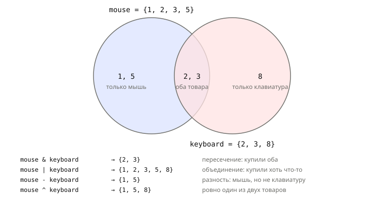

## Теория
Множество (`set`) — коллекция **уникальных** значений без порядка. Дубликаты в нём не хранятся: добавили значение второй раз — ничего не изменилось. Это делает множество естественным инструментом для задач «убрать повторы», «был ли такой уже» и «что общего у двух наборов»: какие покупатели купили оба товара, какие промокоды уже использованы, в каких категориях были покупки.

Проверка `x in s` во множестве очень быстрая — как поиск ключа в словаре, независимо от размера. Множество поддерживает операции из математики: пересечение, объединение, разность. Элементы множества должны быть неизменяемыми (строки, числа, кортежи), а **порядок элементов не гарантирован** — на него нельзя полагаться ни при выводе, ни при обходе.

## Наглядно
**Рисунок 1.** Операции над множествами на примере покупателей: `mouse` — купили мышь, `keyboard` — купили клавиатуру. Каждая операция выделяет свою область диаграммы.



**Таблица 1.** Основные операции с множеством `s = {1, 2, 3}`.

| Операция | Пример | Результат |
|---|---|---|
| создать из коллекции | `set([1, 2, 2, 3])` | `{1, 2, 3}` — дубли исчезли |
| пустое множество | `set()` | `{}` — это пустой **словарь**, не множество |
| проверка | `2 in s` | `True` — быстро при любом размере |
| добавить | `s.add(4)` | повторное добавление ничего не меняет |
| удалить | `s.remove(5)`, `s.discard(5)` | `remove` — `KeyError`, если нет; `discard` — без ошибки |
| пересечение, объединение | `s & {2, 9}`, `s \| {9}` | `{2}`, `{1, 2, 3, 9}` |
| разность | `s - {1}` | `{2, 3}`; `a - b` ≠ `b - a` |
| подмножество | `{1, 2} <= s` | `True` |

## На практике
Задача: найти уникальных покупателей, сравнить аудитории двух товаров и проверять промокоды на повторное использование.

### Шаг 1. Убираем дубли
Журнал просмотров товара хранит `id` покупателей — некоторые смотрели несколько раз:
```python
viewers = [42, 7, 42, 13, 7]
unique_viewers = set(viewers)
print(unique_viewers, len(unique_viewers))
```
Результат:
```
{42, 13, 7} 3
```
Порядок в выводе не совпадает с порядком в списке — множество его не хранит.

### Шаг 2. Проверяем вхождение
`in` во множестве не перебирает элементы, поэтому подходит для частых проверок:
```python
print(13 in unique_viewers, 100 in unique_viewers)
```
Результат:
```
True False
```

### Шаг 3. Добавляем и удаляем
`add` добавляет элемент, `discard` удаляет его без ошибки, если его нет:
```python
used_codes = {101, 102}
used_codes.add(103)
used_codes.add(101)
used_codes.discard(999)
print(used_codes)
used_codes.remove(999)
```
Результат:
```
{101, 102, 103}
KeyError: 999
```

### Шаг 4. Создаём пустое множество
Фигурные скобки без элементов — это словарь:
```python
empty = {}
print(type(empty), type(set()))
```
Результат:
```
<class 'dict'> <class 'set'>
```

### Шаг 5. Сравниваем аудитории
Покупатели мыши и клавиатуры (рисунок 1):
```python
mouse = {1, 2, 3, 5}
keyboard = {2, 3, 8}
print(mouse & keyboard)
print(mouse | keyboard)
print(mouse - keyboard, keyboard - mouse)
print(mouse ^ keyboard)
```
Результат:
```
{2, 3}
{1, 2, 3, 5, 8}
{1, 5} {8}
{1, 5, 8}
```
Разность не симметрична: `mouse - keyboard` — купили мышь, но не клавиатуру; `keyboard - mouse` — наоборот.

### Шаг 6. Создаём множество из строки осторожно
`set()` перебирает переданное значение. Строка — последовательность символов:
```python
print(len(set("SALE10")), len({"SALE10"}))
print("S" in set("SALE10"), "S" in {"SALE10"})
```
Результат:
```
6 1
True False
```
`set("SALE10")` — множество из шести символов, `{"SALE10"}` — множество из одного промокода.

### Шаг 7. Кладём только неизменяемое
Элементом множества может быть число, строка, кортеж — но не список:
```python
pairs = {(42, "M"), (42, "L")}
print(len(pairs))
{[42, "M"]}
```
Результат:
```
2
TypeError: unhashable type: 'list'
```

## Частые ошибки
- **`{}` вместо `set()`.** `{}` — пустой словарь: `.add()` на нём даёт `AttributeError: 'dict' object has no attribute 'add'`.
- **`set("строка")`.** Получается множество символов. Множество из одной строки — `{"SALE10"}`.
- **Перепутанная разность.** `a - b` и `b - a` — разные результаты. Читайте как «есть в `a`, но нет в `b`».
- **Расчёт на порядок.** Множество не хранит порядок; для вывода по порядку — `sorted(s)`.
- **`remove` отсутствующего элемента.** `KeyError`; если элемента может не быть — `discard`.

## Итог
**Множество**
- Уникальные неизменяемые элементы, без порядка.
- Создание: `{1, 2}`, `set(коллекция)`; пустое — только `set()`.
- `x in s` — быстрая проверка при любом размере.

**Изменение**
- `add(x)`; `discard(x)` — без ошибки, `remove(x)` — `KeyError`, если нет.

**Операции**
- `a & b` — общие, `a | b` — все, `a - b` — в `a`, но не в `b`, `a ^ b` — ровно в одном из двух.
- `a <= b` — `a` подмножество `b`.

## Вопросы на собеседовании
<details><summary>Как убрать дубликаты из списка?</summary>

`list(set(items))` — быстро, но порядок теряется. Если порядок важен — `list(dict.fromkeys(items))`: словарь сохраняет порядок первого появления ключей.
</details>

<details><summary>Почему проверка `x in set` быстрее, чем `x in list`?</summary>

Множество, как и словарь, — хеш-таблица: место элемента вычисляется по его хешу, в среднем за O(1). Список проверяет элементы по очереди — O(n).
</details>

<details><summary>Как создать пустое множество?</summary>

Только `set()`. `{}` создаёт пустой словарь — так сложилось исторически: словари появились в языке раньше множеств.
</details>

## Глубже
Как устроено множество внутри и почему элементы обязаны быть hashable — в курсе «Python под капотом», темы «Hashable и неизменяемость» и «`set` и сложность операций».
