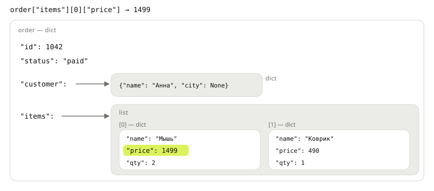

## Теория
Реальные данные почти никогда не плоские. Заказ — это номер и статус, но ещё и покупатель (у которого есть имя и город) и список позиций (у каждой — название, цена и количество). В Python такие данные описывают, вкладывая коллекции друг в друга: словарь в словарь, список словарей, словарь списков. Именно в таком виде приходит JSON от API и строки из базы через ORM.

С вложенной структурой работают **по цепочке**: каждое обращение `[...]` спускается на уровень ниже и возвращает объект, к которому применяется следующее. Главное правило — на каждом шаге понимать, **какой тип** у тебя в руках: у словаря значения берут по ключу-строке, у списка — по индексу-числу. А ещё любой уровень может отсутствовать, и цепочка падает на первом же пропущенном звене.

## Наглядно
**Рисунок 1.** Структура заказа: снаружи словарь, в нём словарь покупателя и список позиций, каждая позиция — словарь. Выделен путь `order["items"][0]["price"]`.



**Таблица 1.** Шаги цепочки `order["items"][0]["price"]`: что возвращает каждый шаг и какого он типа.

| Выражение | Что вернёт | Тип | Как обращаться дальше |
|---|---|---|---|
| `order` | весь заказ | `dict` | по ключу: `["items"]` |
| `order["items"]` | список позиций | `list` | по индексу: `[0]` |
| `order["items"][0]` | первая позиция | `dict` | по ключу: `["price"]` |
| `order["items"][0]["price"]` | цена первой позиции | `int` | — |
| `order["customer"]["name"]` | имя покупателя | `str` | — |

## На практике
Задача: разобрать заказ, пришедший из API: достать данные покупателя, посчитать сумму, изменить позицию и аккуратно обработать необязательные поля.

### Шаг 1. Смотрим на структуру
Заказ в том виде, в каком он пришёл бы JSON-ом:
```python
order = {
    "id": 1042,
    "status": "paid",
    "customer": {"name": "Анна", "city": None},
    "items": [
        {"name": "Мышь", "price": 1499, "qty": 2},
        {"name": "Коврик", "price": 490, "qty": 1},
    ],
}
print(type(order["customer"]), type(order["items"]), type(order["items"][0]))
```
Результат:
```
<class 'dict'> <class 'list'> <class 'dict'>
```

### Шаг 2. Достаём по цепочке
Каждый `[...]` спускается на уровень ниже (рисунок 1):
```python
print(order["customer"]["name"])
print(order["items"][0]["price"])
print(len(order["items"]))
```
Результат:
```
Анна
1499
2
```

### Шаг 3. Обходим вложенный список
Сумма заказа — перебираем позиции, у каждой берём цену и количество:
```python
total = 0
for item in order["items"]:
    total += item["price"] * item["qty"]
print(total)
```
Результат:
```
3488
```

### Шаг 4. Меняем вложенные данные
Изменение по цепочке меняет данные внутри того же заказа:
```python
order["items"][1]["qty"] = 3
order["items"].append({"name": "Кабель", "price": 390, "qty": 1})
print(order["items"][1])
print(len(order["items"]))
```
Результат:
```
{'name': 'Коврик', 'price': 490, 'qty': 3}
3
```

### Шаг 5. Обрабатываем отсутствующие уровни
Блока доставки у этого заказа нет. Прямая цепочка упадёт, а `get` с пустым словарём по умолчанию — нет:
```python
address = order.get("delivery", {}).get("address")
print(address)
print(order["customer"]["city"] is None)
order["delivery"]["address"]
```
Результат:
```
None
True
KeyError: 'delivery'
```
`order.get("delivery", {})` возвращает пустой словарь, если блока нет, — и следующий `.get` уже не падает. Обратите внимание на разницу: ключ `city` у покупателя **есть**, просто значение `None`.

### Шаг 6. Группируем в словарь списков
Номера заказов по статусам. Если статуса ещё нет — заводим для него пустой список (`not in` — проверка «нет такого ключа», противоположность `in`):
```python
orders = [(1042, "paid"), (1043, "new"), (1044, "paid")]
by_status = {}
for order_id, status in orders:
    if status not in by_status:
        by_status[status] = []
    by_status[status].append(order_id)
print(by_status)
```
Результат:
```
{'paid': [1042, 1044], 'new': [1043]}
```
Те же три строки внутри цикла можно заменить одной: `by_status.setdefault(status, []).append(order_id)` — `setdefault` возвращает значение по ключу, а если ключа нет, сначала записывает значение по умолчанию.

## Частые ошибки
- **Не тот тип на шаге цепочки.** `order["items"]["price"]` — `TypeError: list indices must be integers or slices, not str`: `items` — список, сначала нужен индекс позиции.
- **Отсутствующий уровень.** `order["delivery"]["address"]` — `KeyError`, если блока нет. Для необязательных уровней — `get(..., {})`.
- **Ключ есть, но значение `None`.** `order["customer"]["city"]` не падает, но `None.upper()` упадёт. Проверяйте значение, а не только наличие ключа.
- **Перезапись вместо добавления.** `by_status[status] = [order_id]` в цикле затирает собранные ранее номера. Нужен `append` к существующему списку.
- **Индекс за пределами.** `order["items"][5]` для заказа из двух позиций — `IndexError`.

## Итог
**Структура**
- Данные из API и БД — вложенные словари и списки.
- На каждом шаге цепочки — свой тип: словарь — по ключу, список — по индексу.

**Чтение**
- Цепочка `order["items"][0]["price"]` спускается на уровень за шаг.
- Необязательные уровни — `d.get("key", {}).get("inner")`.
- Ключ может быть, а значение — `None`.

**Изменение и группировка**
- Изменение по цепочке меняет исходную структуру.
- Словарь списков: завести пустой список для нового ключа, потом `append`; коротко — `setdefault(key, []).append(x)`.

## Вопросы на собеседовании
<details><summary>Как безопасно достать значение из глубоко вложенного словаря?</summary>

Цепочкой `get` с пустым словарём по умолчанию: `data.get("a", {}).get("b", {}).get("c")`. Для глубоких структур удобнее отдельная функция или проверка схемы данных (в проектах — Pydantic, сериализаторы DRF).
</details>

<details><summary>Что делает `dict.setdefault`?</summary>

Возвращает значение по ключу. Если ключа нет, сначала записывает в словарь значение по умолчанию и возвращает его. Удобно для группировки: `groups.setdefault(key, []).append(x)`.
</details>

<details><summary>Чем отличается отсутствие ключа от значения `None`?</summary>

Нет ключа — `d["k"]` даёт `KeyError`, `"k" in d` — `False`. Ключ со значением `None` — `d["k"]` возвращает `None`, `"k" in d` — `True`. В API это разные факты: «поле не передали» и «поле передали пустым».
</details>
