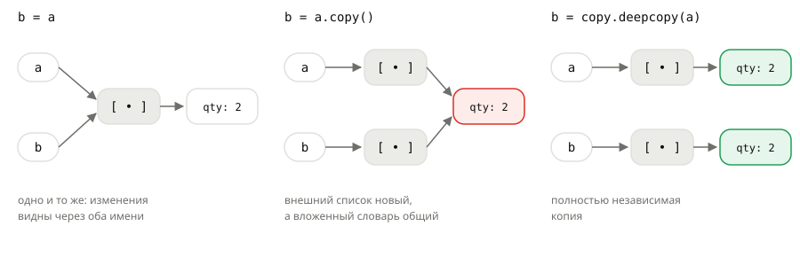

## Теория
Переменная в Python — это имя, которое **указывает** на объект. Присваивание `b = a` не копирует данные: оно даёт тому же объекту второе имя. Пока объект неизменяемый, это незаметно. Но если он изменяемый и его поменяли через одно имя, изменения видны и через все остальные — потому что объект один.

Типы делятся на **неизменяемые** (`int`, `float`, `str`, `tuple`, `bool`, `None`, `frozenset`) и **изменяемые** (`list`, `dict`, `set`). «Изменить» неизменяемый объект нельзя: операция создаёт новый объект и перепривязывает к нему имя. Изменяемый объект меняется на месте — `append`, запись по ключу, `+=` у списка. Чтобы получить независимую копию изменяемого объекта, её создают явно: поверхностную (`copy()`) или глубокую (`copy.deepcopy`) — и разница между ними важна, когда внутри есть вложенные коллекции.

## Наглядно
**Таблица 1.** Какие типы изменяемые и что это значит на практике.

| | Неизменяемые | Изменяемые |
|---|---|---|
| Типы | `int`, `float`, `Decimal`, `str`, `tuple`, `bool`, `None`, `frozenset` | `list`, `dict`, `set` |
| «Изменение» | создаёт новый объект | меняет тот же объект |
| Второе имя (`b = a`) | безопасно | изменения видны через оба имени |
| Ключ словаря, элемент множества | можно | нельзя |

**Рисунок 1.** Три способа получить `b` из списка `a`, внутри которого словарь. Слева — одно и то же, посередине — общий вложенный словарь (выделен), справа — полностью независимая копия.



**Таблица 2.** Как скопировать коллекцию.

| Способ | Что копирует | Вложенные объекты |
|---|---|---|
| `b = a` | ничего — второе имя | общие |
| `a.copy()`, `list(a)`, `a[:]`, `dict(d)`, `d.copy()` | только внешнюю коллекцию | общие |
| `copy.deepcopy(a)` | всё, на всех уровнях | свои |

## На практике
Задача: собрать подарочную корзину на основе корзины покупателя и сделать копию заказа для оформления возврата — так, чтобы изменения не затронули оригинал.

### Шаг 1. Видим два имени у одного списка
Подарочную корзину «скопировали» присваиванием и добавили открытку:
```python
cart = ["мышь", "коврик"]
gift_cart = cart
gift_cart.append("открытка")
print(cart)
print(gift_cart is cart)
```
Результат:
```
['мышь', 'коврик', 'открытка']
True
```
Открытка появилась и в корзине покупателя: `gift_cart` и `cart` — один и тот же список. Оператор `is` проверяет именно это — «один ли это объект».

### Шаг 2. Сравниваем с неизменяемыми типами
С числом такое невозможно — «изменение» создаёт новое значение:
```python
price = 1499
old_price = price
price += 100
print(price, old_price)
```
Результат:
```
1599 1499
```
`price += 100` привязало имя `price` к новому числу, а `old_price` по-прежнему указывает на старое.

### Шаг 3. Различаем изменение и перепривязку
Со списком важно, **как** написано изменение. `+` создаёт новый список, а `+=` меняет существующий:
```python
cart = ["мышь"]
gift_cart = cart
gift_cart = gift_cart + ["открытка"]
print(cart)

cart = ["мышь"]
gift_cart = cart
gift_cart += ["открытка"]
print(cart)
```
Результат:
```
['мышь']
['мышь', 'открытка']
```
Для чисел и строк `x += y` и `x = x + y` равнозначны, а для списка `+=` работает как `extend` — на месте.

### Шаг 4. Делаем копию
Поверхностная копия — новый внешний список с теми же элементами:
```python
cart = ["мышь", "коврик"]
gift_cart = cart.copy()
gift_cart.append("открытка")
print(cart)
print(gift_cart)
```
Результат:
```
['мышь', 'коврик']
['мышь', 'коврик', 'открытка']
```

### Шаг 5. Копируем вложенные данные
Позиции заказа — словари внутри списка. Поверхностная копия копирует только список, а словари остаются общими (рисунок 1, посередине):
```python
import copy

items = [{"name": "Мышь", "qty": 2}]
refund = items.copy()
refund[0]["qty"] = 1
print(items)

items = [{"name": "Мышь", "qty": 2}]
refund = copy.deepcopy(items)
refund[0]["qty"] = 1
print(items)
```
Результат:
```
[{'name': 'Мышь', 'qty': 1}]
[{'name': 'Мышь', 'qty': 2}]
```
Возврат одной мыши через `copy()` испортил исходный заказ. `deepcopy` копирует все уровни — оригинал цел.

### Шаг 6. Помним про изменяемое внутри кортежа
Кортеж не даёт заменить элемент, но изменяемый элемент внутри него меняется:
```python
variant = ("KB-0142", ["black"])
variant[1].append("white")
print(variant)
```
Результат:
```
('KB-0142', ['black', 'white'])
```

### Шаг 7. Не размножаем список умножением
Три пустые полки склада через `*` — это три ссылки на **один** список:
```python
shelves = [[]] * 3
shelves[0].append("мышь")
print(shelves)

shelves = [[], [], []]
shelves[0].append("мышь")
print(shelves)
```
Результат:
```
[['мышь'], ['мышь'], ['мышь']]
[['мышь'], [], []]
```

## Частые ошибки
- **`b = a` как «копия».** Это второе имя. Для независимого списка — `a.copy()`.
- **Поверхностная копия вложенных данных.** `copy()` не копирует словари и списки внутри — они общие. Для вложенных структур — `copy.deepcopy`.
- **`+=` у списка.** Меняет список на месте — изменения видны через все имена. `a = a + b` создаёт новый.
- **`[[]] * n` и `dict.fromkeys(keys, [])`.** Все элементы (значения) — один и тот же список. Создавайте новый список для каждого элемента в цикле.
- **`==` вместо `is`.** `==` сравнивает содержимое, `is` — «тот же ли это объект». Два разных списка с одинаковыми элементами равны (`==`), но не идентичны (`is`).

## Итог
**Имена и объекты**
- Переменная — имя, указывающее на объект; `b = a` даёт второе имя тому же объекту.
- `a is b` — один ли это объект; `a == b` — равно ли содержимое.

**Изменяемость**
- Неизменяемые: числа, `str`, `tuple`, `bool`, `None`, `frozenset` — «изменение» создаёт новый объект.
- Изменяемые: `list`, `dict`, `set` — меняются на месте, изменения видны через все имена.
- У списка `+=` меняет на месте, `+` создаёт новый.

**Копирование**
- `copy()`, `list(a)`, `a[:]` — поверхностная копия: вложенные объекты общие.
- `copy.deepcopy(a)` — независимая копия всех уровней.
- `[[]] * n` и `dict.fromkeys(k, [])` создают общий вложенный список.

## Вопросы на собеседовании
<details><summary>Чем поверхностная копия отличается от глубокой?</summary>

Поверхностная (`copy()`, `list(a)`, срез) создаёт новый внешний контейнер, но кладёт в него ссылки на те же вложенные объекты. Глубокая (`copy.deepcopy`) рекурсивно копирует и вложенные объекты — результат полностью независим.
</details>

<details><summary>Чем `is` отличается от `==`?</summary>

`==` сравнивает значения (вызывает `__eq__`), `is` — проверяет, что это один и тот же объект. `[1] == [1]` — `True`, `[1] is [1]` — `False`. `is` используют для `None`: `x is None`.
</details>

<details><summary>Что выведет `a = [1]; b = a; b += [2]; print(a)` и почему?</summary>

`[1, 2]`. `b = a` — второе имя того же списка, а `+=` у списка меняет его на месте (как `extend`). Для неизменяемых типов `+=` создало бы новый объект, и `a` не изменился бы.
</details>

<details><summary>Почему `[[]] * 3` — плохой способ создать три пустых списка?</summary>

Умножение повторяет ссылку на один и тот же внутренний список. Изменение `shelves[0]` видно во всех трёх элементах. Нужно создавать отдельный список для каждого элемента — в цикле или comprehension.
</details>

## Глубже
Что такое объект, его `id` и почему `is` для чисел иногда «работает», а иногда нет, — в курсе «Python под капотом», темы «Всё — объект», «`is` vs `==`» и «Копирование».
