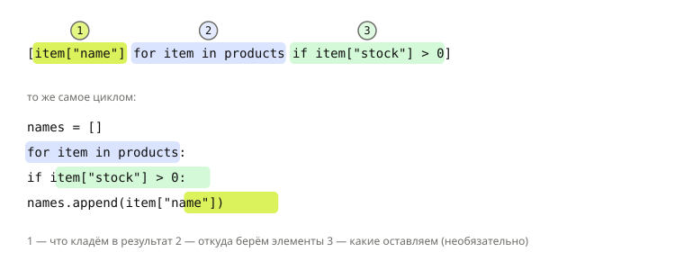

## Теория
Очень частая задача — построить новую коллекцию из старой: из списка товаров взять названия, оставить только товары в наличии, сделать словарь `{id: цена}`. Циклом это четыре строки: пустой список, `for`, `if`, `append`. **Comprehension** («включение») записывает то же самое одной строкой, прямо внутри скобок: `[что_кладём for элемент in откуда if условие]`.

Есть три вида: в квадратных скобках получается список, в фигурных с двоеточием — словарь, в фигурных без двоеточия — множество. Comprehension не делает ничего, чего не умеет цикл, — это способ короче записать **построение** коллекции. Когда логика разрастается (несколько условий, вложенные циклы, побочные действия), обычный цикл читается лучше.

## Наглядно
**Рисунок 1.** Из чего состоит list comprehension и каким строкам обычного цикла соответствует каждая часть. Цифры — порядок чтения: что кладём, откуда берём, какие оставляем.



**Таблица 1.** Три вида comprehension на списке товаров `products`.

| Вид | Запись | Результат |
|---|---|---|
| список | `[p["name"] for p in products]` | `["Мышь", "Клавиатура", ...]` |
| словарь | `{p["id"]: p["price"] for p in products}` | `{42: 1499, 7: 5990, ...}` |
| множество | `{p["category_id"] for p in products}` | `{3, 5}` — без повторов |

**Таблица 2.** Два разных места для `if`.

| Запись | Что делает | Длина результата |
|---|---|---|
| `[x for x in items if условие]` | **фильтр**: оставляет только подходящие | меньше или равна исходной |
| `[a if условие else b for x in items]` | **выбор значения** для каждого элемента | равна исходной |

## На практике
Задача: подготовить данные каталога для страницы и API: названия, товары в наличии, метки наличия, словарь цен, множество категорий, варианты товара.

### Шаг 1. Переписываем цикл
Каталог — список словарей. Названия всех товаров — сначала циклом, потом comprehension:
```python
products = [
    {"id": 42, "name": "Мышь", "price": 1499, "stock": 12, "category_id": 3},
    {"id": 7, "name": "Клавиатура", "price": 5990, "stock": 0, "category_id": 3},
    {"id": 13, "name": "Коврик", "price": 490, "stock": 40, "category_id": 5},
]
names = []
for p in products:
    names.append(p["name"])
print(names)
print([p["name"] for p in products])
```
Результат:
```
['Мышь', 'Клавиатура', 'Коврик']
['Мышь', 'Клавиатура', 'Коврик']
```

### Шаг 2. Фильтруем
`if` в конце оставляет только элементы, для которых условие истинно:
```python
in_stock = [p["name"] for p in products if p["stock"] > 0]
print(in_stock)
```
Результат:
```
['Мышь', 'Коврик']
```

### Шаг 3. Выбираем значение для каждого элемента
Если нужен результат для **каждого** товара, а меняется только значение, — условное выражение стоит в начале:
```python
labels = ["в наличии" if p["stock"] > 0 else "нет в наличии" for p in products]
print(labels)
```
Результат:
```
['в наличии', 'нет в наличии', 'в наличии']
```

### Шаг 4. Строим словарь
Фигурные скобки и пара `ключ: значение` — получается словарь:
```python
prices = {p["id"]: p["price"] for p in products}
print(prices)
print(prices[13])
```
Результат:
```
{42: 1499, 7: 5990, 13: 490}
490
```

### Шаг 5. Строим множество
Фигурные скобки без двоеточия — множество, повторы исчезают:
```python
categories = {p["category_id"] for p in products}
print(categories)
```
Результат:
```
{3, 5}
```

### Шаг 6. Используем два цикла
Варианты товара — каждый цвет в каждом размере. Циклы `for` читаются слева направо, как вложенные: первый — внешний:
```python
colors = ["black", "white"]
sizes = ["S", "M"]
variants = [f"{color}-{size}" for color in colors for size in sizes]
print(variants)
```
Результат:
```
['black-S', 'black-M', 'white-S', 'white-M']
```

### Шаг 7. Выбираем цикл, когда он понятнее
Comprehension — для построения коллекции. Если в теле нужны побочные действия (вывод, запись в базу, изменение других объектов) или больше одного условия с ветками, пишите обычный цикл. Comprehension, который не помещается в строку и читается дольше цикла, — признак, что нужен цикл.

## Частые ошибки
- **`if ... else` в конце.** `[x for x in items if cond else y]` — `SyntaxError`. Фильтр (`if` без `else`) — в конце, выбор значения (`a if cond else b`) — в начале.
- **Множество вместо словаря.** `{p["id"], p["price"] for p in products}` — ошибка, `{(p["id"], p["price"]) for p in products}` — множество кортежей. Словарь получается только с двоеточием: `{k: v for ...}`.
- **Порядок двух `for`.** Первый `for` — внешний цикл. `[... for color in colors for size in sizes]` перебирает размеры внутри каждого цвета.
- **Comprehension ради побочных действий.** `[cart.append(p) for p in products]` создаёт бесполезный список из `None`. Для действий — обычный `for`.
- **Повтор ключей в dict comprehension.** Если ключ встретился дважды, останется последнее значение — без ошибки.

## Итог
**Синтаксис**
- `[выражение for x in коллекция if условие]` — список.
- `{ключ: значение for x in коллекция}` — словарь; `{выражение for x in коллекция}` — множество.

**Условия**
- `if` в конце — фильтр: элементов может стать меньше.
- `a if условие else b` в начале — значение для каждого элемента.

**Несколько циклов**
- `for` читаются слева направо, первый — внешний.

**Когда не использовать**
- Побочные действия, сложные ветки, длинная нечитаемая строка — пишите обычный цикл.
- Ленивые генераторные выражения `(x for x in ...)` — в разделе «Итераторы и генераторы».

## Вопросы на собеседовании
<details><summary>Где ставится `if` в comprehension и в чём разница?</summary>

В конце — фильтр: `[x for x in a if x > 0]` пропускает часть элементов. В начале — условное выражение: `[x if x > 0 else 0 for x in a]` даёт значение для каждого элемента. В конце `else` писать нельзя.
</details>

<details><summary>Быстрее ли comprehension обычного цикла?</summary>

Обычно немного быстрее цикла с `append`: не нужно на каждой итерации искать и вызывать метод `append`. Но выигрыш небольшой — comprehension выбирают ради читаемости, а не скорости.
</details>

<details><summary>Как из списка пар сделать словарь?</summary>

`{k: v for k, v in pairs}` или проще `dict(pairs)`. Если ключи повторяются, остаётся последнее значение.
</details>

## Глубже
Чем comprehension отличается от генераторного выражения по памяти и почему переменная comprehension не «утекает» наружу — в курсе «Python под капотом», раздел «Итерация и протоколы».
