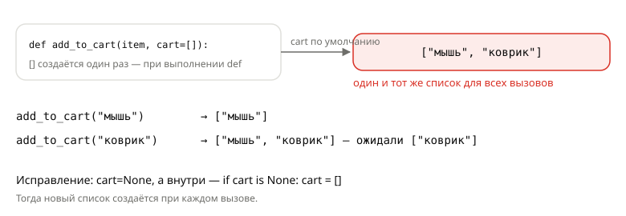

## Теория
При вызове функции аргументы связываются с параметрами двумя способами: **по позиции** (`calc_price(1499, 2)` — первое значение в первый параметр) и **по имени** (`calc_price(qty=2, price=1499)`). Параметру можно дать **значение по умолчанию** — тогда аргумент необязателен. Для функций с переменным числом аргументов есть `*args` (лишние позиционные собираются в кортеж) и `**kwargs` (лишние именованные — в словарь).

Две вещи здесь особенно важны. Первая: значение по умолчанию вычисляется **один раз** — когда выполняется `def`, а не при каждом вызове. Если это изменяемый объект (`[]`, `{}`), все вызовы делят его между собой — классическая ловушка с собеседований. Вторая: параметры после `*` можно передать **только по имени** (keyword-only). Так делают для флагов вроде `express=True`, чтобы вызов `create_order(42, True)` не превращался в загадку.

## Наглядно
**Таблица 1.** Виды параметров на примере `def create_order(user_id, qty=1, *items, express=False, **extra)`.

| Параметр | Вид | Как передать | Что внутри функции |
|---|---|---|---|
| `user_id` | обычный | позицией или по имени, обязателен | значение |
| `qty=1` | со значением по умолчанию | можно не передавать | `1`, если не передали |
| `*items` | переменное число позиционных | все лишние позиционные | кортеж |
| `express=False` | keyword-only (стоит после `*`) | **только** по имени: `express=True` | значение |
| `**extra` | переменное число именованных | все лишние именованные | словарь |

**Рисунок 1.** Ловушка изменяемого значения по умолчанию: список `[]` создан один раз при `def`, и каждый вызов без `cart` добавляет товар в него же.



## На практике
Задача: написать функции расчёта и оформления заказа так, чтобы их было удобно и безопасно вызывать.

### Шаг 1. Передаём аргументы по позиции и по имени
Одна функция — два способа вызова:
```python
def calc_price(price, qty):
    return price * qty

print(calc_price(1499, 2))
print(calc_price(qty=2, price=1499))
```
Результат:
```
2998
2998
```
По имени порядок не важен, и вызов читается без заглядывания в определение. Позиционные аргументы пишутся раньше именованных: `calc_price(qty=2, 1499)` — `SyntaxError`.

### Шаг 2. Получаем ошибку из-за пропущенного аргумента
Обязательный параметр не передали:
```python
calc_price(1499)
```
Результат:
```
TypeError: calc_price() missing 1 required positional argument: 'qty'
```

### Шаг 3. Задаём значение по умолчанию
Количество чаще всего — 1, делаем его необязательным:
```python
def calc_price(price, qty=1):
    return price * qty

print(calc_price(1499), calc_price(1499, 3))
```
Результат:
```
1499 4497
```

### Шаг 4. Попадаем в ловушку изменяемого значения по умолчанию
Функция добавляет товар в корзину; если корзину не передали — в «новую»:
```python
def add_to_cart(item, cart=[]):
    cart.append(item)
    return cart

print(add_to_cart("мышь"))
print(add_to_cart("коврик"))
```
Результат:
```
['мышь']
['мышь', 'коврик']
```
Второй покупатель получил мышь первого (рисунок 1). Правильно — `None` по умолчанию и новый список внутри:
```python
def add_to_cart(item, cart=None):
    if cart is None:
        cart = []
    cart.append(item)
    return cart

print(add_to_cart("мышь"))
print(add_to_cart("коврик"))
```
Результат:
```
['мышь']
['коврик']
```

### Шаг 5. Принимаем любое число позиционных аргументов
`*prices` собирает все позиционные аргументы в кортеж:
```python
def total(*prices):
    print(type(prices), prices)
    return sum(prices)

print(total(1499, 490, 390))
print(total())
```
Результат:
```
<class 'tuple'> (1499, 490, 390)
2379
<class 'tuple'> ()
0
```

### Шаг 6. Принимаем любые именованные аргументы
`**filters` собирает именованные аргументы в словарь — удобно для фильтров каталога:
```python
def filter_products(products, **filters):
    result = []
    for p in products:
        if all([p.get(key) == value for key, value in filters.items()]):
            result.append(p["name"])
    return result

products = [
    {"name": "Мышь", "color": "black", "category_id": 3},
    {"name": "Коврик", "color": "black", "category_id": 5},
    {"name": "Клавиатура", "color": "white", "category_id": 3},
]
print(filter_products(products, color="black"))
print(filter_products(products, color="black", category_id=3))
```
Результат:
```
['Мышь', 'Коврик']
['Мышь']
```

### Шаг 7. Делаем флаг только именованным
Параметры после одиночной `*` передаются только по имени — вызов с «голым» `True` запрещён:
```python
def create_order(user_id, *, express=False):
    return {"user_id": user_id, "express": express}

print(create_order(42, express=True))
create_order(42, True)
```
Результат:
```
{'user_id': 42, 'express': True}
TypeError: create_order() takes 1 positional argument but 2 were given
```

### Шаг 8. Распаковываем аргументы при вызове
`*` и `**` работают и в обратную сторону — раскладывают коллекцию по аргументам:
```python
item = (1499, 2)
print(calc_price(*item))
data = {"price": 5990, "qty": 1}
print(calc_price(**data))
```
Результат:
```
2998
5990
```

## Частые ошибки
- **Изменяемое значение по умолчанию.** `def f(cart=[])` — один список на все вызовы. Используйте `None` и создавайте объект внутри.
- **Список вместо распаковки в `*args`.** `total(prices)` при `def total(*prices)` даёт кортеж из **одного** элемента-списка. Нужно `total(*prices)`.
- **Флаги позицией.** `create_order(42, True, False)` нечитаемо и легко перепутать порядок. Делайте флаги keyword-only.
- **Позиционный после именованного.** `f(qty=2, 1499)` — `SyntaxError`.
- **Одно значение передано дважды.** `calc_price(1499, price=1499)` — `TypeError: got multiple values for argument 'price'`.

## Итог
**Передача аргументов**
- По позиции — по порядку; по имени — `param=value`, порядок не важен; позиционные — раньше именованных.
- Распаковка при вызове: `f(*seq)`, `f(**mapping)`.

**Значения по умолчанию**
- Делают параметр необязательным: `qty=1`.
- Вычисляются один раз при `def`; для изменяемых — `None` + создание внутри.

**Переменное число аргументов**
- `*args` — кортеж лишних позиционных; `**kwargs` — словарь лишних именованных.

**Keyword-only**
- Параметры после `*` (или после `*args`) — только по имени; так оформляют флаги и настройки.

## Вопросы на собеседовании
<details><summary>Почему нельзя писать `def f(items=[])`?</summary>

Значение по умолчанию вычисляется один раз — при выполнении `def` — и хранится в функции. Все вызовы без аргумента получают **тот же** список, и изменения накапливаются между вызовами. Правильно: `items=None`, а внутри `if items is None: items = []`.
</details>

<details><summary>Что такое `*args` и `**kwargs`?</summary>

`*args` собирает лишние позиционные аргументы в кортеж, `**kwargs` — лишние именованные в словарь. Имена `args`/`kwargs` — соглашение, важны звёздочки. При вызове `*` и `**` наоборот распаковывают коллекцию в аргументы.
</details>

<details><summary>Что значит одиночная `*` в списке параметров?</summary>

Все параметры после неё — keyword-only: их можно передать только по имени. Это защищает от непонятных вызовов вида `f(1, True, False)` и позволяет менять порядок параметров без поломки вызывающего кода.
</details>

## Глубже
Где именно хранится значение по умолчанию (`__defaults__`) и почему Python передаёт аргументы «по ссылке на объект» — в курсе «Python под капотом», темы «Передача аргументов» и «Изменяемые значения по умолчанию».
