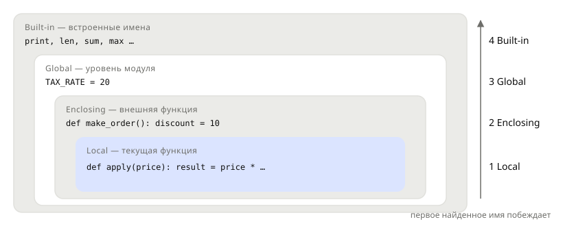

## Теория
У каждого имени есть **область видимости** — часть программы, где оно доступно. Переменные, созданные внутри функции, **локальные**: они живут только во время вызова и снаружи не видны. Переменные уровня модуля (файла) — **глобальные**: их можно читать из любой функции. Когда Python встречает имя, он ищет его по правилу **LEGB**: Local → Enclosing (внешняя функция) → Global → Built-in (встроенные `print`, `len`…), и берёт первое найденное.

Ловушка в том, как Python решает, что имя локальное: **любое присваивание** имени внутри функции делает его локальным во **всей** функции — даже в строках выше присваивания. Поэтому `count += 1` для глобального счётчика падает с `UnboundLocalError`. Изменить глобальное имя можно через `global`, а имя внешней функции — через `nonlocal`, но в обычном коде это признак плохого дизайна: функция, которая меняет глобальное состояние, непредсказуема и плохо тестируется. Надёжнее принимать данные параметрами и возвращать результат.

## Наглядно
**Рисунок 1.** Области видимости вложены друг в друга. Имя ищется от текущей функции наружу; первое найденное побеждает.



**Таблица 1.** Что можно делать с глобальным именем изнутри функции.

| Действие в функции | Пример | Что происходит |
|---|---|---|
| прочитать | `price * TAX_RATE` | работает: имя найдено в Global |
| присвоить | `TAX_RATE = 18` | создаётся **новое локальное** имя, глобальное не меняется |
| прочитать и присвоить | `count += 1` | `UnboundLocalError`: имя локальное, но ещё без значения |
| изменить объект | `CART.append("мышь")` | работает: имя не присваивается, меняется сам список |
| `global count` + присвоить | `count += 1` | меняется глобальное имя — работает, но плохая практика |

## На практике
Задача: написать функции расчёта налога и учёта заказов и разобраться, какие имена они видят и могут менять.

### Шаг 1. Не видим локальные имена снаружи
Переменная, созданная в функции, исчезает после вызова:
```python
def calc_tax(price):
    tax = price * 20 // 100
    return tax

print(calc_tax(1499))
print(tax)
```
Результат:
```
299
NameError: name 'tax' is not defined. Did you mean: 'max'?
```
Подсказка «Did you mean» здесь мимо: Python просто нашёл похожее встроенное имя. Причина ошибки — `tax` существует только внутри `calc_tax`.

### Шаг 2. Читаем глобальную константу
Чтение глобального имени из функции работает:
```python
TAX_RATE = 20

def calc_tax(price):
    return price * TAX_RATE // 100

print(calc_tax(1499))
```
Результат:
```
299
```

### Шаг 3. Создаём локальное имя присваиванием
Присваивание внутри функции не трогает глобальное имя — создаётся новое локальное с тем же названием:
```python
def special_offer(price):
    TAX_RATE = 0
    return price * TAX_RATE // 100

print(special_offer(1499), TAX_RATE)
```
Результат:
```
0 20
```

### Шаг 4. Получаем UnboundLocalError
Счётчик заказов увеличивается внутри функции:
```python
orders_count = 0

def register_order():
    orders_count += 1

register_order()
```
Результат:
```
UnboundLocalError: cannot access local variable 'orders_count' where it is not associated with a value
```
`+=` — это присваивание, значит `orders_count` локальное во всей функции. Чтобы прибавить 1, его сначала нужно прочитать — а локального значения ещё нет.

### Шаг 5. Меняем глобальное имя через global
`global` говорит Python: это имя — глобальное:
```python
def register_order():
    global orders_count
    orders_count += 1

register_order()
register_order()
print(orders_count)
```
Результат:
```
2
```
Работает, но теперь результат функции зависит от того, сколько раз и в каком порядке её вызывали где-то ещё. Такой код трудно тестировать и отлаживать.

### Шаг 6. Передаём и возвращаем вместо global
Та же логика без скрытого состояния: функция получает текущее значение и возвращает новое:
```python
def next_order_number(last_number):
    return last_number + 1

number = 1041
number = next_order_number(number)
print(number)
```
Результат:
```
1042
```
Всё, от чего зависит результат, видно в вызове.

### Шаг 7. Замечаем скрытое изменение объекта
Изменять глобальный (или переданный) **объект** можно и без `global` — и это тоже легко сделать случайно:
```python
def with_gift(cart):
    cart.append("открытка")
    return cart

my_cart = ["мышь"]
gift_cart = with_gift(my_cart)
print(my_cart)
```
Результат:
```
['мышь', 'открытка']
```
Функция вернула корзину с подарком, но заодно изменила исходную. Если это не задумано — создавайте новый список: `return cart + ["открытка"]`.

## Частые ошибки
- **`UnboundLocalError`.** Присваивание имени где угодно в функции делает его локальным во всей функции — чтение до присваивания падает.
- **`global` для обмена данными между функциями.** Скрытое состояние делает функции зависимыми от порядка вызовов. Передавайте параметры и возвращайте результат.
- **Невидимое изменение переданного списка.** `cart.append(...)` внутри функции меняет объект вызывающего кода. Нужна новая коллекция — создавайте её.
- **Затенение встроенных имён.** Локальная переменная `sum` или `list` перекрывает встроенную функцию до конца функции.
- **Ожидание, что локальная переменная доступна снаружи.** После вызова локальные имена исчезают — нужный результат возвращают через `return`.

## Итог
**Поиск имён**
- LEGB: Local → Enclosing → Global → Built-in; первое найденное побеждает.
- Локальные имена живут только во время вызова.

**Присваивание**
- Любое присваивание имени (в том числе `+=`) делает его локальным во всей функции.
- Чтение такого имени до присваивания — `UnboundLocalError`.
- `global x` / `nonlocal x` — присваивать глобальное / внешнее имя.

**Хорошая практика**
- Данные — через параметры, результат — через `return`; `global` — почти никогда.
- Не меняйте переданные изменяемые объекты, если это не цель функции.

## Вопросы на собеседовании
<details><summary>Что такое правило LEGB?</summary>

Порядок поиска имени: Local (текущая функция) → Enclosing (охватывающие функции) → Global (модуль) → Built-in (встроенные имена). Используется первое найденное.
</details>

<details><summary>Почему `count += 1` в функции падает с `UnboundLocalError`, хотя `count` есть глобально?</summary>

Python решает, какие имена локальные, при компиляции функции: раз в функции есть присваивание `count`, имя локальное во всей функции. `+=` сначала читает локальное `count`, а значения у него ещё нет. Решение — передать значение параметром и вернуть результат (или `global`, если без него никак).
</details>

<details><summary>Чем `global` отличается от `nonlocal`?</summary>

`global x` связывает имя с переменной уровня модуля. `nonlocal x` — с переменной ближайшей охватывающей функции; используется во вложенных функциях и замыканиях (следующая тема).
</details>

## Глубже
Почему присваивание делает имя локальным ещё до выполнения функции и как это видно в байткоде — в курсе «Python под капотом», тема «Область видимости: ловушки».
