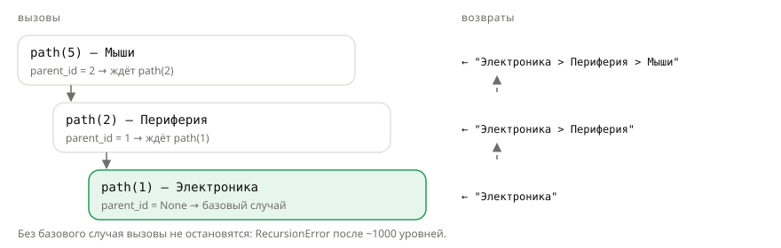

## Теория
Рекурсия — когда функция вызывает саму себя. Она естественна для данных, которые устроены «сами в себе»: дерево категорий (у категории есть родитель, у родителя — свой родитель), вложенные комментарии, меню сайта. Каждый рекурсивный вызов решает задачу чуть меньшего размера, пока не дойдёт до случая, который решается сразу.

У правильной рекурсии всегда две части. **Базовый случай** — когда ответ известен без новых вызовов (у корневой категории нет родителя). **Рекурсивный шаг** — вызов себя для задачи поменьше, приближающей к базовому случаю. Без базового случая вызовы не остановятся: Python ограничивает глубину (обычно 1000 вызовов, в тренажёре сайта — 300) и выбросит `RecursionError`. Для простого «прохода вверх по цепочке» часто проще цикл; рекурсия выигрывает там, где у узла несколько потомков и их нужно обойти все.

## Наглядно
**Рисунок 1.** Хлебные крошки для категории «Мыши»: вызовы спускаются по цепочке родителей до корня (базовый случай), а результаты собираются на обратном пути.



**Таблица 1.** Рекурсия и цикл: когда что выбирать.

| | Рекурсия | Цикл |
|---|---|---|
| Цепочка «вверх к корню» | работает | обычно проще и без лимита глубины |
| Дерево с несколькими потомками | естественна: «обработай узел и всех детей» | нужен свой стек — сложнее |
| Ограничения | глубина ~1000 вызовов (в тренажёре — 300), `RecursionError` | нет |
| Главная ошибка | нет базового случая или шаг к нему не приближает | бесконечный `while` |

## На практике
Задача: построить «хлебные крошки» для страницы категории и посчитать товары во всём поддереве каталога.

### Шаг 1. Описываем дерево категорий
Категории со ссылкой на родителя — как в таблице `categories`:
```python
categories = {
    1: {"name": "Электроника", "parent_id": None},
    2: {"name": "Периферия", "parent_id": 1},
    5: {"name": "Мыши", "parent_id": 2},
}
print(categories[5]["parent_id"], categories[1]["parent_id"])
```
Результат:
```
2 None
```

### Шаг 2. Пишем базовый случай и рекурсивный шаг
Путь к категории — путь к её родителю плюс её название; у корня путь — просто название:
```python
def path(category_id):
    category = categories[category_id]
    if category["parent_id"] is None:
        return category["name"]
    return path(category["parent_id"]) + " > " + category["name"]

print(path(5))
print(path(1))
```
Результат:
```
Электроника > Периферия > Мыши
Электроника
```

### Шаг 3. Смотрим порядок вызовов
Добавим вывод — видно, как вызовы спускаются, а результаты поднимаются (рисунок 1):
```python
def path_traced(category_id, depth=0):
    category = categories[category_id]
    print("  " * depth + f"вызов path({category_id})")
    if category["parent_id"] is None:
        return category["name"]
    result = path_traced(category["parent_id"], depth + 1) + " > " + category["name"]
    print("  " * depth + f"возврат из path({category_id})")
    return result

path_traced(5)
```
Результат:
```
вызов path(5)
  вызов path(2)
    вызов path(1)
  возврат из path(2)
возврат из path(5)
```

### Шаг 4. Получаем RecursionError
Функция без базового случая вызывает себя бесконечно, пока Python её не остановит:
```python
def broken(category_id):
    return broken(category_id)

broken(5)
```
Результат:
```
RecursionError: maximum recursion depth exceeded
```

### Шаг 5. Обходим дерево вниз
Каталог как дерево: у узла может быть несколько детей. Число товаров в поддереве — свои товары плюс товары всех потомков:
```python
tree = {
    "name": "Электроника", "products": 2,
    "children": [
        {"name": "Периферия", "products": 3, "children": [
            {"name": "Мыши", "products": 5, "children": []},
        ]},
        {"name": "Мониторы", "products": 4, "children": []},
    ],
}

def count_products(node):
    total = node["products"]
    for child in node["children"]:
        total += count_products(child)
    return total

print(count_products(tree))
```
Результат:
```
14
```
Базовый случай здесь неявный: у листа список `children` пуст, цикл не выполняется — новых вызовов нет.

### Шаг 6. Сравниваем с циклом
Цепочку «вверх к корню» можно пройти и циклом — без лимита глубины:
```python
def path_loop(category_id):
    names = []
    while category_id is not None:
        names.append(categories[category_id]["name"])
        category_id = categories[category_id]["parent_id"]
    return " > ".join(reversed(names))

print(path_loop(5))
```
Результат:
```
Электроника > Периферия > Мыши
```

## Частые ошибки
- **Нет базового случая.** Функция вызывает себя всегда — `RecursionError`. Сначала напишите условие остановки.
- **Шаг не приближает к базе.** Вызов с тем же аргументом (или «дальше» от базы) — та же бесконечная рекурсия.
- **Потерянный результат.** `count_products(child)` без `total +=` (или без `return`) — вызов работает, а его результат выбрасывается.
- **Слишком глубокие данные.** Цепочка из тысяч уровней упрётся в лимит глубины — для таких данных нужен цикл.
- **Цикл в данных.** Если категория ссылается сама на себя (по ошибке в базе), рекурсия никогда не дойдёт до корня — защищайтесь проверкой уже посещённых узлов.

## Итог
**Устройство**
- Рекурсивная функция вызывает саму себя для задачи поменьше.
- Базовый случай — ответ без новых вызовов; рекурсивный шаг — приближение к нему.

**Где уместна**
- Деревья с несколькими потомками: «узел + все дети».
- Цепочку «вверх к корню» часто проще пройти циклом.

**Ограничения**
- Глубина ограничена (~1000, в тренажёре — 300) — `RecursionError`.
- Результат рекурсивного вызова нужно использовать: сложить, вернуть.

## Вопросы на собеседовании
<details><summary>Из чего состоит рекурсивная функция?</summary>

Из базового случая — условия, при котором ответ возвращается без рекурсивного вызова, — и рекурсивного шага, который вызывает функцию для задачи поменьше и приближает к базовому случаю.
</details>

<details><summary>Что такое `RecursionError` и как его избежать?</summary>

Python ограничивает глубину вызовов (`sys.getrecursionlimit()`, обычно 1000), чтобы не переполнить стек. Где стек меньше, лимит ставят ниже: в тренажёре сайта (Python в браузере) — 300 уровней. Превышение — `RecursionError`. Избегают так: проверить базовый случай, убедиться, что шаг к нему приближает, а для глубоких данных переписать алгоритм циклом.
</details>

<details><summary>Когда рекурсия лучше цикла?</summary>

Когда структура данных рекурсивна и ветвится: деревья, вложенные комментарии, обход JSON произвольной вложенности. Для линейных цепочек цикл обычно проще и не упирается в лимит глубины.
</details>
