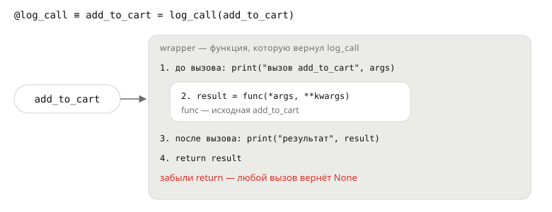

## Теория
Декоратор — функция, которая принимает функцию и возвращает новую функцию с добавленным поведением. Так к любой функции добавляют общее действие, не трогая её код: записать вызов в лог, посчитать вызовы, проверить права, закэшировать результат. Запись `@log_call` над `def` — короткая форма для `add_to_cart = log_call(add_to_cart)`: после неё имя функции указывает уже на **обёртку**.

Декоратор собирается из того, что вы уже знаете: функция как значение (её передают и возвращают) и замыкание (обёртка помнит исходную функцию). У правильной обёртки три обязательных свойства: она принимает любые аргументы (`*args, **kwargs`) и передаёт их дальше; **возвращает** результат исходной функции; сохраняет её имя и docstring через `functools.wraps`. Декоратор применяется **один раз — в момент определения** функции, а обёртка работает при каждом вызове. В Django и FastAPI декораторы повсюду: `@login_required`, `@app.get("/")`, `@transaction.atomic`.

## Наглядно
**Рисунок 1.** После `@log_call` имя `add_to_cart` указывает на обёртку. Обёртка делает своё до вызова, вызывает исходную функцию, делает своё после и возвращает результат.



**Таблица 1.** Каркас декоратора: что делает каждая строка.

| Строка | Зачем |
|---|---|
| `def log_call(func):` | декоратор принимает исходную функцию |
| `@functools.wraps(func)` | обёртка получает имя и docstring исходной функции |
| `def wrapper(*args, **kwargs):` | обёртка принимает любые аргументы |
| `result = func(*args, **kwargs)` | вызывает исходную функцию с теми же аргументами |
| `return result` | отдаёт результат вызывающему коду |
| `return wrapper` | декоратор возвращает обёртку **без вызова** |

## На практике
Задача: добавить логирование вызовов к функциям корзины и счётчик вызовов к расчёту отчёта — не меняя сами функции.

### Шаг 1. Оборачиваем функцию вручную
Декоратор — обычная функция; применим её без особого синтаксиса:
```python
def log_call(func):
    def wrapper(*args, **kwargs):
        print(f"вызов {func.__name__} с {args}")
        result = func(*args, **kwargs)
        print(f"результат: {result}")
        return result
    return wrapper

def calc_total(prices):
    return sum(prices)

calc_total = log_call(calc_total)
calc_total([1499, 490])
```
Результат:
```
вызов calc_total с ([1499, 490],)
результат: 1989
```

### Шаг 2. Используем синтаксис @
`@log_call` над `def` делает то же самое, что строка `calc_total = log_call(calc_total)`:
```python
@log_call
def add_to_cart(cart, item):
    return cart + [item]

new_cart = add_to_cart(["мышь"], "коврик")
print(new_cart)
```
Результат:
```
вызов add_to_cart с (['мышь'], 'коврик')
результат: ['мышь', 'коврик']
['мышь', 'коврик']
```

### Шаг 3. Возвращаем результат
Если обёртка забудет `return`, декорированная функция всегда будет возвращать `None`:
```python
def log_call_broken(func):
    def wrapper(*args, **kwargs):
        print(f"вызов {func.__name__}")
        func(*args, **kwargs)
    return wrapper

@log_call_broken
def calc_total(prices):
    return sum(prices)

print(calc_total([1499, 490]))
```
Результат:
```
вызов calc_total
None
```

### Шаг 4. Сохраняем имя функции
Без `wraps` декорированная функция «теряет» имя и docstring — они берутся у обёртки:
```python
import functools

print(add_to_cart.__name__)

def log_call(func):
    @functools.wraps(func)
    def wrapper(*args, **kwargs):
        print(f"вызов {func.__name__} с {args}")
        return func(*args, **kwargs)
    return wrapper

@log_call
def add_to_cart(cart, item):
    """Новая корзина с добавленным товаром."""
    return cart + [item]

print(add_to_cart.__name__, "—", add_to_cart.__doc__)
```
Результат:
```
wrapper
add_to_cart — Новая корзина с добавленным товаром.
```
Имя нужно не для красоты: по нему фреймворки регистрируют обработчики, а логи и трейсбеки показывают, какая функция работала.

### Шаг 5. Помним, когда применяется декоратор
Код декоратора выполняется при определении функции, а обёртка — при каждом вызове:
```python
def register(func):
    print(f"регистрирую {func.__name__}")
    return func

@register
def notify_paid(order_id):
    return f"Заказ №{order_id} оплачен"

print("определения закончились")
print(notify_paid(1042))
```
Результат:
```
регистрирую notify_paid
определения закончились
Заказ №1042 оплачен
```

### Шаг 6. Храним состояние в обёртке
Счётчик вызовов: у функции, как у любого объекта, можно завести атрибут:
```python
def count_calls(func):
    @functools.wraps(func)
    def wrapper(*args, **kwargs):
        wrapper.calls += 1
        return func(*args, **kwargs)
    wrapper.calls = 0
    return wrapper

@count_calls
def build_report(orders):
    return len(orders)

build_report([1042, 1043])
build_report([])
print(build_report.calls)
```
Результат:
```
2
```

## Частые ошибки
- **Нет `return` в обёртке.** Декорированная функция всегда возвращает `None`.
- **Обёртка без `*args, **kwargs`.** `def wrapper():` ломает любую функцию с параметрами: `TypeError: wrapper() takes 0 positional arguments`.
- **Нет `functools.wraps`.** Имя и docstring становятся `wrapper` — путаются логи, документация и регистрация во фреймворках.
- **`return wrapper()` вместо `return wrapper`.** Декоратор вызывает обёртку при определении функции и возвращает результат, а не функцию.
- **Ожидание, что код декоратора выполняется при каждом вызове.** При вызове работает только обёртка; тело декоратора — один раз, при `@`.

## Итог
**Что это**
- Декоратор — функция: принимает функцию, возвращает новую (обёртку).
- `@deco` над `def f` — то же, что `f = deco(f)`.

**Правильная обёртка**
- Принимает `*args, **kwargs` и передаёт их в `func`.
- Возвращает результат `func`.
- Помечена `@functools.wraps(func)` — сохраняет имя и docstring.

**Когда что выполняется**
- Тело декоратора — один раз, при определении функции.
- Обёртка — при каждом вызове.

## Вопросы на собеседовании
<details><summary>Что такое декоратор и как он работает?</summary>

Функция, принимающая функцию и возвращающая новую, обычно обёртку, которая вызывает исходную с дополнительным поведением. `@deco` — синтаксический сахар для `f = deco(f)`; применяется один раз при определении функции.
</details>

<details><summary>Зачем нужен `functools.wraps`?</summary>

Он копирует в обёртку метаданные исходной функции: `__name__`, `__doc__`, `__module__`, аннотации и `__wrapped__`. Без него все декорированные функции называются `wrapper`, что ломает логи, документацию, отладку и инструменты, которые опираются на имя функции.
</details>

<details><summary>Когда выполняется код декоратора?</summary>

Тело декоратора — в момент определения декорируемой функции (обычно при импорте модуля). Обёртка — при каждом вызове функции. Поэтому декораторы удобны для регистрации обработчиков: они срабатывают при загрузке модуля.
</details>

## Глубже
Почему регистрация через декоратор срабатывает при импорте и как декоратор хранит состояние — в курсе «Python под капотом», тема «Когда выполняется декоратор».
