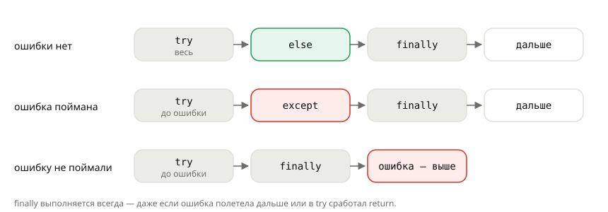

## Теория
Когда в программе происходит то, с чем она не может справиться, — строка не превращается в число, нужного ключа нет, делитель равен нулю, — Python **выбрасывает исключение**: создаёт объект ошибки и прерывает выполнение. Если исключение никто не обработал, программа падает с traceback. В backend так нельзя: одна кривая форма не должна ронять сервер, а пользователь должен получить понятный ответ вместо «500 Internal Server Error».

Исключения обрабатывают конструкцией `try / except`: код, который может упасть, — в `try`, реакция на ошибку — в `except`. Ловят **конкретные** типы ошибок, которые вы ожидаете и знаете, как обработать: `except ValueError`, а не всё подряд. Блок `else` выполняется, если ошибки не было, `finally` — всегда, даже если ошибка полетела дальше; в нём освобождают ресурсы: снимают резерв товара, закрывают соединение. Типы исключений образуют иерархию: `except LookupError` поймает и `KeyError`, и `IndexError`, а `except Exception` — почти всё, поэтому его используют осторожно.

## Наглядно
**Рисунок 1.** Какие блоки выполняются в трёх ситуациях: ошибки нет, ошибка поймана, ошибку не поймали. `finally` есть на всех трёх путях.



**Таблица 1.** Встроенные исключения, которые чаще всего встречаются в коде магазина.

| Исключение | Когда возникает | Пример |
|---|---|---|
| `ValueError` | тип подходит, значение — нет | `int("3 шт")` |
| `TypeError` | операция не подходит для типа | `1499 + "2"` |
| `KeyError` | нет ключа в словаре | `product["color"]` |
| `IndexError` | индекс за пределами | `cart[10]` |
| `AttributeError` | у объекта нет атрибута/метода | `None.upper()` |
| `ZeroDivisionError` | деление на ноль | `total / 0` |
| `LookupError` | общий предок `KeyError` и `IndexError` | `except LookupError` ловит оба |
| `Exception` | предок почти всех исключений | ловить — только осознанно |

## На практике
Задача: обработать количество и промокод из формы заказа так, чтобы кривой ввод давал понятное сообщение, а резерв товара снимался при любом исходе.

### Шаг 1. Видим, как ошибка прерывает программу
Строки после упавшей не выполняются:
```python
print("принимаем заказ")
qty = int("3 шт")
print("количество:", qty)
```
Результат:
```
принимаем заказ
ValueError: invalid literal for int() with base 10: '3 шт'
```

### Шаг 2. Перехватываем ошибку
Код, который может упасть, — в `try`; реакция — в `except` с конкретным типом:
```python
raw = "3 шт"
try:
    qty = int(raw)
except ValueError:
    qty = None
    print(f"«{raw}» — не количество")
print("продолжаем, qty =", qty)
```
Результат:
```
«3 шт» — не количество
продолжаем, qty = None
```

### Шаг 3. Получаем текст ошибки
`except ... as e` даёт сам объект исключения — его текст можно записать в лог или показать:
```python
try:
    qty = int("abc")
except ValueError as e:
    print(f"{type(e).__name__}: {e}")
```
Результат:
```
ValueError: invalid literal for int() with base 10: 'abc'
```

### Шаг 4. Обрабатываем разные ошибки по-разному
Средняя цена позиции: количество может быть не числом или нулём:
```python
def average_price(total, raw_qty):
    try:
        qty = int(raw_qty)
        return total / qty
    except ValueError:
        return "количество — не число"
    except ZeroDivisionError:
        return "количество не может быть нулём"

print(average_price(2998, "2"))
print(average_price(2998, "два"))
print(average_price(2998, "0"))
```
Результат:
```
1499.0
количество — не число
количество не может быть нулём
```

### Шаг 5. Ловим группу ошибок через предка
`KeyError` и `IndexError` — потомки `LookupError`, его `except` ловит обе:
```python
order = {"items": [{"name": "Мышь"}]}
for path in (("items", 0), ("items", 5), ("delivery", 0)):
    try:
        print(order[path[0]][path[1]]["name"])
    except LookupError as e:
        print("нет данных:", type(e).__name__)
```
Результат:
```
Мышь
нет данных: IndexError
нет данных: KeyError
```
Порядок `except` важен: проверяются сверху вниз, срабатывает первый подходящий. Поэтому конкретные типы пишут **выше** общих.

### Шаг 6. Отделяем удачный путь через else
В `try` оставляем только то, что может упасть; продолжение «если всё хорошо» — в `else`:
```python
raw = "2"
try:
    qty = int(raw)
except ValueError:
    print("неверное количество")
else:
    print(f"в корзину: {qty} шт., сумма {1499 * qty} ₽")
```
Результат:
```
в корзину: 2 шт., сумма 2998 ₽
```
Если бы расчёт суммы стоял в `try`, ошибка в нём (например, опечатка) молча попала бы в `except ValueError` и выдала бы неверное сообщение.

### Шаг 7. Освобождаем ресурсы в finally
Товар резервируется на время оплаты; резерв нужно снять при любом исходе. Функция оплаты сама выбрасывает ошибку при неверной сумме (как выбрасывать ошибки — в следующей теме):
```python
reserved = []

def pay(amount):
    if amount <= 0:
        raise ValueError("сумма оплаты должна быть положительной")
    return "оплачено"

def checkout(product_id, amount):
    reserved.append(product_id)
    try:
        return pay(amount)
    finally:
        reserved.remove(product_id)
        print("резерв снят:", product_id)

print(checkout(42, 1499))
try:
    checkout(7, 0)
except ValueError as e:
    print("ошибка:", e)
print(reserved)
```
Результат:
```
резерв снят: 42
оплачено
резерв снят: 7
ошибка: сумма оплаты должна быть положительной
[]
```
`finally` сработал и после `return`, и когда ошибка полетела дальше — резерв не «завис».

## Частые ошибки
- **Голый `except:` или `except Exception:` «на всё».** Прячет и ожидаемые ошибки, и баги: опечатка в имени (`NameError`) молча превращается в «неверный ввод». `except:` ловит даже `KeyboardInterrupt` (Ctrl+C).
- **Общий `except` выше конкретного.** `except Exception` перед `except ValueError` — до второго дело никогда не дойдёт.
- **Слишком большой `try`.** Чем больше кода в `try`, тем больше чужих ошибок попадёт в `except`. В `try` — только то, что может упасть ожидаемым образом; остальное — в `else`.
- **`except: pass`.** Ошибка исчезает бесследно, а программа продолжает работать с неверными данными. Минимум — записать в лог.
- **Освобождение ресурса без `finally`.** Если ошибка случится до строки освобождения, ресурс останется занятым.

## Итог
**Исключение**
- Объект ошибки, который прерывает выполнение; не пойман — программа падает с traceback.
- Типы образуют иерархию: `LookupError` → `KeyError`, `IndexError`; `Exception` — предок почти всех.

**Обработка**
- `try` — код, который может упасть; `except Тип as e` — реакция; несколько `except` — сверху вниз, конкретные выше общих.
- `else` — выполняется, если ошибки не было; `finally` — всегда, даже после `return` и при непойманной ошибке.

**Правила**
- Ловите конкретные ожидаемые типы, не всё подряд.
- В `try` — минимум кода.
- Ошибку не глотают молча: обрабатывают, логируют или пропускают дальше.

## Вопросы на собеседовании
<details><summary>Чем `else` отличается от `finally` в `try`?</summary>

`else` выполняется, только если в `try` не было исключения. `finally` выполняется всегда: и без ошибки, и после обработки, и когда исключение полетело дальше, и даже после `return` в `try`.
</details>

<details><summary>Почему нельзя писать голый `except:`?</summary>

Он ловит все исключения, включая `KeyboardInterrupt` и `SystemExit`, и прячет баги: опечатка или неожиданная ошибка обрабатывается как «ожидаемая». Нужно ловить конкретные типы, а если действительно нужно поймать «всё прикладное» — `except Exception` с логированием.
</details>

<details><summary>Что будет, если ни один `except` не подошёл?</summary>

Исключение полетит дальше — в вызывающую функцию, затем выше по стеку. `finally` при этом выполнится. Если исключение нигде не поймали, программа завершится с traceback (в веб-фреймворке — ответ 500).
</details>

<details><summary>Чем `ValueError` отличается от `TypeError`?</summary>

`TypeError` — операция не подходит для типа значения (`1499 + "2"`). `ValueError` — тип подходит, но значение недопустимо (`int("abc")`: строку в `int` передавать можно, но не эту).
</details>

## Глубже
Что делает `return` внутри `finally` с исключением и как Python связывает исключения в цепочки (`__context__`, `__cause__`) — в курсе «Python под капотом», тема «Исключения изнутри».
