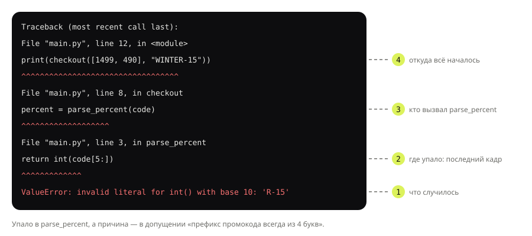

## Теория
Отладка — поиск причины, по которой программа ведёт себя не так, как задумано. Главное правило: **место, где программа упала, и место ошибки — не одно и то же**. Traceback показывает последнюю строку, которую Python не смог выполнить, но причина часто выше — в данных, которые туда передали, или в допущении, которое оказалось неверным. Поэтому отладка — это не «поправить строку из traceback», а цепочка: воспроизвести ошибку → прочитать traceback → выдвинуть гипотезу → проверить её, посмотрев на значения → исправить причину → убедиться, что ошибка ушла.

Смотреть на значения можно тремя способами. **Отладочный вывод** — `print(f"{code=}")` печатает имя и значение переменной; быстро, но его нужно не забыть удалить. **`assert`** — проверка своих допущений прямо в коде: если условие ложно, программа падает с понятным сообщением. И **отладчик** `pdb`: `breakpoint()` останавливает программу в нужной строке, а дальше можно смотреть переменные и выполнять код по шагам. В тренажёре отладчика нет, но в терминале и в IDE (кнопка Debug в PyCharm и VS Code — графическая обёртка над тем же механизмом) это основной инструмент.

## Наглядно
**Рисунок 1.** Traceback цепочки вызовов. Читаем снизу вверх: что случилось, где упало (последний кадр), кто вызвал эту функцию и откуда всё началось.



**Таблица 1.** Инструменты отладки и когда какой брать.

| Инструмент | Как | Когда | Помнить |
|---|---|---|---|
| traceback | читать снизу вверх | всегда, первым делом | место падения ≠ место причины |
| отладочный вывод | `print(f"{code=}")` | быстро проверить значение | удалить перед коммитом |
| `assert` | `assert 0 < percent <= 90, "сообщение"` | проверить своё допущение | отключается флагом `-O` — не для проверки ввода |
| отладчик | `breakpoint()`, команды `p`, `n`, `s`, `w`, `c`, `q` | сложная логика, много переменных | в тренажёре нет — локально или в IDE |

**Таблица 2.** Основные команды отладчика `pdb`.

| Команда | Что делает |
|---|---|
| `p выражение` | вывести значение (`p code`, `p code[5:]`) |
| `n` | выполнить текущую строку, не заходя в вызовы |
| `s` | выполнить строку, заходя внутрь вызываемой функции |
| `w` | показать стек вызовов — где мы и кто нас вызвал |
| `c` | продолжить до следующей точки остановки |
| `q` | выйти из отладчика (программа прерывается) |

## На практике
Задача: промокоды вида `SALE-10` работали, а промокод `WINTER-15` роняет оформление заказа. Найдём и исправим причину.

### Шаг 1. Воспроизводим и читаем traceback
Код оформления заказа с проблемным промокодом:
```python
def parse_percent(code):
    """Скидка из промокода: SALE-10 → 10."""
    return int(code[5:])


def checkout(cart, code):
    total = sum(cart)
    percent = parse_percent(code)
    return total * (100 - percent) // 100


print(checkout([1499, 490], "WINTER-15"))
```
Результат:
```
Traceback (most recent call last):
  File "main.py", line 12, in <module>
    print(checkout([1499, 490], "WINTER-15"))
          ^^^^^^^^^^^^^^^^^^^^^^^^^^^^^^^^^^
  File "main.py", line 8, in checkout
    percent = parse_percent(code)
              ^^^^^^^^^^^^^^^^^^^
  File "main.py", line 3, in parse_percent
    return int(code[5:])
           ^^^^^^^^^^^^^
ValueError: invalid literal for int() with base 10: 'R-15'
```
Снизу вверх (рисунок 1): `int()` получил `'R-15'` вместо числа; упало в `parse_percent` на строке 3; её вызвала `checkout`, а ту — основной код.

### Шаг 2. Смотрим на значения
Гипотеза: срез `code[5:]` берёт не то. Проверим отладочным выводом — `=` в f-строке печатает и выражение, и значение:
```python
code = "WINTER-15"
print(f"{code=} {code[5:]=}")
code = "SALE-10"
print(f"{code=} {code[5:]=}")
```
Результат:
```
code='WINTER-15' code[5:]='R-15'
code='SALE-10' code[5:]='10'
```
Причина найдена: функция «знает», что префикс промокода всегда из четырёх букв. Строка 3 только выполнила это неверное допущение.

### Шаг 3. Исправляем причину, а не симптом
Берём часть после дефиса, какой бы длины ни был префикс:
```python
def parse_percent(code):
    """Скидка из промокода: <ПРЕФИКС>-<процент> → процент."""
    prefix, percent = code.split("-")
    return int(percent)

print(checkout([1499, 490], "WINTER-15"), checkout([1499, 490], "SALE-10"))
```
Результат:
```
1690 1790
```
«Починить» симптом (`try/except` вокруг `int` с нулевой скидкой) было бы хуже: промокод `WINTER-15` молча перестал бы давать скидку.

### Шаг 4. Проверяем допущения через assert
Скидка магазина по правилам — от 1 до 90 %. Если промокод когда-нибудь даст больше, лучше узнать сразу:
```python
def checkout(cart, code):
    total = sum(cart)
    percent = parse_percent(code)
    assert 1 <= percent <= 90, f"скидка вне допустимого диапазона: {percent}"
    return total * (100 - percent) // 100

checkout([1499], "MEGA-95")
```
Результат:
```
AssertionError: скидка вне допустимого диапазона: 95
```
`assert` — проверка **своих** допущений о коде. Python с флагом `-O` полностью убирает `assert`, поэтому проверять ими ввод пользователя нельзя — для этого `raise ValueError`.

### Шаг 5. Останавливаемся отладчиком
В терминале или IDE можно не печатать значения, а остановить программу перед проблемной строкой. Добавляем `breakpoint()` в первую версию `parse_percent`:
```python
def parse_percent(code):
    """Скидка из промокода: SALE-10 → 10."""
    breakpoint()
    return int(code[5:])
```
Запускаем `python main.py` в терминале и вводим команды после приглашения `(Pdb)`:
```text
> main.py(4)parse_percent()
-> return int(code[5:])
(Pdb) p code
'WINTER-15'
(Pdb) p code[5:]
'R-15'
(Pdb) w
  main.py(13)<module>()
-> print(checkout([1499, 490], "WINTER-15"))
  main.py(9)checkout()
-> percent = parse_percent(code)
> main.py(4)parse_percent()
-> return int(code[5:])
```
Программа стоит на строке 4 и ждёт команд: `p` показывает значения, `w` — стек вызовов (тот же, что в traceback, но до падения). В тренажёре `breakpoint()` не работает — это инструмент для локального запуска.

### Шаг 6. Убираем отладочный код
Перед коммитом удаляем `print` для отладки и `breakpoint()`: забытый `breakpoint()` на сервере остановит обработку запроса и будет ждать ввода, которого никогда не будет. Найти их помогает поиск по проекту и линтеры (тема «Стиль кода»).

## Частые ошибки
- **Исправление строки из traceback вместо причины.** Последний кадр — где упало; причина часто в данных или допущении выше.
- **`try/except` вместо исправления.** Ошибка исчезает, а неправильное поведение остаётся — и становится невидимым.
- **`assert` для проверки ввода.** С `python -O` проверка исчезнет. Для ввода — `raise ValueError`.
- **Забытый отладочный код.** `print` засоряет вывод и логи, `breakpoint()` подвешивает сервер.
- **Отладка без воспроизведения.** Пока ошибка не повторяется стабильно, нельзя проверить, что исправление сработало.

## Итог
**Процесс**
- Воспроизвести → прочитать traceback → гипотеза → посмотреть значения → исправить причину → проверить.
- Место падения и место причины — разные вещи.

**Traceback**
- Снизу вверх: тип и сообщение, последний кадр (где упало), вызывающие функции.

**Инструменты**
- `print(f"{x=}")` — быстрый взгляд на значение.
- `assert условие, "сообщение"` — проверка своих допущений; отключается `-O`.
- `breakpoint()` и `pdb`: `p`, `n`, `s`, `w`, `c`, `q`; в IDE — то же самое кнопкой Debug.
- Отладочный код удаляют перед коммитом.

## Вопросы на собеседовании
<details><summary>Как читать traceback?</summary>

Снизу вверх: последняя строка — тип исключения и сообщение; над ней — кадр, где возникла ошибка (файл, строка, функция); выше — цепочка вызовов, которая к нему привела. Причину ищут, начиная с последнего кадра и поднимаясь вверх по данным, которые туда передали.
</details>

<details><summary>Почему нельзя использовать `assert` для проверки входных данных?</summary>

Python, запущенный с флагом `-O` (оптимизация), удаляет все `assert` из кода. Проверка, на которую полагается безопасность или корректность обработки ввода, просто исчезнет. `assert` — для внутренних инвариантов, ввод проверяют явным `if` + `raise`.
</details>

<details><summary>Чем отладчик лучше `print`?</summary>

Отладчик останавливает программу и позволяет смотреть любые переменные, выполнять код по шагам и видеть стек вызовов без изменения кода и перезапуска. `print` быстрее для одной-двух переменных, но требует правок и уборки, а каждое новое предположение — нового запуска.
</details>
