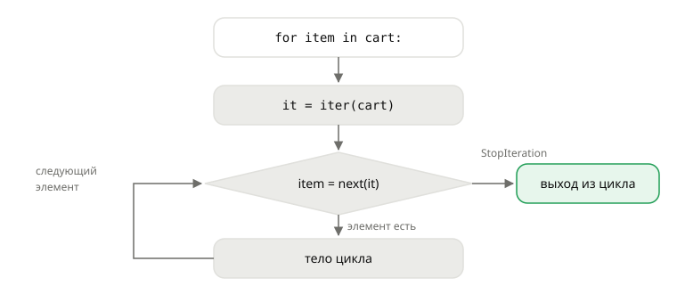

## Теория
Цикл `for` умеет перебирать списки, строки, словари, `range`, результаты `zip` и `map` — всё это **итерируемые** объекты. Перебор устроен одинаково: из итерируемого объекта функция `iter()` получает **итератор** — «указатель», который помнит текущую позицию и по запросу `next()` выдаёт следующий элемент. Когда элементы кончаются, `next()` выбрасывает `StopIteration`, и `for` понимает, что цикл закончен. Сам `for` делает именно это, просто незаметно.

Различие между итерируемым объектом и итератором важно на практике. Список можно перебирать сколько угодно раз: каждый `for` берёт у него новый итератор. А итератор — **одноразовый**: пройдя его до конца, второй раз ничего не получишь. `zip`, `map`, `filter`, `enumerate`, `reversed` и генераторы возвращают именно итераторы. Если такой результат передать в функцию, которая перебирает данные дважды (посчитать сумму, а потом количество), второй проход окажется пустым — без всякой ошибки.

## Наглядно
**Рисунок 1.** Что делает `for` под капотом: получает итератор через `iter()` и вызывает `next()`, пока не поймает `StopIteration`.



**Таблица 1.** Итерируемые объекты и итераторы.

| | Итерируемый объект | Итератор |
|---|---|---|
| Примеры | `list`, `tuple`, `str`, `dict`, `set`, `range` | результат `iter(...)`, `zip`, `map`, `filter`, `enumerate`, `reversed`, генератор |
| Можно перебрать | сколько угодно раз | **один раз** |
| `next(x)` | `TypeError` | следующий элемент или `StopIteration` |
| `len(x)` | обычно есть | нет |
| Хранит элементы | да (кроме `range`) | нет — выдаёт по одному |

## На практике
Задача: разобраться, почему отчёт по ценам иногда считает среднее как деление на ноль, и научиться брать «первый подходящий» заказ.

### Шаг 1. Получаем итератор и берём элементы
`iter()` даёт итератор списка, `next()` — следующий элемент:
```python
cart = ["мышь", "коврик"]
it = iter(cart)
print(next(it))
print(next(it))
next(it)
```
Результат:
```
мышь
коврик
StopIteration
```

### Шаг 2. Повторяем руками то, что делает for
Цикл `for item in cart` — это примерно такой код (рисунок 1):
```python
it = iter(cart)
while True:
    try:
        item = next(it)
    except StopIteration:
        break
    print("в корзине:", item)
```
Результат:
```
в корзине: мышь
в корзине: коврик
```

### Шаг 3. Различаем итерируемый объект и итератор
Список перебирается снова и снова, а итератор — только один раз:
```python
prices = [1499, 490, 390]
print(sum(prices), sum(prices))

prices_it = iter(prices)
print(sum(prices_it), sum(prices_it))
```
Результат:
```
2379 2379
2379 0
```
Второй `sum` по итератору получил пустой поток — итератор уже на конце.

### Шаг 4. Узнаём одноразовые результаты встроенных функций
`zip`, `map` и `enumerate` возвращают итераторы — и тоже исчерпываются:
```python
names = ["Мышь", "Коврик"]
pairs = zip(names, prices)
print(list(pairs))
print(list(pairs))
print(type(pairs), type(map(str, prices)))
```
Результат:
```
[('Мышь', 1499), ('Коврик', 490)]
[]
<class 'zip'> <class 'map'>
```
Если результат нужен несколько раз — сразу превращайте его в список: `pairs = list(zip(...))`.

### Шаг 5. Берём первый подходящий элемент
Генераторное выражение — это comprehension в круглых скобках: `(x for x in data if ...)`. Оно не строит список, а выдаёт элементы по одному, то есть это итератор. `next()` берёт из него первый подходящий элемент и не перебирает остальные. Второй аргумент — значение, если подходящих нет:
```python
orders = [(1042, "new"), (1043, "paid"), (1044, "paid")]
first_paid = next((order_id for order_id, status in orders if status == "paid"), None)
first_cancelled = next((order_id for order_id, status in orders if status == "cancelled"), None)
print(first_paid, first_cancelled)
```
Результат:
```
1043 None
```
Без второго аргумента `next()` на пустом потоке выбросил бы `StopIteration`. Подробнее о генераторных выражениях — в теме «Ленивые конвейеры».

## Частые ошибки
- **Повторный проход по итератору.** `zip`, `map`, `filter`, генераторы перебираются один раз; второй проход пуст и **не даёт ошибки**. Нужны данные дважды — `list(...)`.
- **`next()` без значения по умолчанию.** На пустом потоке — `StopIteration`. Для «первого подходящего или ничего» — `next(gen, None)`.
- **`len()` у итератора.** `TypeError: object of type ... has no len()` — итератор не знает своей длины. Считают проходом: `sum(1 for _ in it)`.
- **`next()` у списка.** `TypeError: 'list' object is not an iterator` — сначала `iter(lst)`.

## Итог
**Понятия**
- Итерируемый объект — то, что можно перебрать (`list`, `str`, `dict`, `range`…).
- Итератор — одноразовый «указатель»: `next()` выдаёт следующий элемент, в конце — `StopIteration`.
- `for` = `iter()` + `next()` до `StopIteration`.

**Одноразовость**
- `zip`, `map`, `filter`, `enumerate`, `reversed`, генераторы — итераторы: проход один.
- Нужно несколько проходов — сохраните в `list`.

**Приёмы**
- `next(gen, default)` — первый подходящий элемент или значение по умолчанию.

## Вопросы на собеседовании
<details><summary>Чем итерируемый объект отличается от итератора?</summary>

Итерируемый объект умеет выдавать итератор (`iter(x)`), его можно перебирать многократно. Итератор хранит позицию и выдаёт элементы через `next()`; он одноразовый. Итератор сам тоже итерируемый — `iter(it)` возвращает его же.
</details>

<details><summary>Что делает цикл `for` с объектом?</summary>

Вызывает `iter()` и получает итератор, затем вызывает у него `next()` на каждой итерации, пока не будет выброшено `StopIteration`, — тогда цикл заканчивается.
</details>

<details><summary>Почему второй `list(zip(a, b))` по тому же объекту возвращает пустой список?</summary>

`zip` возвращает итератор, а первый `list()` прошёл его до конца. Итератор не перематывается, и следующий проход сразу получает `StopIteration`.
</details>

## Глубже
Свой класс-итератор с `__iter__` и `__next__` пишем в теме «Магические методы» раздела «ООП». Как устроен протокол итерации (`__iter__` и `__next__`) и почему второй `for` по генератору ничего не выводит — в курсе «Python под капотом», тема «Как работает for».
