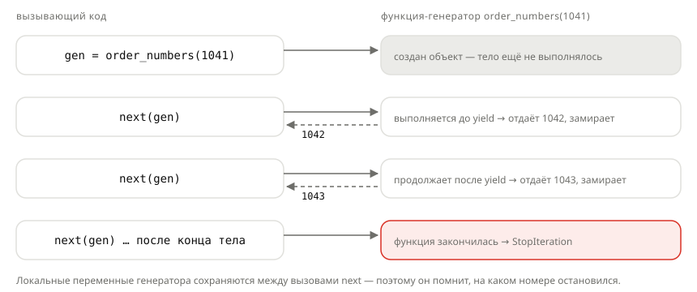

## Теория
Генератор — самый простой способ сделать свой итератор. Это обычная функция, в которой вместо (или вместе с) `return` стоит `yield`. Вызов такой функции **не выполняет её тело**, а возвращает объект-генератор. Тело начинает выполняться только при первом `next()` — до ближайшего `yield`: значение отдаётся наружу, а функция **замирает** со всеми своими переменными. Следующий `next()` продолжает работу с того же места. Когда тело заканчивается, генератор выбрасывает `StopIteration`, и `for` спокойно завершается.

Генераторы ленивые: они вычисляют следующее значение только тогда, когда его попросили, и не держат в памяти всю последовательность. Поэтому на них строят постраничную выдачу каталога, построчную обработку больших выгрузок, потоковую отдачу ответа сервера и даже бесконечные последовательности — например, номера заказов. Обратная сторона ленивости: код внутри генератора выполняется позже, чем его вызвали, — и ошибки в нём тоже появляются позже.

## Наглядно
**Рисунок 1.** Как работает генератор: при создании тело не выполняется; каждый `next()` выполняет его до следующего `yield` и замораживает; конец тела — `StopIteration`.



**Таблица 1.** `return` и `yield`.

| | `return` | `yield` |
|---|---|---|
| Что делает с функцией | завершает | приостанавливает, сохраняя переменные |
| Сколько значений отдаёт | одно | сколько угодно — по одному за `next()` |
| Что возвращает вызов функции | значение | объект-генератор (тело ещё не выполнялось) |
| Память | весь результат сразу (например, список) | одно значение за раз |

## На практике
Задача: выдавать номера заказов, отдавать каталог страницами и собирать товары из нескольких категорий — без построения больших списков.

### Шаг 1. Пишем функцию-генератор
Номера заказов, начиная со следующего после `start`. `print` внутри показывает, когда тело действительно выполняется:
```python
def order_numbers(start, count):
    print("генератор начал работу")
    current = start
    for _ in range(count):
        current += 1
        yield current
    print("генератор закончил")

gen = order_numbers(1041, 3)
print(type(gen))
```
Результат:
```
<class 'generator'>
```
Вызов функции ничего не напечатал: тело пока не выполнялось.

### Шаг 2. Запрашиваем значения
Каждый `next()` выполняет тело до следующего `yield` (рисунок 1):
```python
print(next(gen))
print(next(gen))
```
Результат:
```
генератор начал работу
1042
1043
```

### Шаг 3. Перебираем остаток в цикле
`for` берёт оставшиеся значения и сам обрабатывает `StopIteration`:
```python
for number in gen:
    print("номер", number)
```
Результат:
```
номер 1044
генератор закончил
```
Цикл продолжил с того места, где остановились: генератор помнит своё состояние.

### Шаг 4. Убеждаемся, что генератор одноразовый
Повторный проход по закончившемуся генератору ничего не даёт:
```python
print(list(gen))
print(list(order_numbers(1041, 2)))
```
Результат:
```
[]
генератор начал работу
генератор закончил
[1042, 1043]
```
Нужен новый проход — вызовите функцию заново: получится новый генератор.

### Шаг 5. Отдаём каталог страницами
Генератор страниц: каждая страница — срез списка товаров:
```python
def paginate(items, page_size):
    for start in range(0, len(items), page_size):
        yield items[start:start + page_size]

products = ["Мышь", "Клавиатура", "Коврик", "Кабель", "Монитор"]
for page_number, page in enumerate(paginate(products, 2), start=1):
    print(page_number, page)
```
Результат:
```
1 ['Мышь', 'Клавиатура']
2 ['Коврик', 'Кабель']
3 ['Монитор']
```
`range(0, len(items), page_size)` даёт начала страниц `0, 2, 4` — последняя неполная страница тоже попадает в выдачу.

### Шаг 6. Передаём значения из другого генератора
`yield from` отдаёт все значения вложенного итерируемого объекта — удобно, когда товары лежат по категориям:
```python
catalog = {"Периферия": ["Мышь", "Клавиатура"], "Аксессуары": ["Коврик"]}

def all_products(catalog):
    for category, items in catalog.items():
        yield from items

print(list(all_products(catalog)))
```
Результат:
```
['Мышь', 'Клавиатура', 'Коврик']
```
`yield from items` — то же, что `for item in items: yield item`.

### Шаг 7. Делаем бесконечный генератор
Генератор не обязан заканчиваться — значения считаются, пока их просят:
```python
def numbering(start):
    while True:
        start += 1
        yield start

numbers = numbering(5000)
print([next(numbers) for _ in range(3)])
print(next(numbers))
```
Результат:
```
[5001, 5002, 5003]
5004
```
`list(numbering(5000))` здесь зависнет навсегда: бесконечный генератор перебирают только с ограничением.

## Частые ошибки
- **`return` вместо `yield` в цикле.** Функция вернёт первое значение и завершится — это обычная функция, а не генератор.
- **Ожидание, что код выполнится при вызове.** Тело генератора — проверки, `print`, ошибки — выполняется только при первом `next()` или в цикле.
- **Повторный проход.** Генератор одноразовый; для нового прохода вызывают функцию заново.
- **`list()` от бесконечного генератора.** Программа зависнет. Берите ограниченное число значений: `next()` в цикле, `itertools.islice`.
- **Потерянная последняя страница.** `range(0, len(items) - page_size, page_size)` теряет хвост; конец диапазона — `len(items)`.

## Итог
**Генератор**
- Функция с `yield`; вызов возвращает генератор, тело ещё не выполняется.
- `next()` выполняет тело до `yield`, отдаёт значение и замораживает функцию с переменными.
- Конец тела — `StopIteration`; `for` обрабатывает его сам.

**Свойства**
- Ленивый: значения считаются по запросу, в памяти — одно за раз.
- Одноразовый: для нового прохода — новый вызов функции.
- Может быть бесконечным — перебирают с ограничением.

**Приёмы**
- Пагинация: `yield items[start:start + size]` для `start` из `range(0, len(items), size)`.
- `yield from другой` — отдать все значения вложенного итерируемого объекта.

## Вопросы на собеседовании
<details><summary>Чем `yield` отличается от `return`?</summary>

`return` завершает функцию и возвращает одно значение. `yield` отдаёт значение и приостанавливает функцию, сохраняя её состояние; при следующем `next()` выполнение продолжается после `yield`. Функция с `yield` при вызове возвращает генератор, а не результат.
</details>

<details><summary>Когда выполняется код внутри генератора?</summary>

Не при вызове функции, а при первом запросе значения — `next()`, цикл `for`, `list()`. Поэтому ошибки и проверки внутри генератора срабатывают позже, чем его создали.
</details>

<details><summary>Зачем генераторы в backend?</summary>

Чтобы обрабатывать большие объёмы данных, не загружая их в память целиком: построчное чтение выгрузок, постраничная выборка из БД (`QuerySet.iterator()` в Django), потоковая отдача файла или CSV клиенту (`StreamingHttpResponse`).
</details>

## Глубже
Как генератор хранит своё состояние между вызовами и что делают `send`, `throw` и `close` — в курсе «Python под капотом», тема «Генератор изнутри».
