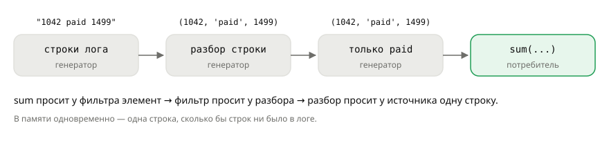

## Теория
Обработка данных часто выглядит как конвейер: взять строки выгрузки → разобрать каждую → оставить нужные → посчитать итог. Если на каждом шаге строить список, в памяти окажутся все промежуточные результаты целиком — а выгрузка заказов за год может весить гигабайты. Если каждый шаг сделать генератором, данные пойдут по конвейеру **по одному элементу**: итоговая функция просит следующий элемент, запрос проходит по цепочке до источника, и в памяти одновременно живёт одна строка.

Для коротких шагов не нужно писать функции с `yield` — хватает **генераторного выражения**: это comprehension в круглых скобках, `(x for x in data if ...)`. Если оно единственный аргумент функции, вторые скобки не нужны: `sum(p for p in prices)`. Готовые «детали» конвейера лежат в модуле `itertools`: `islice` берёт первые N элементов (даже из бесконечного потока), `chain` склеивает несколько источников, `groupby` группирует подряд идущие элементы. У ленивости та же цена, что у генераторов: поток одноразовый, у него нет длины и индексов.

## Наглядно
**Рисунок 1.** Ленивый конвейер обработки лога: итоговая `sum` запрашивает элемент, запрос идёт по цепочке к источнику, и каждая строка проходит все шаги по одной.



**Таблица 1.** Инструменты для конвейеров.

| Инструмент | Что делает | Пример |
|---|---|---|
| `(x for x in data)` | ленивая версия comprehension | `(p["price"] for p in products)` |
| `itertools.islice(it, n)` | первые `n` элементов | первые 10 строк лога |
| `itertools.islice(it, start, stop)` | элементы с `start` по `stop - 1` | вторая страница выдачи |
| `itertools.chain(a, b)` | сначала все из `a`, потом все из `b` | заказы сайта + маркетплейса |
| `itertools.groupby(it, key)` | группы **подряд идущих** элементов с одинаковым ключом | выручка по статусам (после сортировки) |

**Таблица 2.** Когда список, а когда ленивый поток.

| Нужно | Выбор |
|---|---|
| пройти один раз, данных много или они бесконечны | генератор / генераторное выражение |
| пройти несколько раз, узнать длину, обратиться по индексу | список |
| отдать результат в JSON, шаблон, тест | список |

## На практике
Задача: посчитать выручку по выгрузке заказов, не загружая её целиком, взять первые записи, объединить два источника и сгруппировать заказы по статусам.

### Шаг 1. Сравниваем список и генераторное выражение
Генераторное выражение не хранит элементы, поэтому занимает меньше памяти, сколько бы элементов ни было:
```python
import sys

prices = list(range(1000, 101000))
squares_list = [p * 2 for p in prices]
squares_gen = (p * 2 for p in prices)
print(sys.getsizeof(squares_gen) < sys.getsizeof(squares_list))
print(sum(p * 2 for p in prices) == sum(squares_list))
```
Результат:
```
True
True
```
Во второй строке генераторное выражение — единственный аргумент `sum`, поэтому вторые скобки не нужны.

### Шаг 2. Собираем конвейер
Источник — генератор строк выгрузки (в реальности — строки файла или записи из БД). Каждый шаг — генератор:
```python
def log_lines():
    yield "1042 paid 1499"
    yield "1043 cancelled 5990"
    yield "1044 paid 490"

def parse(lines):
    for line in lines:
        order_id, status, total = line.split()
        yield int(order_id), status, int(total)

paid = (total for order_id, status, total in parse(log_lines()) if status == "paid")
print(sum(paid))
```
Результат:
```
1989
```

### Шаг 3. Видим, что данные идут по одному
Добавим вывод в источник и в разбор — шаги чередуются, а не выполняются «сначала всё одно, потом всё другое»:
```python
def log_lines_traced():
    for line in ("1042 paid 1499", "1044 paid 490"):
        print("читаю:", line)
        yield line

def parse_traced(lines):
    for line in lines:
        order_id, status, total = line.split()
        print("  разобрал:", order_id)
        yield int(order_id), status, int(total)

print(sum(total for _, _, total in parse_traced(log_lines_traced())))
```
Результат:
```
читаю: 1042 paid 1499
  разобрал: 1042
читаю: 1044 paid 490
  разобрал: 1044
1989
```

### Шаг 4. Берём первые элементы через islice
`islice` останавливает перебор, как только набрано нужное число, — работает и с бесконечными потоками:
```python
from itertools import islice

def numbering(start):
    while True:
        start += 1
        yield start

print(list(islice(numbering(1041), 3)))
print(list(islice(log_lines(), 1, 3)))
```
Результат:
```
[1042, 1043, 1044]
['1043 cancelled 5990', '1044 paid 490']
```

### Шаг 5. Склеиваем источники через chain
Заказы сайта и маркетплейса приходят разными генераторами. `+` для генераторов не работает, `chain` — работает:
```python
from itertools import chain

def site_orders():
    yield 1042
    yield 1043

def market_orders():
    yield 9001

print(list(chain(site_orders(), market_orders())))
site_orders() + market_orders()
```
Результат:
```
[1042, 1043, 9001]
TypeError: unsupported operand type(s) for +: 'generator' and 'generator'
```

### Шаг 6. Группируем через groupby
`groupby` объединяет **соседние** элементы с одинаковым ключом. Поэтому сначала сортируем по тому же ключу:
```python
from itertools import groupby

orders = [("paid", 1499), ("new", 5990), ("paid", 490)]

def status_of(order):
    return order[0]

for status, group in groupby(orders, key=status_of):
    print("без сортировки:", status, sum(total for _, total in group))

for status, group in groupby(sorted(orders, key=status_of), key=status_of):
    print("с сортировкой:", status, sum(total for _, total in group))
```
Результат:
```
без сортировки: paid 1499
без сортировки: new 5990
без сортировки: paid 490
с сортировкой: new 5990
с сортировкой: paid 1989
```
Без сортировки «paid» встретился двумя группами — выручка разбилась. Для простой группировки без сортировки часто проще словарь: `totals[status] = totals.get(status, 0) + total`.

## Частые ошибки
- **`len()` у генератора.** `TypeError: object of type 'generator' has no len()`. Количество считают проходом — `sum(1 for _ in gen)` — или работают со списком.
- **`groupby` без сортировки.** Одинаковые ключи, стоящие не подряд, дают несколько групп. Сначала `sorted(..., key=...)` по тому же ключу.
- **`+` для генераторов.** `TypeError`; объединяют через `itertools.chain`.
- **Повторный проход по конвейеру.** Любой шаг-генератор одноразовый: второй `sum` по тому же потоку даст `0`.
- **Лишний `list()` в середине.** `list(...)` на промежуточном шаге загружает в память всё, ради чего конвейер и строился ленивым.

## Итог
**Генераторное выражение**
- `(x for x in data if ...)` — ленивый comprehension; как единственный аргумент — без лишних скобок: `sum(x for x in data)`.

**Конвейер**
- Шаги — генераторы, соединённые друг с другом; итоговая функция (`sum`, `for`, `list`) тянет данные по одному.
- В памяти — один элемент за раз, независимо от объёма данных.

**itertools**
- `islice(it, n)` / `islice(it, start, stop)` — срез потока, в том числе бесконечного.
- `chain(a, b)` — склеить источники.
- `groupby(it, key)` — только подряд идущие; перед ним — `sorted` по тому же ключу.

**Ограничения**
- Нет `len()` и индексов, проход один. Нужны они — список.

## Вопросы на собеседовании
<details><summary>Чем генераторное выражение отличается от list comprehension?</summary>

List comprehension сразу строит весь список в памяти. Генераторное выражение возвращает генератор, который вычисляет элементы по одному по запросу. Оно экономит память, но перебирается один раз и не поддерживает `len()` и индексы.
</details>

<details><summary>Почему `itertools.groupby` иногда даёт несколько групп с одним ключом?</summary>

Он группирует только **подряд идущие** элементы с одинаковым ключом — это позволяет ему работать лениво, не просматривая поток целиком. Если одинаковые ключи разбросаны, их нужно сначала отсортировать по тому же ключу.
</details>

<details><summary>Как обработать файл в несколько гигабайт, не загружая его в память?</summary>

Перебирать его построчно (файловый объект сам является итератором строк) и строить обработку конвейером генераторов: разбор → фильтр → агрегат. Тогда в памяти одновременно одна строка. Похожим образом работают `QuerySet.iterator()` в Django и потоковые ответы сервера.
</details>
