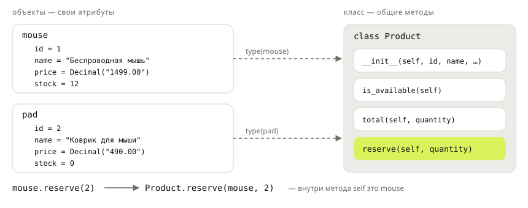

## Теория
До сих пор товар был словарём, а работа с ним — отдельными функциями: `{"name": "Мышь", "price": ...}` и `reserve(product, 2)`. Пока функций три, так удобно. Когда их тридцать, начинаются проблемы. Опечатку в ключе (`product["prise"]`) замечаешь только при запуске. Нигде не записано, какие ключи обязательны. Функции для товара разбросаны по модулям. **Класс** решает это: он описывает, из каких данных состоит товар и что с ним можно делать. Данные и поведение лежат в одном месте.

Класс — это описание, а **объект** (экземпляр) — конкретный товар, созданный по этому описанию: `Product(1, "Мышь", ...)`. Данные объекта — **атрибуты** (`mouse.price`), функции внутри класса — **методы** (`mouse.reserve(2)`). При создании объекта Python вызывает метод `__init__`: он заполняет атрибуты. Первый параметр каждого метода — `self`, сам объект, у которого метод вызвали. Запись `mouse.reserve(2)` Python выполняет как `Product.reserve(mouse, 2)`. Поэтому внутри метода данные объекта доступны только через `self.`: просто `price` — это обычная локальная переменная.

## Наглядно
**Рисунок 1.** Два объекта одного класса: у каждого свои атрибуты, а методы общие и лежат в классе. При вызове `mouse.reserve(2)` объект `mouse` передаётся в метод как `self`.



**Таблица 1.** Товар словарём и товар объектом.

| | Словарь | Объект класса |
|---|---|---|
| Создание | `{"id": 1, "name": "Мышь", ...}` | `Product(1, "Мышь", ...)` |
| Обязательные поля | нигде не записаны | параметры `__init__`: забыть нельзя |
| Чтение поля | `product["price"]` | `product.price` |
| Опечатка в поле | `KeyError` при запуске | `AttributeError` при запуске + подсказка в редакторе |
| Поведение | отдельные функции `reserve(product, 2)` | методы `product.reserve(2)` |
| Сравнение `==` | по содержимому | по умолчанию — тот ли это объект (тема «Магические методы») |

## На практике
Задача: описать товар магазина классом `Product`. У товара есть `id`, название, цена и остаток на складе. Товар можно зарезервировать под заказ.

### Шаг 1. Описываем класс и создаём объекты
`__init__` получает данные товара и сохраняет их в атрибуты объекта через `self.`:
```python
from decimal import Decimal


class Product:
    def __init__(self, id, name, price, stock):
        self.id = id
        self.name = name
        self.price = price
        self.stock = stock


mouse = Product(1, "Беспроводная мышь", Decimal("1499.00"), 12)
pad = Product(2, "Коврик для мыши", Decimal("490.00"), 0)
print(mouse.name, mouse.price, mouse.stock)
print(pad.name, pad.stock)
```
Результат:
```
Беспроводная мышь 1499.00 12
Коврик для мыши 0
```
`self` при вызове не передают: `Product(1, ...)` создаёт пустой объект и вызывает `__init__(новый_объект, 1, ...)`. Имя `id` совпадает со встроенной функцией `id()`. Внутри `__init__` это не мешает, а атрибут `self.id` с ней вообще не пересекается — поэтому поле называют так же, как колонку в БД.

### Шаг 2. Добавляем методы
Метод — это функция внутри класса. Данные объекта он берёт через `self`:
```python
class Product:
    def __init__(self, id, name, price, stock):
        self.id = id
        self.name = name
        self.price = price
        self.stock = stock

    def is_available(self):
        return self.stock > 0

    def total(self, quantity):
        return self.price * quantity


mouse = Product(1, "Беспроводная мышь", Decimal("1499.00"), 12)
pad = Product(2, "Коврик для мыши", Decimal("490.00"), 0)
print(mouse.is_available(), pad.is_available())
print(mouse.total(3))
```
Результат:
```
True False
4497.00
```

### Шаг 3. Меняем состояние объекта
Метод может менять атрибуты объекта. Резерв уменьшает остаток, а если товара не хватает, выбрасывает ошибку:
```python
class Product:
    def __init__(self, id, name, price, stock):
        self.id = id
        self.name = name
        self.price = price
        self.stock = stock

    def reserve(self, quantity):
        if quantity > self.stock:
            raise ValueError(f"{self.name}: на складе {self.stock}, просят {quantity}")
        self.stock -= quantity


mouse = Product(1, "Беспроводная мышь", Decimal("1499.00"), 12)
mouse.reserve(2)
print(mouse.stock)
mouse.reserve(20)
```
Результат:
```
10
ValueError: Беспроводная мышь: на складе 10, просят 20
```

### Шаг 4. Убеждаемся, что объекты независимы
У каждого объекта свои атрибуты: резерв одного товара не трогает другой. Метод при этом один на всех — он лежит в классе (рисунок 1):
```python
keyboard = Product(3, "Клавиатура", Decimal("2990.00"), 5)
mouse.reserve(1)
print(mouse.stock, keyboard.stock)
print(isinstance(mouse, Product), type(keyboard).__name__)
```
Результат:
```
9 5
True Product
```

### Шаг 5. Смотрим, что такое self
`mouse.reserve(1)` — это короткая запись вызова метода класса, где первым аргументом идёт объект:
```python
Product.reserve(keyboard, 2)
print(keyboard.stock)
```
Результат:
```
3
```
Именно поэтому `self` стоит первым параметром каждого метода: через него метод узнаёт, с каким объектом работает.

## Частые ошибки
- **Забыли `self` в параметрах метода.** `def is_available():` — при вызове `mouse.is_available()` Python всё равно передаёт объект, и получается `TypeError: Product.is_available() takes 0 positional arguments but 1 was given`.
- **Забыли `self.` внутри метода.** `return name` вместо `return self.name` — `NameError: name 'name' is not defined`. А присваивание `stock = 0` без `self.` даже не даёт ошибки: создаётся локальная переменная метода, объект не меняется.
- **Вызвали метод без скобок.** `if product.is_available:` — это сам метод, а не результат вызова. Метод всегда истинен, поэтому условие выполняется для любого товара.
- **Обратились к атрибуту, которого нет.** Опечатка `mouse.prise` — `AttributeError: 'Product' object has no attribute 'prise'`. Все атрибуты задаём в `__init__`, чтобы у каждого объекта был полный набор.
- **Ждали, что `==` сравнит данные.** Два объекта с одинаковыми полями не равны: по умолчанию `==` проверяет, тот ли это объект. Сравнивайте по полю (`a.id == b.id`) или научите класс сравнению — тема «Магические методы».

## Итог
**Понятия**
- Класс — описание: какие данные и какие действия. Объект — конкретный экземпляр: `mouse = Product(...)`.
- Атрибуты — данные объекта (`mouse.price`), методы — функции класса (`mouse.reserve(2)`).

**`__init__` и `self`**
- `__init__` вызывается при создании объекта и заполняет атрибуты: `self.price = price`.
- `self` — объект, у которого вызвали метод; `mouse.reserve(2)` = `Product.reserve(mouse, 2)`.
- Внутри метода данные объекта — только через `self.`; имя без `self.` — локальная переменная.

**Объекты**
- У каждого объекта свои атрибуты, методы общие и хранятся в классе.
- `isinstance(obj, Product)` — проверка, что объект создан этим классом.
- `==` по умолчанию сравнивает объекты по тождеству, а не по данным.

## Вопросы на собеседовании
<details><summary>Чем класс отличается от объекта?</summary>

Класс — описание типа: какие атрибуты и методы будут у его экземпляров. Объект — конкретный экземпляр со своими значениями атрибутов. Из одного класса создают сколько угодно объектов.
</details>

<details><summary>Что такое `self` и почему его не передают при вызове?</summary>

`self` — ссылка на объект, у которого вызван метод. Python подставляет её сам: `obj.method(x)` выполняется как `Class.method(obj, x)`. Имя `self` — соглашение, а не ключевое слово, но другим его не называют.
</details>

<details><summary>Является ли `__init__` конструктором?</summary>

Строго говоря, нет: объект уже создан, когда вызывается `__init__`, — метод только заполняет его атрибуты (инициализирует). Создаёт объект `__new__`, его переопределяют редко. `__init__` должен возвращать `None`, иначе — `TypeError`.
</details>

## Глубже
Где именно хранятся атрибуты объекта и класса и как Python находит `mouse.reserve` — в курсе «Python под капотом», тема «Поиск атрибута».
