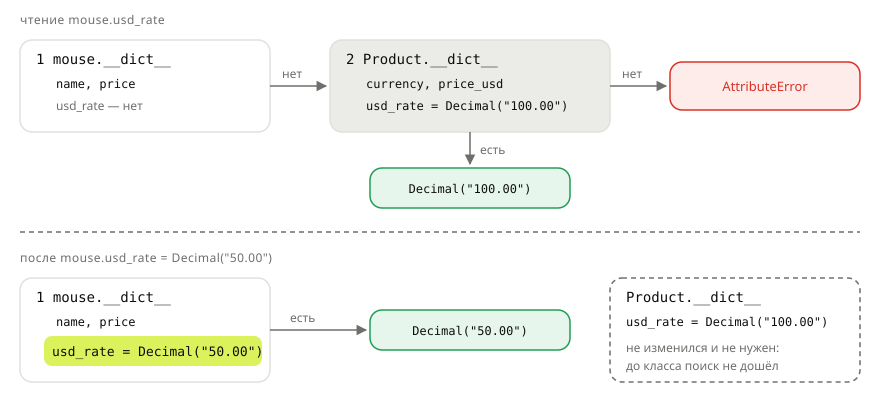

## Теория
Не все данные товара личные. Цена и остаток у каждого товара свои, а валюта магазина и курс доллара одни на весь каталог. Хранить курс в каждом объекте — значит при смене курса обходить все товары. Поэтому общие данные записывают прямо в теле класса: это **атрибуты класса**. Атрибуты, которые задаёт `self.x = ...`, принадлежат конкретному объекту — это **атрибуты экземпляра**.

Python ищет атрибут по порядку. Запись `mouse.usd_rate` значит: сначала посмотреть в самом объекте, не нашлось — в его классе, и только потом выбросить `AttributeError`. Чтение через объект видит атрибут класса. Но **присваивание** через объект (`mouse.usd_rate = ...`) всегда пишет в сам объект: класс не меняется, а у объекта появляется свой атрибут, который заслоняет общий. С изменяемыми атрибутами класса другая ловушка: `mouse.tags.append(...)` ничего не присваивает, а меняет **общий** список — и изменение видят все объекты.

## Наглядно
**Рисунок 1.** Где Python ищет `mouse.usd_rate`: сначала в атрибутах объекта, потом в классе. Присваивание через объект кладёт значение в объект, и дальше поиск до класса не доходит.



**Таблица 1.** Атрибуты класса и экземпляра.

| | Атрибут класса | Атрибут экземпляра |
|---|---|---|
| Где задают | в теле класса: `usd_rate = Decimal("90.00")` | в методе: `self.price = price` |
| Где хранится | `Product.__dict__` — один на всех | `mouse.__dict__` — свой у каждого |
| Для чего | общее: курс, валюта, настройки, счётчики | данные конкретного объекта |
| Изменить для всех | `Product.usd_rate = ...` | — |
| `mouse.x = ...` | **не меняет** класс: создаёт атрибут объекта | меняет атрибут этого объекта |
| `mouse.items.append(...)`, если `items` — атрибут класса | меняет **общий** список | меняет только список объекта |

## На практике
Задача: хранить курс доллара в классе `Product` так, чтобы его смена сразу меняла цены в долларах во всём каталоге, — и не попасть в ловушки общего атрибута.

### Шаг 1. Объявляем атрибуты класса
Атрибуты класса пишут в теле класса, без `self`. Читать их можно и через класс, и через объект:
```python
from decimal import Decimal


class Product:
    currency = "RUB"
    usd_rate = Decimal("90.00")

    def __init__(self, name, price):
        self.name = name
        self.price = price

    def price_usd(self):
        return (self.price / self.usd_rate).quantize(Decimal("0.01"))


mouse = Product("Мышь", Decimal("1499.00"))
pad = Product("Коврик", Decimal("490.00"))
print(mouse.currency, pad.currency, mouse.price_usd(), pad.price_usd())
```
Результат:
```
RUB RUB 16.66 5.44
```
`self.usd_rate` внутри метода тоже находит атрибут класса: в самом объекте его нет.

### Шаг 2. Смотрим, где что хранится
`__dict__` — словарь атрибутов. У объекта в нём только то, что задал `__init__`:
```python
print(mouse.__dict__)
print("usd_rate" in mouse.__dict__, "usd_rate" in Product.__dict__)
```
Результат:
```
{'name': 'Мышь', 'price': Decimal('1499.00')}
False True
```

### Шаг 3. Меняем общее значение через класс
Новый курс записываем в класс — все объекты видят его сразу:
```python
Product.usd_rate = Decimal("100.00")
print(mouse.price_usd(), pad.price_usd())
```
Результат:
```
14.99 4.90
```

### Шаг 4. Видим, как объект заслоняет атрибут класса
Присваивание через объект не трогает класс. Оно создаёт у объекта свой атрибут с тем же именем:
```python
mouse.usd_rate = Decimal("50.00")
print(mouse.price_usd(), pad.price_usd(), Product.usd_rate)
print(mouse.__dict__)
```
Результат:
```
29.98 4.90 100.00
{'name': 'Мышь', 'price': Decimal('1499.00'), 'usd_rate': Decimal('50.00')}
```
Теперь у `mouse` свой курс, и следующие изменения `Product.usd_rate` её не затронут. `del mouse.usd_rate` удаляет атрибут объекта — и поиск снова доходит до класса:
```python
del mouse.usd_rate
print(mouse.price_usd())
```
Результат:
```
14.99
```

### Шаг 5. Не храним изменяемые данные в атрибуте класса
Список в теле класса создаётся **один раз** — при выполнении `class`. `append` через любой объект меняет этот общий список:
```python
class Product:
    tags = []

    def __init__(self, name):
        self.name = name


mouse = Product("Мышь")
pad = Product("Коврик")
mouse.tags.append("новинка")
print(pad.tags)
```
Результат:
```
['новинка']
```
Свой список у каждого объекта создаётся в `__init__`:
```python
class Product:
    def __init__(self, name):
        self.name = name
        self.tags = []


mouse = Product("Мышь")
pad = Product("Коврик")
mouse.tags.append("новинка")
print(mouse.tags, pad.tags)
```
Результат:
```
['новинка'] []
```

## Частые ошибки
- **Список или словарь в теле класса.** `items = []` — один список на все объекты: товары одной корзины появляются в другой. Изменяемые данные создают в `__init__`: `self.items = []`.
- **Смена общего значения через объект.** `self.usd_rate = rate` меняет курс только у этого объекта. Для всех — через класс: `Product.usd_rate = rate`.
- **Счётчик через `self`.** `self.count += 1` читает значение из класса, а записывает в объект. Счётчик класса так и остаётся прежним. Нужно `Product.count += 1`.
- **Атрибут класса вместо атрибута экземпляра.** Данные конкретного товара (цена, остаток) — только через `self.` в `__init__`. Иначе они окажутся общими для всех товаров.

## Итог
**Два вида атрибутов**
- Атрибут класса — в теле класса, один на всех: `usd_rate = Decimal("90.00")`.
- Атрибут экземпляра — через `self.` в методах, свой у каждого объекта.
- `obj.__dict__` и `Class.__dict__` показывают, что где лежит.

**Чтение и запись**
- Чтение `obj.x`: сначала объект, потом класс, иначе `AttributeError`.
- Запись `obj.x = ...` всегда пишет в объект и заслоняет атрибут класса.
- Изменить общее значение — только через класс: `Product.usd_rate = ...`.

**Изменяемые значения**
- `obj.items.append(...)` — не присваивание, а изменение объекта, найденного поиском. Если это список класса, изменение видят все.
- Свой список или словарь у каждого объекта — в `__init__`.

## Вопросы на собеседовании
<details><summary>В каком порядке Python ищет атрибут `obj.x`?</summary>

Сначала в атрибутах самого объекта (`obj.__dict__`), затем в классе, затем в родительских классах. Если нигде нет — `AttributeError`. Упрощённо: для `property` и других дескрипторов порядок сложнее.
</details>

<details><summary>Что выведет код: `class A: x = 1`, `a, b = A(), A()`, `a.x = 2`, `print(a.x, b.x, A.x)`?</summary>

`2 1 1`. Присваивание `a.x = 2` создало атрибут у объекта `a`, класс не изменился. `b.x` по-прежнему находит атрибут класса.
</details>

<details><summary>Почему `items = []` в теле класса — ошибка?</summary>

Список создаётся один раз, при определении класса, и он общий для всех объектов. `self.items.append(...)` не создаёт атрибут объекта, а меняет этот общий список. Поэтому данные «перетекают» между объектами. Список нужно создавать в `__init__`.
</details>

<details><summary>Как из метода обратиться к атрибуту класса, если у объекта есть атрибут с тем же именем?</summary>

Через класс: `Product.usd_rate` или `type(self).usd_rate`. `self.usd_rate` вернёт атрибут объекта.
</details>

## Глубже
Как поиск атрибута устроен целиком: где в нём `property`, что делают `__getattr__` и `__getattribute__` — в курсе «Python под капотом», тема «Поиск атрибута».
