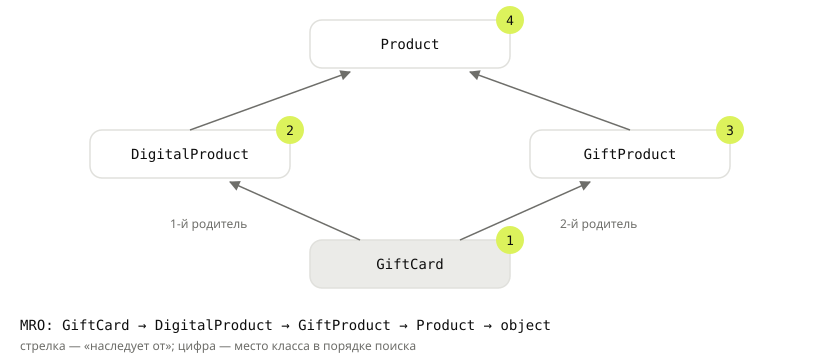

## Теория
В магазине появились цифровые товары: электронные книги и подписки. Это тоже товары — с названием, ценой и резервом. Но доставки у них нет, а есть ссылка на скачивание. Копировать класс `Product` целиком и менять два метода — значит потом чинить каждую ошибку в двух местах. **Наследование** позволяет описать новый класс через существующий: `class DigitalProduct(Product)`. Наследник (дочерний класс) получает все атрибуты и методы родителя (базового класса). Дальше он **переопределяет** то, что делает иначе, и **добавляет** своё.

Переопределённый метод полностью заменяет родительский. Если нужно не заменить, а дополнить поведение родителя, вызывают его через `super()`. Чаще всего так делают в `__init__`: `super().__init__(...)` заполняет общие атрибуты, а наследник добавляет свои. У класса может быть несколько родителей. Тогда методы ищутся в строгом порядке — **MRO** (method resolution order), его видно в `Класс.__mro__`. `super()` вызывает не «родителя», а **следующий класс в этом порядке**. Наследование выражает отношение «является»: цифровой товар **является** товаром. Если это «является» звучит странно, наследование, скорее всего, не к месту — об этом тема «Композиция vs наследование».

## Наглядно
**Таблица 1.** Что наследник может сделать с методом родителя.

| Действие | Как | Пример |
|---|---|---|
| Унаследовать | ничего не писать | `ebook.reserve(1)` — метод `Product` |
| Переопределить | объявить метод с тем же именем | `delivery_price()` у цифрового товара — `0` |
| Расширить | переопределить и вызвать `super().метод(...)` | `__init__` добавляет `download_url` |
| Добавить | новый метод | `download_link()` |

**Рисунок 1.** Ромбовидное наследование: подарочный сертификат — и цифровой товар, и подарок. MRO выстраивает классы в одну цепочку, где общий предок `Product` стоит после обоих родителей и встречается один раз.



## На практике
Задача: добавить цифровые товары, не копируя класс `Product`, и разобраться, в каком порядке Python ищет методы при нескольких родителях.

### Шаг 1. Наследуем класс
Базовый класс — обычный товар с доставкой. Пустой наследник уже умеет всё то же самое:
```python
from decimal import Decimal


class Product:
    def __init__(self, name, price, stock):
        self.name = name
        self.price = price
        self.stock = stock

    def delivery_price(self):
        return Decimal("299.00")

    def reserve(self, quantity):
        if quantity > self.stock:
            raise ValueError(f"{self.name}: на складе {self.stock}")
        self.stock -= quantity

    def __str__(self):
        return f"{self.name} — {self.price} ₽"


class DigitalProduct(Product):
    pass


ebook = DigitalProduct("Книга «Чистый код»", Decimal("690.00"), 100)
ebook.reserve(1)
print(ebook, ebook.stock, ebook.delivery_price())
print(isinstance(ebook, DigitalProduct), isinstance(ebook, Product))
```
Результат:
```
Книга «Чистый код» — 690.00 ₽ 99 299.00
True True
```
Объект наследника — это и объект родителя: `isinstance` с `Product` даёт `True`.

### Шаг 2. Переопределяем и расширяем
У цифрового товара доставка бесплатная, и есть ссылка на скачивание. `__init__` расширяем: общие поля заполняет родитель через `super().__init__(...)`, а наследник добавляет своё:
```python
class DigitalProduct(Product):
    def __init__(self, name, price, stock, download_url):
        super().__init__(name, price, stock)
        self.download_url = download_url

    def delivery_price(self):
        return Decimal("0.00")

    def __str__(self):
        return super().__str__() + " (цифровой)"


ebook = DigitalProduct("Книга «Чистый код»", Decimal("690.00"), 100, "/download/42")
mouse = Product("Мышь", Decimal("1499.00"), 12)
for product in (mouse, ebook):
    print(product, "| доставка:", product.delivery_price())
print(ebook.download_url)
```
Результат:
```
Мышь — 1499.00 ₽ | доставка: 299.00
Книга «Чистый код» — 690.00 ₽ (цифровой) | доставка: 0.00
/download/42
```
Цикл не проверяет тип товара: каждый объект сам отвечает, как считать доставку.

### Шаг 3. Видим, что без `super().__init__` родительских полей нет
Если наследник переопределил `__init__` и не вызвал родительский, атрибуты родителя не создаются:
```python
class GiftCard(Product):
    def __init__(self, name, price, stock, nominal):
        self.nominal = nominal


card = GiftCard("Сертификат", Decimal("3000.00"), 50, 3000)
print(card.nominal)
print(card)
```
Результат:
```
3000
AttributeError: 'GiftCard' object has no attribute 'name'
```
Объект создался без ошибки — падение случилось позже, при первом обращении к `name`.

### Шаг 4. Отличаем `isinstance` от проверки `type`
`type(x) == Product` верно только для объектов самого `Product`, наследники не проходят. `isinstance` учитывает наследование:
```python
print(type(ebook) == Product, isinstance(ebook, Product))
print(issubclass(DigitalProduct, Product))
```
Результат:
```
False True
True
```

### Шаг 5. Смотрим порядок поиска при нескольких родителях
Подарочный сертификат — и цифровой товар, и подарок. Каждый класс дописывает свою метку к меткам «следующего» через `super()`:
```python
class Product:
    def labels(self):
        return ["товар"]


class DigitalProduct(Product):
    def labels(self):
        return super().labels() + ["цифровой"]


class GiftProduct(Product):
    def labels(self):
        return super().labels() + ["подарок"]


class GiftCard(DigitalProduct, GiftProduct):
    pass


print([cls.__name__ for cls in GiftCard.__mro__])
print(GiftCard().labels())
```
Результат:
```
['GiftCard', 'DigitalProduct', 'GiftProduct', 'Product', 'object']
['товар', 'подарок', 'цифровой']
```
Порядок поиска — `GiftCard → DigitalProduct → GiftProduct → Product` (рисунок 1). `super()` внутри `DigitalProduct` привёл не в `Product`, а в `GiftProduct` — следующий класс в MRO **объекта**. Поэтому сработали все три метода, и `Product.labels` выполнился один раз. Родители перечисляются слева направо, общий предок идёт после всех своих наследников.

## Частые ошибки
- **Забыли `super().__init__(...)`.** Объект создаётся, но без атрибутов родителя — `AttributeError` при первом обращении к ним.
- **Вызов родителя по имени: `Product.__init__(self, ...)`.** При ромбовидном наследовании общий предок вызовется дважды, а часть классов — ни разу. `super()` идёт по MRO и вызывает каждый класс один раз.
- **`type(x) == Product`.** Не пропускает наследников. Для проверки «это товар?» — `isinstance(x, Product)`.
- **Порядок родителей.** В `class GiftCard(A, B)` методы `A` найдутся раньше методов `B`. Примесь (mixin), которая должна перехватить метод базового класса, ставят **левее** него.
- **Другая сигнатура в наследнике.** `def delivery_price(self, city)` у наследника, когда код вызывает `product.delivery_price()` у любого товара, — `TypeError` только для объектов наследника. Переопределённый метод принимает те же аргументы, что и родительский.
- **Наследование ради пары методов.** `class Order(list)` или `class Cart(Product)` только чтобы «взять готовое» — признак, что нужна композиция.

## Итог
**Основы**
- `class DigitalProduct(Product)` — наследник получает все атрибуты и методы родителя.
- Метод с тем же именем переопределяет родительский; новый метод добавляет поведение.
- Наследование — для отношения «является»: цифровой товар является товаром.

**super()**
- `super().__init__(...)` в `__init__` наследника — иначе нет атрибутов родителя.
- `super().метод()` — расширить, а не заменить поведение родителя.
- `super()` ведёт к следующему классу в MRO объекта, а не обязательно к прямому родителю.

**Проверки и порядок**
- `isinstance(x, Product)` учитывает наследников; `type(x) == Product` — нет.
- MRO: `Класс.__mro__` — порядок поиска методов; родители слева направо, общий предок — после всех наследников, один раз.

## Вопросы на собеседовании
<details><summary>Что такое MRO и как его посмотреть?</summary>

Method resolution order — порядок, в котором Python ищет атрибуты и методы в иерархии классов. Строится алгоритмом C3: сам класс, затем родители слева направо, общий предок — после всех своих наследников, каждый класс один раз. Посмотреть: `Класс.__mro__` или `Класс.mro()`.
</details>

<details><summary>Что делает `super()`?</summary>

Возвращает объект-посредник, который ищет метод начиная со **следующего** класса в MRO текущего объекта. При простом наследовании это родитель, при множественном — может быть «соседний» класс. Благодаря этому при ромбовидном наследовании каждый `__init__` вызывается ровно один раз.
</details>

<details><summary>Что такое проблема ромба и как Python её решает?</summary>

Два родителя `B` и `C` наследуют от общего предка `A`, а `D` — от обоих. Вопросы: чей метод вызывать и не вызвать ли `A` дважды. Python выстраивает линейный MRO `D → B → C → A → object`. Если все классы вызывают `super()`, каждый метод отрабатывает один раз в этом порядке.
</details>

<details><summary>Чем `isinstance` лучше `type(x) == Cls`?</summary>

`isinstance` учитывает наследование: объект наследника считается и объектом родителя. Сравнение `type` проверяет точный класс и ломает код, когда появляются наследники. Кроме того, `isinstance` принимает кортеж типов: `isinstance(x, (int, Decimal))`.
</details>

## Глубже
Как устроен алгоритм C3 и как писать примеси, которые корректно работают с `super()`, — в курсе «Python под капотом», тема «MRO и `super()`».
