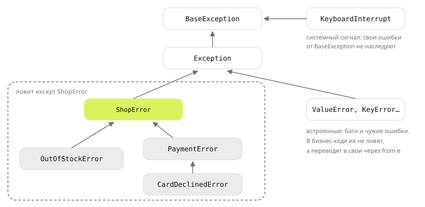

## Теория
Пока ошибки магазина были встроенными: `ValueError("на складе 3")`, `ValueError("карта отклонена")`. Обработчику запроса от этого плохо. «Товар закончился» — это ответ `409` с предложением уменьшить количество. «Карта отклонена» — `402` и просьба сменить карту. А `ValueError` из-за бага в коде — это `500`, и о нём нужно знать разработчикам. По типу эти ошибки не различить, а разбирать текст сообщения ненадёжно: текст поменяют — обработчик сломается. Решение — **свои классы исключений**. Исключение — обычный класс, наследник `Exception`, поэтому ошибку можно назвать по смыслу (`OutOfStockError`) и положить в неё данные (`product_id`, `left`).

Свои ошибки выстраивают в **иерархию**. Базовый класс приложения (`ShopError`) наследует от `Exception`, а конкретные ошибки — от него. Тогда обработчик ловит конкретную ошибку там, где знает, что с ней делать (`except OutOfStockError`). Всё остальное от магазина он ловит одним `except ShopError`. Чужие и неожиданные ошибки в эту ветку не попадают — это баги, и они должны дойти до лога. Ошибку библиотеки (сеть, база) на границе своего кода переводят в свою: `raise PaymentError(...) from e`, сохраняя исходную причину.

## Наглядно
**Рисунок 1.** Иерархия ошибок магазина. `except ShopError` ловит всю ветку магазина, но не встроенные ошибки рядом с ней.



**Таблица 1.** Как обработчик запроса реагирует на ошибки.

| Ошибка | Где ловят | Ответ API |
|---|---|---|
| `OutOfStockError` | `except OutOfStockError` | `409`: «осталось 3 шт.» |
| `CardDeclinedError` | `except PaymentError` | `402`: «смените карту» |
| любая другая `ShopError` | `except ShopError` | `400` с текстом ошибки |
| `KeyError`, `TypeError`… | не ловят в бизнес-коде | `500`, запись в лог — это баг |

## На практике
Задача: описать ошибки оформления заказа своими классами и обработать их в одном месте — в обработчике запроса.

### Шаг 1. Объявляем иерархию
Классу исключения часто не нужно тело — достаточно имени и родителя. Строку документации пишут вместо `pass`:
```python
class ShopError(Exception):
    """Базовая ошибка магазина."""


class PaymentError(ShopError):
    """Не удалось провести оплату."""


class CardDeclinedError(PaymentError):
    """Банк отклонил карту."""


print([cls.__name__ for cls in CardDeclinedError.__mro__])
print(issubclass(CardDeclinedError, ShopError), issubclass(KeyError, ShopError))
```
Результат:
```
['CardDeclinedError', 'PaymentError', 'ShopError', 'Exception', 'BaseException', 'object']
True False
```

### Шаг 2. Кладём данные в исключение
Обработчику нужны не только текст, но и сами данные: какой товар и сколько осталось. Сохраняем их в атрибутах, а готовое сообщение передаём родителю через `super().__init__`:
```python
class OutOfStockError(ShopError):
    def __init__(self, product_id, requested, left):
        super().__init__(f"товар {product_id}: запрошено {requested}, осталось {left}")
        self.product_id = product_id
        self.requested = requested
        self.left = left


try:
    raise OutOfStockError(1, requested=5, left=3)
except OutOfStockError as e:
    print(e)
    print(e.left, e.args)
```
Результат:
```
товар 1: запрошено 5, осталось 3
3 ('товар 1: запрошено 5, осталось 3',)
```
`str(e)` — сообщение, которое передали в `super().__init__`. Его увидят лог и traceback.

### Шаг 3. Ловим по иерархии
Бизнес-код только выбрасывает ошибки. Решает, что ответить клиенту, обработчик запроса: конкретные ошибки — первыми, общая ошибка магазина — последней:
```python
STOCK = {1: 3, 2: 10}


def place_order(product_id, quantity, card):
    left = STOCK[product_id]
    if quantity > left:
        raise OutOfStockError(product_id, quantity, left)
    if card == "0000":
        raise CardDeclinedError("банк отклонил карту")
    return "ok"


def handle_checkout(product_id, quantity, card):
    try:
        place_order(product_id, quantity, card)
    except OutOfStockError as e:
        return 409, f"Можно заказать не больше {e.left} шт."
    except PaymentError as e:
        return 402, f"Оплата не прошла: {e}"
    except ShopError as e:
        return 400, str(e)
    return 201, "Заказ оформлен"


print(handle_checkout(1, 5, "4242"))
print(handle_checkout(2, 1, "0000"))
print(handle_checkout(2, 1, "4242"))
handle_checkout(99, 1, "4242")
```
Результат:
```
(409, 'Можно заказать не больше 3 шт.')
(402, 'Оплата не прошла: банк отклонил карту')
(201, 'Заказ оформлен')
KeyError: 99
```
`KeyError` для несуществующего товара не пойман: это не ошибка магазина, а непредусмотренный случай. Он дойдёт до общего обработчика фреймворка и попадёт в лог как `500`. Если такой случай ожидаемый, его переводят в свою ошибку — следующий шаг.

### Шаг 4. Переводим чужую ошибку в свою
Код обращения к платёжному сервису получает ошибки сети. Наружу должна выйти ошибка магазина, но с сохранённой причиной:
```python
def charge(amount):
    raise ConnectionError("payment gateway timeout")


def pay(order_id, amount):
    try:
        charge(amount)
    except ConnectionError as e:
        raise PaymentError(f"заказ {order_id}: платёжный сервис недоступен") from e


try:
    pay(1042, 2998)
except PaymentError as e:
    print(e)
    print(type(e.__cause__).__name__, e.__cause__)
```
Результат:
```
заказ 1042: платёжный сервис недоступен
ConnectionError payment gateway timeout
```
Обработчик из шага 3 ответит на это `402`, а traceback в логе покажет обе ошибки: исходную и новую.

## Частые ошибки
- **`__init__` без `super().__init__(сообщение)`.** Атрибуты есть, но `str(e)` — это кортеж аргументов вида `(1, 5, 3)`, и лог становится нечитаемым. Сообщение передают родителю.
- **Ошибка вне иерархии приложения.** `class PaymentError(Exception)` вместо `(ShopError)` — `except ShopError` её не ловит, и клиент получает `500` вместо `402`.
- **Наследование от `BaseException`.** От него наследуют только системные сигналы (`KeyboardInterrupt`, `SystemExit`). Такая ошибка пролетает сквозь `except Exception` во всех обработчиках. Свои исключения — всегда от `Exception` или его потомков.
- **Данные только в тексте.** Обработчик, который достаёт остаток из `str(e)` через `split()`, сломается при любой правке сообщения. Данные — в атрибуты.
- **Перевод ошибки без `from e`.** Исходная причина неявно сохраняется, но traceback выглядит как новая ошибка внутри обработчика. `from e` прямо помечает причину.
- **Своя ошибка на каждую строку.** Класс заводят, когда ошибку нужно **ловить отдельно** или нести в ней данные. Для «неверный аргумент» подходит встроенная `ValueError`.

## Итог
**Свой класс исключения**
- `class ShopError(Exception)` — исключение это обычный класс, наследник `Exception`.
- Тело может быть пустым — достаточно имени и строки документации.
- Данные — в атрибутах; сообщение — через `super().__init__(текст)`.

**Иерархия**
- Базовая ошибка приложения → конкретные ошибки: `ShopError → PaymentError → CardDeclinedError`.
- `except ShopError` ловит всю ветку, но не баги (`KeyError`, `TypeError`).
- Конкретные `except` — выше общих.

**Граница кода**
- Ошибки библиотек переводят в свои: `raise PaymentError(...) from e`; причина — в `e.__cause__`.
- Решение «что ответить клиенту» — в обработчике запроса, а не в бизнес-коде.

## Вопросы на собеседовании
<details><summary>Зачем делать свои исключения, если есть встроенные?</summary>

Чтобы ловить ошибки по смыслу, а не по тексту, отделять ожидаемые ошибки бизнес-логики от багов и передавать вместе с ошибкой данные (какой товар, сколько осталось). Иерархия позволяет ловить и конкретную ошибку, и всю группу ошибок приложения одним `except`.
</details>

<details><summary>Почему свои исключения наследуют от `Exception`, а не от `BaseException`?</summary>

`BaseException` — корень для системных событий: `KeyboardInterrupt`, `SystemExit`, `GeneratorExit`. Их не должен перехватывать обычный `except Exception`. Исключение, унаследованное от `BaseException`, проскочит мимо всех `except Exception` в коде и фреймворке.
</details>

<details><summary>Что делает `raise NewError(...) from e`?</summary>

Выбрасывает новую ошибку и записывает исходную в её атрибут `__cause__`. Traceback показывает обе с пометкой, что первая — прямая причина второй. Так ошибку библиотеки переводят в ошибку своего уровня, не теряя подробностей для отладки.
</details>

<details><summary>Что попадает в `str(e)` у своего исключения?</summary>

Аргументы, переданные в `Exception.__init__` (они же `e.args`). Если в `args` один элемент — `str(e)` вернёт его. Если несколько — строку кортежа. Если свой `__init__` не вызвал `super().__init__`, в `args` окажутся аргументы конструктора, и сообщение станет кортежем.
</details>

## Глубже
Как исключения связываются в цепочку (`__context__` и `__cause__`) и почему `return` в `finally` «глотает» ошибку — в курсе «Python под капотом», тема «Исключения изнутри».
