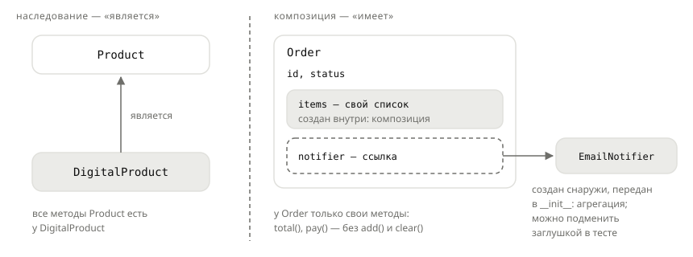

## Теория
Заказ похож на корзину: в нём те же позиции и та же сумма. Велико искушение написать `class Order(Cart)` и получить всё готовым. Но вместе с полезным заказ унаследует **весь** интерфейс корзины: `order.add(...)` и `order.clear()` после оплаты, хотя состав оплаченного заказа меняться не должен. Наследование отвечает на вопрос «**является** ли»: цифровой товар является товаром. Заказ корзиной не является — он **содержит** позиции, взятые из корзины. Отношение «**имеет**» выражают **композицией**: объект хранит другие объекты в атрибутах и поручает им работу (делегирует).

У композиции есть ещё одна сила — части можно подменять. Заказ, который сам создаёт внутри себя `EmailNotifier`, всегда шлёт письма — даже в тестах. А заказ, которому уведомитель **передали** в `__init__`, работает с любым объектом с методом `send`: email, SMS, заглушкой для тестов. Отсюда известное правило «предпочитай композицию наследованию». Наследование — только когда «является» действительно верно и наследник подходит везде, где ждут родителя. Во всех остальных случаях — композиция.

## Наглядно
**Рисунок 1.** «Является» и «имеет»: цифровой товар — разновидность товара, а заказ состоит из позиций и пользуется уведомителем, который ему передали.



**Таблица 1.** Наследование и композиция.

| | Наследование | Композиция |
|---|---|---|
| Отношение | «является»: `DigitalProduct` — это `Product` | «имеет»: у `Order` есть позиции и уведомитель |
| Как выглядит | `class Order(Cart)` | `self.items = ...`, `self.notifier = notifier` |
| Интерфейс | весь интерфейс родителя, нужный и ненужный | только методы, которые вы написали |
| Замена части | нельзя без нового класса | передать другой объект в `__init__` |
| Связь | жёсткая: правка родителя ломает наследников | слабая: часть меняют, не трогая владельца |

**Таблица 2.** Композиция и агрегация — два вида «имеет».

| | Композиция | Агрегация |
|---|---|---|
| Кто создаёт часть | владелец, внутри себя | кто-то снаружи, передаёт владельцу |
| Живёт ли часть без владельца | нет: позиции заказа без заказа не нужны | да: уведомитель общий для многих заказов |
| Пример | `self.items = [OrderItem(...) ...]` | `self.notifier = notifier` |

## На практике
Задача: описать заказ, который берёт позиции из корзины, но не позволяет их менять, и отправляет уведомление об оплате способом, выбранным снаружи.

### Шаг 1. Видим, что лишнего даёт наследование
Заказ, унаследованный от корзины, после оплаты остаётся корзиной:
```python
from decimal import Decimal


class Cart:
    def __init__(self):
        self.items = []

    def add(self, name, price, quantity=1):
        self.items.append((name, price, quantity))

    def total(self):
        return sum(price * quantity for _, price, quantity in self.items)


class BadOrder(Cart):
    def __init__(self, id):
        super().__init__()
        self.id = id
        self.status = "paid"


order = BadOrder(1042)
order.add("Мышь", Decimal("1499.00"))
order.add("Клавиатура", Decimal("2990.00"))
print(order.status, order.total())
```
Результат:
```
paid 4489.00
```
Оплаченный заказ принял новый товар — у него есть `add`, потому что он «корзина».

### Шаг 2. Собираем заказ из частей
Заказ **имеет** позиции: копирует их из корзины при создании. Методов изменения у него нет — только то, что нужно заказу:
```python
class Order:
    def __init__(self, id, cart, notifier):
        self.id = id
        self.items = list(cart.items)
        self.notifier = notifier
        self.status = "new"

    def total(self):
        return sum(price * quantity for _, price, quantity in self.items)

    def pay(self):
        self.status = "paid"
        self.notifier.send(f"Заказ №{self.id} оплачен: {self.total()} ₽")
```
Позиции — композиция: заказ создаёт свой список и владеет им. Уведомитель — агрегация: его создают снаружи и передают в `__init__`.

### Шаг 3. Передаём уведомитель снаружи
Любой объект с методом `send(text)` подходит. Для отладки — уведомитель, который печатает текст:
```python
class PrintNotifier:
    def send(self, text):
        print("уведомление:", text)


cart = Cart()
cart.add("Мышь", Decimal("1499.00"), 2)
order = Order(1042, cart, PrintNotifier())
order.pay()
cart.add("Коврик", Decimal("490.00"))
print(order.status, order.total(), hasattr(order, "add"))
```
Результат:
```
уведомление: Заказ №1042 оплачен: 2998.00 ₽
paid 2998.00 False
```
Корзину продолжили наполнять — оплаченный заказ не изменился. Добавить в него товар нельзя.

### Шаг 4. Подменяем часть для тестов
В тесте письма отправлять не нужно — нужно проверить, **что** заказ хотел отправить. Подставляем заглушку, которая запоминает сообщения:
```python
class FakeNotifier:
    def __init__(self):
        self.sent = []

    def send(self, text):
        self.sent.append(text)


fake = FakeNotifier()
Order(1043, cart, fake).pay()
print(fake.sent)
```
Результат:
```
['Заказ №1043 оплачен: 3488.00 ₽']
```
Код `Order` для этого не меняли. Если бы заказ сам создавал `EmailNotifier()` внутри `__init__`, подменить его без правки класса было бы нельзя.

### Шаг 5. Видим, чем опасно ложное «является»
Наследник подходит везде, где ждут родителя. Ночная задача чистит брошенные корзины — и `BadOrder` для неё тоже корзина:
```python
def clear_abandoned(objects):
    for obj in objects:
        if isinstance(obj, Cart):
            obj.items.clear()


bad = BadOrder(1044)
bad.add("Мышь", Decimal("1499.00"))
clear_abandoned([Cart(), bad, order])
print(bad.status, bad.total(), "|", order.status, order.total())
```
Результат:
```
paid 0 | paid 2998.00
```
Оплаченный `BadOrder` опустел, а `Order` из композиции не пострадал: корзиной он не является. Перед наследованием задайте два вопроса: «X **является** Y?» и «Можно ли отдать X **любому** коду, который работает с Y?». Если на второй вопрос ответ «нет» — нужна композиция.

## Частые ошибки
- **Наследование ради готовых методов.** `class Order(Cart)` даёт заказу `add` и `clear`, которых у него быть не должно. Берите нужное композицией и пишите только свои методы.
- **Зависимость создаётся внутри.** `self.notifier = EmailNotifier()` в `__init__` намертво привязывает класс к почте: в тестах уходят настоящие письма, а сменить канал без правки класса нельзя. Передавайте зависимость параметром.
- **Наследование от `list` или `dict` ради проверки.** Переопределили `append`, но `extend`, `insert`, `+=` и срезы обходят проверку. Храните список внутри и откройте только свои методы.
- **Ссылка вместо копии.** `self.items = cart.items` — заказ и корзина делят один список, и изменения корзины попадают в заказ. Части, которыми объект владеет, копируют.
- **Глубокие иерархии.** `Product → PhysicalProduct → HeavyProduct → HeavyFragileProduct` ломается, когда появляется «лёгкий хрупкий» товар. Разные свойства — разные части, а не уровни иерархии.

## Итог
**Выбор**
- Наследование — «является» и подходит везде, где ждут родителя.
- Композиция — «имеет»: объект хранит другие объекты и поручает им работу.
- По умолчанию — композиция; наследование — когда «является» точно верно.

**Композиция на практике**
- Части — в атрибутах: `self.items`, `self.notifier`.
- Зависимости передают в `__init__` — их можно подменить: другой канал, заглушка в тесте.
- Наружу открывают только свои методы, а не весь интерфейс частей.

**Виды «имеет»**
- Композиция: владелец создаёт часть, без владельца часть не живёт (позиции заказа).
- Агрегация: часть создают снаружи, она может быть общей (уведомитель).

## Вопросы на собеседовании
<details><summary>Почему говорят «предпочитай композицию наследованию»?</summary>

Наследование жёстко связывает классы: наследник получает весь интерфейс родителя и ломается от его изменений, а поведение нельзя поменять без нового класса. Композиция собирает объект из частей, которые можно заменить или переиспользовать по отдельности. Наследование оставляют для настоящего «является».
</details>

<details><summary>Чем композиция отличается от агрегации?</summary>

Обе — отношение «имеет». При композиции владелец создаёт часть и отвечает за её жизнь: позиции заказа без заказа не существуют. При агрегации часть создаётся снаружи и может принадлежать нескольким владельцам: один уведомитель на все заказы. В Python синтаксис одинаковый, разница — в том, кто создаёт объект и кто ещё на него ссылается.
</details>

<details><summary>Как композиция помогает тестировать?</summary>

Если зависимость (уведомитель, платёжный шлюз, репозиторий) передаётся в конструктор, в тесте вместо неё передают заглушку, которая ничего не отправляет и запоминает вызовы. Класс проверяется без сети и базы, а его код не меняется. Это называют внедрением зависимостей.
</details>

<details><summary>Почему не стоит наследовать свой класс от `list`, чтобы добавить проверку?</summary>

У `list` десятки методов, которые меняют содержимое: `append`, `extend`, `insert`, `+=`, присваивание срезу. Переопределив один, вы оставляете обходные пути. Встроенные методы `list` к тому же не вызывают ваш `append` изнутри. Надёжнее хранить список в атрибуте и открыть наружу только свои методы с проверкой.
</details>
