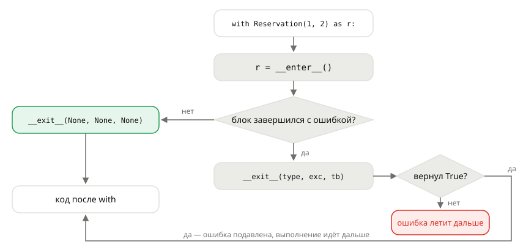

## Теория
`with open(...) as f` гарантирует, что файл закроется, даже если внутри блока случилась ошибка. В магазине таких парных действий много. Зарезервировали товар — при неудачной оплате резерв нужно снять. Начали менять корзину — при ошибке надо вернуть её как было. Засекли время запроса — записать его в лог при любом исходе. Можно писать `try/finally` в каждом месте, но рано или поздно его где-нибудь забудут. **Контекстный менеджер** упаковывает пару «начало — завершение» в объект, и `with` вызывает завершение всегда.

Протокол — два магических метода. `__enter__(self)` выполняется при входе в `with`, и то, что он вернул, попадает в переменную после `as`. `__exit__(self, exc_type, exc, tb)` выполняется при выходе — и при обычном завершении, и при исключении. В первом случае все три аргумента — `None`, во втором — тип, объект и traceback исключения. Важная деталь: если `__exit__` вернёт истинное значение, исключение **будет подавлено**. Поэтому обычно возвращают `None` (ничего), и ошибка летит дальше. Для простых случаев есть `contextlib.contextmanager`: генератор, где код до `yield` — это вход, а после — выход.

## Наглядно
**Рисунок 1.** Что делает `with`: вызывает `__enter__`, выполняет блок и в любом случае вызывает `__exit__`. При ошибке результат `__exit__` решает, полетит ли исключение дальше.



**Таблица 1.** Два способа написать контекстный менеджер.

| | Класс | `@contextmanager` |
|---|---|---|
| Вход | `__enter__`, возвращает значение для `as` | код до `yield`; `yield значение` — для `as` |
| Выход | `__exit__(exc_type, exc, tb)` | код после `yield` — обязательно в `try/finally` или `except` |
| Узнать об ошибке | `exc_type is not None` | `except` вокруг `yield` |
| Подавить ошибку | `return True` | не перевыбросить в `except` |
| Когда удобен | есть состояние и методы (транзакция с `add`) | короткая пара действий |

## На практике
Задача: зарезервировать товар на время оплаты так, чтобы при любой ошибке резерв снимался, и сделать «транзакцию» корзины, которая откатывает изменения при ошибке.

### Шаг 1. Пишем менеджер-класс для резерва
`__enter__` резервирует товар и возвращает сам менеджер. `__exit__` снимает резерв, если блок завершился ошибкой:
```python
from decimal import Decimal

STOCK = {1: 5}


class Reservation:
    def __init__(self, product_id, quantity):
        self.product_id = product_id
        self.quantity = quantity

    def __enter__(self):
        if STOCK[self.product_id] < self.quantity:
            raise ValueError(f"товара {self.product_id} недостаточно")
        STOCK[self.product_id] -= self.quantity
        print("резерв:", self.quantity, "| на складе:", STOCK[self.product_id])
        return self

    def __exit__(self, exc_type, exc, tb):
        if exc_type is not None:
            STOCK[self.product_id] += self.quantity
            print("откат резерва из-за", exc_type.__name__, "| на складе:", STOCK[self.product_id])


with Reservation(1, 2) as r:
    print("оплата", r.quantity, "шт. прошла")
print("после успешной оплаты:", STOCK[1])
```
Результат:
```
резерв: 2 | на складе: 3
оплата 2 шт. прошла
после успешной оплаты: 3
```

### Шаг 2. Проверяем откат при ошибке
Оплата падает внутри блока. `__exit__` снимает резерв, а исключение летит дальше, потому что `__exit__` ничего не вернул:
```python
def charge(amount):
    raise ConnectionError("платёжный сервис недоступен")


try:
    with Reservation(1, 3):
        charge(Decimal("4497.00"))
except ConnectionError as e:
    print("ошибка дошла до обработчика:", e)
print("на складе:", STOCK[1])
```
Результат:
```
резерв: 3 | на складе: 0
откат резерва из-за ConnectionError | на складе: 3
ошибка дошла до обработчика: платёжный сервис недоступен
на складе: 3
```

### Шаг 3. Делаем транзакцию корзины
Менеджер запоминает состав корзины при входе и при ошибке возвращает его. Внутри блока можно менять корзину сколько угодно — либо все изменения сохранятся, либо ни одно:
```python
class CartTransaction:
    def __init__(self, cart):
        self.cart = cart

    def __enter__(self):
        self.snapshot = dict(self.cart)
        return self.cart

    def __exit__(self, exc_type, exc, tb):
        if exc_type is not None:
            self.cart.clear()
            self.cart.update(self.snapshot)


cart = {1: 2}
with CartTransaction(cart) as c:
    c[5] = 1
print(cart)

try:
    with CartTransaction(cart) as c:
        c[7] = 3
        c[1] = int("два")
except ValueError:
    pass
print(cart)
```
Результат:
```
{1: 2, 5: 1}
{1: 2, 5: 1}
```
Во втором блоке товар 7 уже добавился, но ошибка на следующей строке откатила корзину целиком.

### Шаг 4. Пишем то же через `@contextmanager`
Для короткой пары действий хватает генератора. Код до `yield` — вход, `except` вокруг `yield` — реакция на ошибку блока. `raise` без аргументов отправляет ошибку дальше:
```python
from contextlib import contextmanager


@contextmanager
def reservation(product_id, quantity):
    STOCK[product_id] -= quantity
    try:
        yield quantity
    except Exception:
        STOCK[product_id] += quantity
        raise


try:
    with reservation(1, 2) as qty:
        print("в блоке, резерв:", qty, "| на складе:", STOCK[1])
        charge(Decimal("2998.00"))
except ConnectionError:
    print("на складе после ошибки:", STOCK[1])
```
Результат:
```
в блоке, резерв: 2 | на складе: 1
на складе после ошибки: 3
```
Ошибка из блока `with` возникает **внутри генератора, в строке `yield`**. Без `try` вокруг `yield` код отката не выполнится вовсе.

### Шаг 5. Подавляем ошибку осознанно
Иногда ошибку действительно нужно проглотить — например, удалить товар из кэша, которого там может и не быть. Для этого есть готовый `contextlib.suppress`: в нём видно, какую именно ошибку глушат:
```python
from contextlib import suppress

cache = {1: "Мышь"}
with suppress(KeyError):
    del cache[42]
print("кэш:", cache)
```
Результат:
```
кэш: {1: 'Мышь'}
```
В своих менеджерах `return True` из `__exit__` почти никогда не нужен: он глушит **любую** ошибку блока, включая баги.

## Частые ошибки
- **`__exit__` возвращает `True`.** Любое исключение в блоке исчезает: оплата «прошла», хотя упала. Возвращайте `None` (ничего не пишите) — тогда ошибка летит дальше после очистки.
- **`__enter__` без `return self`.** В `with Reservation(...) as r` переменная `r` равна `None`, и `r.quantity` даёт `AttributeError`.
- **`@contextmanager` без `try` вокруг `yield`.** Ошибка блока прерывает генератор на `yield`, и код после него не выполняется. Освобождение ресурса — в `finally` или `except` + `raise`.
- **Откат и при успехе.** `__exit__` без проверки `exc_type` откатывает и удачные изменения. Действия «только при ошибке» — под `if exc_type is not None`.
- **Глушат ошибку в `except` генератора.** `except Exception: откат` без `raise` подавляет исключение так же, как `return True`.

## Итог
**Протокол**
- `__enter__()` — вход в `with`, возвращает значение для `as` (часто `self`).
- `__exit__(exc_type, exc, tb)` — выход всегда; при ошибке аргументы описывают исключение, без ошибки — `None`.
- Истинный результат `__exit__` подавляет исключение; обычно возвращают `None`.

**`@contextmanager`**
- Код до `yield` — вход, значение `yield` — для `as`, код после — выход.
- Ошибка блока возникает в строке `yield`: очистка — в `try/finally` или `except` с `raise`.

**Применение**
- Пары действий: резерв и снятие резерва, транзакция и откат, начало и запись замера.
- `contextlib.suppress(Ошибка)` — явно подавить одну ожидаемую ошибку.

## Вопросы на собеседовании
<details><summary>Какие методы нужны контекстному менеджеру и что они получают?</summary>

`__enter__(self)` — вызывается при входе, его результат попадает в `as`. `__exit__(self, exc_type, exc_value, traceback)` — вызывается при выходе в любом случае. Если блок завершился без ошибки, все три аргумента — `None`, иначе они описывают исключение.
</details>

<details><summary>Как контекстный менеджер может подавить исключение и почему это опасно?</summary>

Вернуть из `__exit__` истинное значение — тогда исключение не полетит дальше. Опасно тем, что подавляется любая ошибка блока, включая баги и даже `KeyboardInterrupt`. Узнать о проблеме будет не по чему. Если подавление нужно, лучше `contextlib.suppress` с конкретным типом.
</details>

<details><summary>Как работает `@contextmanager`?</summary>

Превращает функцию-генератор в контекстный менеджер. `with` запускает генератор до `yield`, значение `yield` отдаёт в `as` и выполняет блок. После блока продолжает генератор после `yield`, а при ошибке выбрасывает её в генераторе в точке `yield`. Поэтому код очистки оборачивают в `try/finally`.
</details>

<details><summary>Зачем свой контекстный менеджер, если есть `try/finally`?</summary>

Чтобы не повторять `try/finally` в каждом месте использования. Логика «начать и гарантированно завершить» пишется один раз и проверяется тестами, а вызывающий код получает короткий и безопасный `with`. Тот же принцип — у `open`, блокировок и транзакций базы данных.
</details>

## Глубже
Что ещё в генераторе вызывает `with`: `throw` и `close` — в курсе «Python под капотом», тема «Генератор изнутри». Как контекстный менеджер вписывается в модель данных Python — тема «Протоколы и модель данных».
